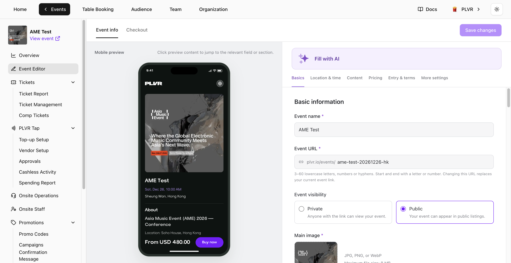

Open an event and select **Event Editor** in the event menu. Edit the form on the right and check the **Mobile preview** on the left. Select a section in the preview to jump to its settings.

<Frame>
  
</Frame>

## Event info

- **Basics** — Edit the **Event name**, **Event URL**, visibility and square **Main image**. Upload and reorder secondary images. Changing the **Event URL** replaces the current event link.
- **Location & time** — Select the **Venue** before setting session dates and times. Times use the venue's time zone. If you add more than one session, give each a unique name. Keep at least one session. Sessions with linked tickets or orders can't be removed.
- **Content** — Update **About**, genres and the line-up. Use **Add with Spotify Link** to add an artist.
- **Pricing** — Choose **Currency** and how fees appear. **All-in pricing** shows the price with buyer fees and tax included. With this setting off, buyer fees and tax are added at checkout. Use **Insert lowest price** in the optional **Price label**. Leave **Button text** blank to use **Buy now**.
- **Entry & terms** and **More settings** — Set entry requirements, update **Terms and conditions**, and enable **PLVR Tap** as needed.

<Note>
  Event currency locks when the first **Ticket**, **Bundle** or **Add-on** is successfully created. Free and inactive items also lock the currency.
</Note>

Use **Fill with AI** to fill in **Event info** from text you paste. It fills empty fields by default. Turn on **Replace existing values** to update fields you already filled in, then review the result before saving.

## Checkout

- **Contact details** and **Booking details** — **Full Name** and **Email Address** are always required. Use [Registration form](/events/registration-form) to add or edit booking questions.
- **Tax** — Turn on tax and enter a rate if applicable. Changes apply to new orders.
- **Consent** — PLVR's Terms of Use and Privacy Policy are fixed. Add your own terms under **Additional terms**. **Marketing consent** is off by default. When you enable it, buyers can choose whether to opt in.

## Saving

Select **Save changes** to save edits from both tabs. If the editor flags content for review, revise the highlighted fields and save again.

<Warning>
  Choosing **Leave without saving** discards your unsaved edits.
</Warning>
