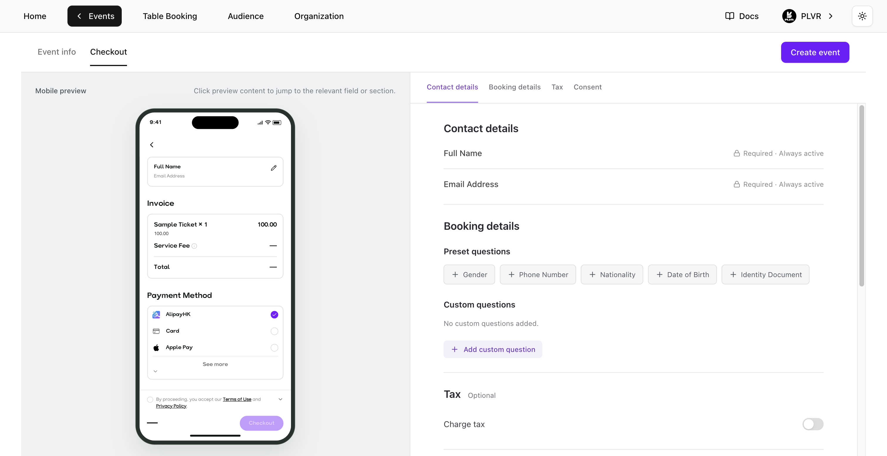
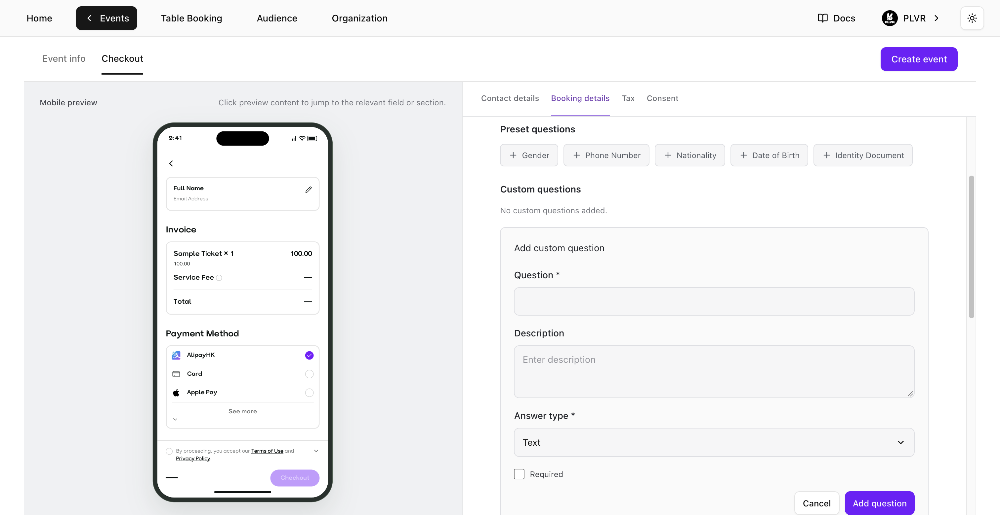

Open **Event Editor**, select **Checkout**, then go to **Booking details**. You can also set up these questions on the **Checkout** tab when you [create an event](/events/create-an-event).

<Frame>
  
</Frame>

## Add questions

- **Preset questions** — Select a question under **Preset questions**.
- **Custom questions** — Select **Add custom question**, enter the question, and choose **Text**, **Number**, **Single choice** or **Multiple choice**. For either choice type, enter at least one option. Select **Add question** to apply it to the form.

<Frame>
  
</Frame>

## Manage questions

- Select **Edit** beside a custom question, then select **Save question** when you're done.
- Select **Required** to make a question mandatory. Turn off **Show at checkout** to hide it and keep its settings.
- Drag questions to reorder them within **Preset questions** or **Custom questions**.

Select **Save changes** in **Event Editor**, or **Create event** if you're setting up a new event, to apply the questions at checkout.

<Note>
  **Full Name** and **Email Address** are always required under **Contact details**.
</Note>

## View responses

- **RSVP applications** — View answers under **Form Responses** on the [RSVP](/events/rsvp) page.
- **Events without RSVP** — View answers on the [Ticket Report](/tickets/ticket-report) page.

<Tip>
  Events using PLVR Tap have a separate [Personalization form](/tap/personalization-form).
</Tip>
