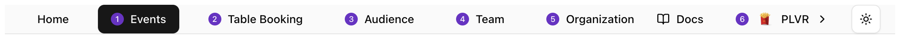
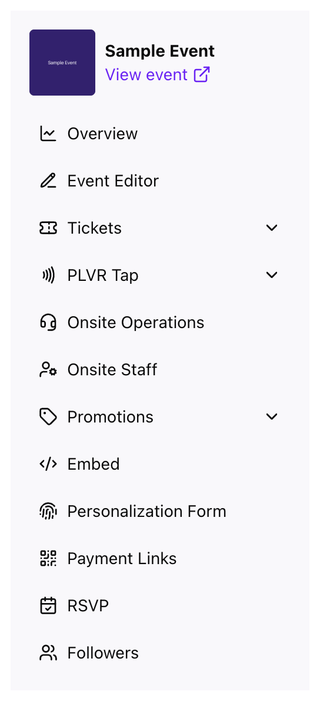

Navigation has two levels: a **header** for organization-wide pages, and a **side menu** inside an event.

## The header

<Frame>
  
</Frame>

| Link | Page | Who sees it |
| --- | --- | --- |
| **Events** | [Events overview](/events/overview) | Everyone |
| **Table Booking** | [Table booking](/other/table-booking) | Owners, admins, managers |
| **Audience** | [Audience](/organization/audience) | Everyone |
| **Team** | [Team and roles](/organization/team) | Owners, admins |
| **Organization** | [Organization settings](/organization/settings) | Owners, admins, managers |

## The account menu

Switch organization, create another one, change the appearance, or log out.

<Frame>
  
</Frame>

<Tip>
  If you have unsaved changes, the portal asks before you leave the page, switch organization or log out.
</Tip>

## The event menu

Inside an event, the left menu has the event's tools. **View event** at the top opens the public page.

<Frame>
  
</Frame>

- **Overview**: [sales and performance](/events/overview)
- **Event Editor**: [the public event page](/events/event-editor)
- **Tickets**: [Ticket report](/tickets/ticket-report), management and comp tickets
- **PLVR Tap**: [cashless setup and activity](/tap/introduction)
- **Onsite Operations**: [Command Center](/onsite/command-center)
- **Onsite Staff**: [staff for your event](/onsite/onsite-staff)
- **Promotions**: [promo codes](/promotions/promo-codes), campaigns, tracking links and more
- **Registration Form**: [checkout questions](/events/registration-form)
- **Personalization Form**: [Personalization form](/tap/personalization-form)
- **Payment Links**: [Payment links](/other/payment-links)
- **RSVP** and **Followers**: [RSVP](/events/rsvp), [Followers](/events/followers)

<Note>
  **PLVR Tap** and **Personalization Form** only appear on events that use PLVR Tap.
</Note>

Select **Events** in the header to leave an event.
