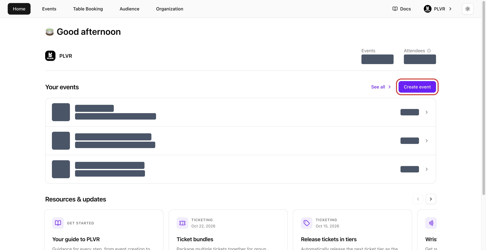
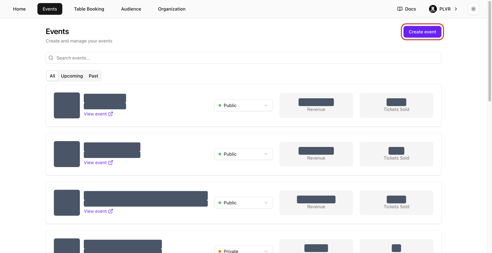
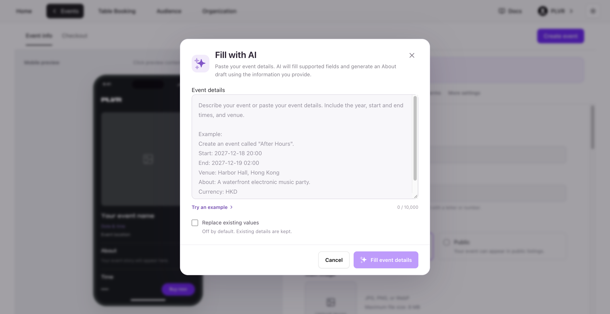
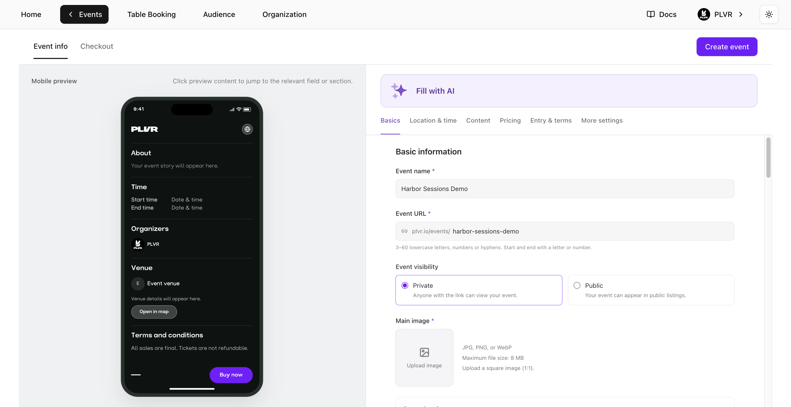
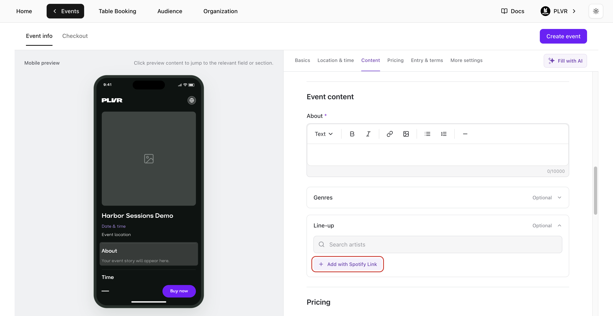
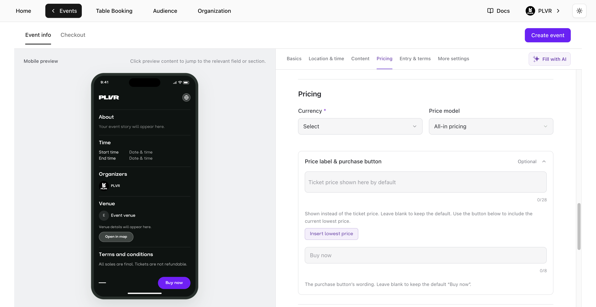
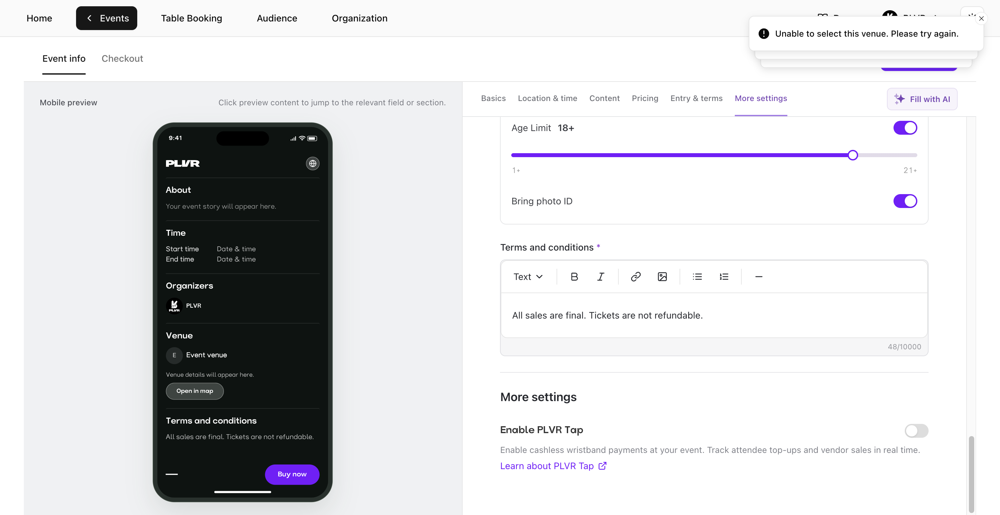
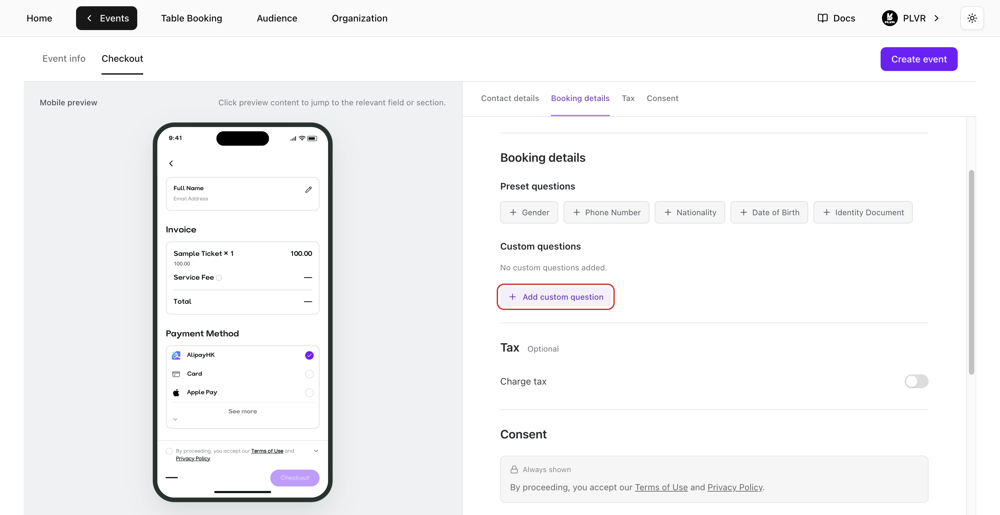
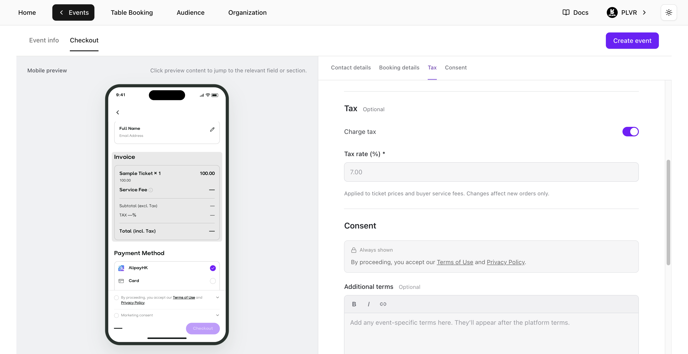
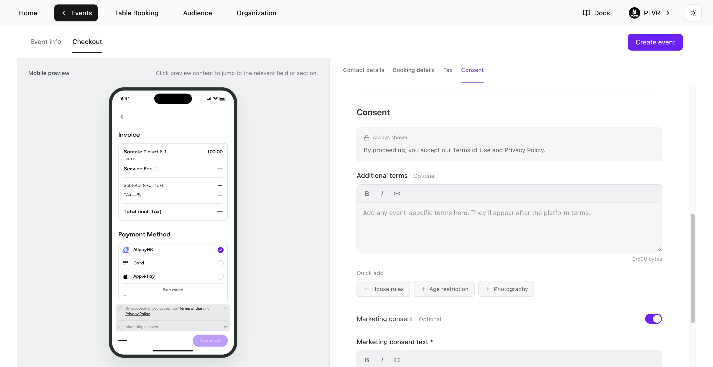

## Create event を開く

**Home**（ホーム）または **Events**（イベント）で **Create event**（イベントを作成）を選択します。組織のオーナー、管理者、マネージャーは、標準的なチケット制イベントを作成できます。

**Home** では、**Your events**（あなたのイベント）の下にある **See all**（すべて表示）の横にボタンがあります。

<Frame>
  
</Frame>

**Events** では、イベント一覧の右上にボタンがあります。

<Frame>
  
</Frame>

## Event info を入力する

**Event info**（イベント情報）上部のセクションショートカットを使って、フォーム内を移動します。**Mobile preview**（モバイルプレビュー）には、作業中に購入者向けのページが表示されます。プレビュー内のセクションを選択すると、その設定へ移動できます。アスタリスクの付いた項目は必須です。

### AI で入力

イベントの概要資料がすでにある場合は、**Fill with AI**（AI で入力）を使って作業を始められます。

1. **Fill with AI** を選択し、開催年、開始・終了時刻、会場などの詳細を貼り付けます。**Try an example**（例を試す）を選択するとサンプルを確認できます。
2. **Fill event details**（イベント詳細を入力）を選択します。AI が **Event info** の対応項目を入力し、詳細をもとに **About** の下書きを作成することもあります。**Replace existing values**（既存の値を置き換える）をオンにしない限り、既存の値は保持されます。
3. 入力内容を確認し、不足している項目を入力します。画像のアップロードと **Checkout**（チェックアウト）の設定は手動で行ってください。

<Frame>
  
</Frame>

### 基本情報

- **Event name**（イベント名）— 購入者に表示する名前を入力します。
- **Event URL**（イベント URL）— 名前を入力したら、提案されたリンクを確認します。空欄の場合やすでに使われている場合は、`plvr.io/events/` の後の部分を編集します。小文字の英字、数字、ハイフンで3〜60文字とし、先頭と末尾は英字または数字にしてください。
- **Event visibility**（イベントの公開範囲）— 初期設定では **Private**（非公開）が選択されています。リンクを知っている人は誰でもイベントを開けます。PLVR の掲載一覧に表示される対象にするには **Public**（公開）を選びます。
- **Main image**（メイン画像）— **Upload image**（画像をアップロード）を選択し、正方形（1:1）の JPG、PNG、WebP ファイル（最大 8 MB）を選びます。
- **Secondary images**（サブ画像）— この任意のセクションを展開し、**Add**（追加）を選択してギャラリー画像を最大15枚アップロードします。画像はドラッグして並べ替えられます。

<Frame>
  
</Frame>

### 場所と日時

1. **Venue**（会場）で会場名または住所を検索し、結果を選択します。これによりタイムゾーンが設定され、日付と時刻の項目が入力可能になります。
2. **Time**（日時）で、**Start**（開始）と **End**（終了）の日付と時刻を両方設定します。会場のタイムゾーンで今日以降の日付を使ってください。終了は開始より後である必要があります。会場を変更した場合は、日時を再確認してください。タイムゾーンは更新されますが、入力した日付と時刻はそのまま残ります。
3. 複数のセッションがあるイベントでは、**Add session**（セッションを追加）を選択します。各セッションに異なる **Session name**（セッション名）を付け、それぞれの開始・終了を設定します。不要なセッションは **Remove**（削除）で削除します。

<Frame>
  
</Frame>

### コンテンツ

- **About**（概要）— 購入者に表示されるイベントの説明を書きます。ツールバーでテキストを整形し、リンクや画像を追加できます。
- **Genres**（ジャンル）— 任意。ジャンルを検索または一覧から選びます。サブジャンルを選択すると、その親ジャンルは置き換えられます。
- **Line-up**（出演者）— 任意。アーティストを検索し、掲載したいアーティストを選びます。該当する場合は、メインの出演者を **Headliner**（ヘッドライナー）に設定します。Spotify からアーティストをインポートするには、**Add with Spotify Link**（Spotify リンクで追加）を選択し、アーティストの Spotify プロフィールリンクを貼り付けて **Add** を選択します。

<Frame>
  
</Frame>

### 価格設定

- **Currency**（通貨）— イベントで使用する通貨を選択します。
- **Price model**（価格モデル）— 購入者手数料と税金を含めた総額を表示する場合は **All-in pricing**（総額表示）、基本のチケット価格を表示して決済時に手数料と税金を加算する場合は **Split pricing**（別途表示）を選びます。
- **Price label & purchase button**（価格ラベルと購入ボタン）— この任意のセクションを展開すると、価格と購入ボタンの表示をカスタマイズできます。**Insert lowest price**（最低価格を挿入）を使うと、ラベルに現在の最低価格を含められます。ラベルは28文字までで、最低価格タグは16文字としてカウントされます。**Button text**（ボタンのテキスト）は最大8文字です。空欄にするとそれぞれ初期値が使われます。ボタンの初期値は **Buy now** です。

<Note>
  イベントの通貨は、最初の **Ticket**（チケット）、**Bundle**（バンドル）、**Add-on**（アドオン）が作成された時点でロックされます。
</Note>

<Frame>
  
</Frame>

### 入場条件と規約

- **Entry requirements**（入場条件）— 任意。該当する場合は **Age Limit**（年齢制限）をオンにして最低年齢を設定します。**Bring photo ID**（写真付き身分証明書の持参）をオンにすると、入場時に有効な写真付き身分証明書の提示が必要であることを購入者に伝えられます。
- **Terms and conditions**（利用規約）— あらかじめ入力されている規約を確認し、イベントに合わせて更新します。この規約はイベントページに表示されます。

### その他の設定

キャッシュレスのリストバンド決済を利用する予定の場合は、**Enable PLVR Tap**（PLVR Tap を有効にする）をオンにします。初期設定ではオフです。詳しくはフォーム内の **Learn about PLVR Tap**（PLVR Tap について）をご覧ください。

<Frame>
  
</Frame>

## Checkout を設定する

**Checkout** タブを選択します。**Mobile preview** で、質問、料金、同意事項が購入者にどう表示されるかを確認できます。

### 連絡先情報と予約情報

- **Contact details**（連絡先情報）— **Full Name**（氏名）と **Email Address**（メールアドレス）は常に必須です。
- **Booking details**（予約情報）— **Phone Number**（電話番号）などのプリセット質問を追加するか、**Add custom question**（カスタム質問を追加）を選択します。質問を入力し、**Text**（テキスト）、**Number**（数値）、**Single choice**（単一選択）、**Multiple choice**（複数選択）から形式を選びます。選択式の質問には少なくとも1つの選択肢を追加し、**Add question**（質問を追加）を選択します。**Required**（必須）と **Show at checkout**（決済時に表示）で、購入者に表示する質問と回答必須の質問を管理します。質問の種類、編集、並べ替えについては[登録フォーム](/ja/events/registration-form)をご覧ください。

<Frame>
  
</Frame>

### 税金

税金を徴収する必要がある場合は、**Charge tax**（税金を徴収）をオンにして **Tax rate (%)**（税率）を入力します。プレビューでサンプルの請求書を確認してください。この税率は、新規注文のチケット価格と購入者サービス料に適用されます。

<Frame>
  
</Frame>

### 同意事項

- **PLVR terms**（PLVR の規約）— プラットフォームの **Terms of Use**（利用規約）と **Privacy Policy**（プライバシーポリシー）は常に表示されます。
- **Additional terms**（追加の規約）— 必要に応じて、イベント固有の購入時の規約を追加します。**House rules**（ハウスルール）や **Photography**（撮影について）などのテンプレートは **Quick add**（クイック追加）で追加できます。
- **Marketing consent**（マーケティングへの同意）— 初期設定ではオフです。オンにした場合は **Marketing consent text**（マーケティング同意文）を入力します。購入者にはチェックの入っていないチェックボックスが表示され、任意で同意を選べます。

<Frame>
  
</Frame>

## プレビューして作成する

1. フォームで **Event URL** と **Event visibility** を確認します。両方のタブで **Mobile preview** を使い、会場、セッションの時刻、イベントページ、チェックアウトを確認します。
2. **Create event** を選択します。フォームで項目がハイライトされた場合は、修正してもう一度お試しください。イベントページは選択した公開範囲で公開されます。チケットを追加する前にイベントを作成することもできます。
3. 作成後に[チケット管理](/ja/tickets/ticket-management)が開くので、最初のチケットを追加できます。あとからイベントページやチェックアウトを更新するには、[イベントエディター](/ja/events/event-editor)を開きます。
