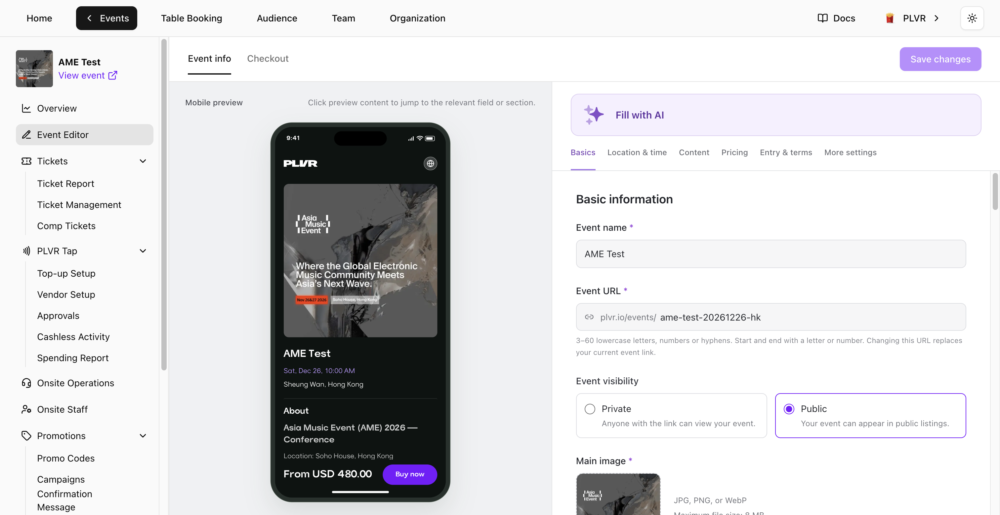

イベントを開き、イベントメニューで **Event Editor**（イベントエディター）を選択します。右側のフォームを編集し、左側の **Mobile preview**（モバイルプレビュー）で確認します。プレビュー内のセクションを選ぶと、その設定項目へ移動できます。

<Frame>
  
</Frame>

## イベント情報

- **Basics**（基本情報）— **Event name**（イベント名）、**Event URL**、公開設定、正方形の **Main image**（メイン画像）を編集します。サブ画像のアップロードや並べ替えもできます。**Event URL** を変更すると、現在のイベントリンクは置き換えられます。
- **Location & time**（場所と日時）— セッションの日時を設定する前に **Venue**（会場）を選択してください。時刻は会場のタイムゾーンで表示されます。セッションを複数追加する場合は、それぞれに異なる名前を付けてください。セッションは最低1つ必要です。チケットや注文が紐づいているセッションは削除できません。
- **Content**（コンテンツ）— **About**、ジャンル、出演者を更新します。アーティストを追加するには **Add with Spotify Link** を使います。
- **Pricing**（価格設定）— **Currency**（通貨）と手数料の表示方法を選びます。**All-in pricing**（総額表示）では、購入者手数料と税を含めた価格を表示します。この設定をオフにすると、購入者手数料と税はチェックアウト時に加算されます。任意の **Price label**（価格ラベル）では **Insert lowest price** を使えます。**Button text**（ボタンテキスト）を空欄にすると **Buy now** が使われます。
- **Entry & terms**（入場条件と規約）と **More settings**（その他の設定）— 必要に応じて入場条件を設定し、**Terms and conditions**（利用規約）を更新し、**PLVR Tap** を有効にします。

<Note>
  イベントの通貨は、最初の **Ticket**、**Bundle**、**Add-on** の作成に成功した時点でロックされます。無料や無効のアイテムでも通貨はロックされます。
</Note>

**Fill with AI** を使うと、貼り付けたテキストから **Event info** を入力できます。初期設定では空欄の項目のみが入力されます。入力済みの項目も更新するには **Replace existing values** をオンにし、保存前に結果を確認してください。

## チェックアウト

- **Contact details**（連絡先情報）と **Booking details**（予約情報）— **Full Name**（氏名）と **Email Address**（メールアドレス）は常に必須です。予約時の質問を追加・編集するには[登録フォーム](/ja/events/registration-form)を使います。
- **Tax**（税）— 必要に応じて税をオンにし、税率を入力します。変更は新しい注文に適用されます。
- **Consent**（同意）— PLVR の利用規約とプライバシーポリシーは固定です。独自の規約は **Additional terms** に追加してください。**Marketing consent**（マーケティング同意）は初期設定でオフです。有効にすると、購入者はオプトインするかどうかを選べます。

## 保存

**Save changes**（変更を保存）を選ぶと、両方のタブの編集内容が保存されます。エディターが確認が必要な内容を指摘した場合は、ハイライトされた項目を修正して再度保存してください。

<Warning>
  **Leave without saving** を選ぶと、保存していない編集内容は破棄されます。
</Warning>
