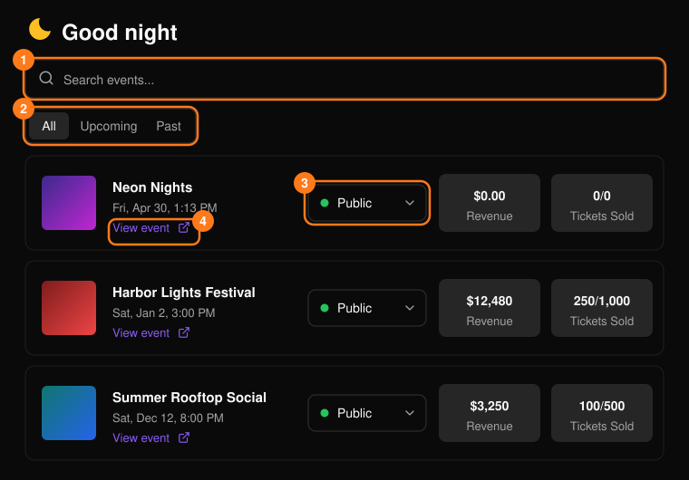
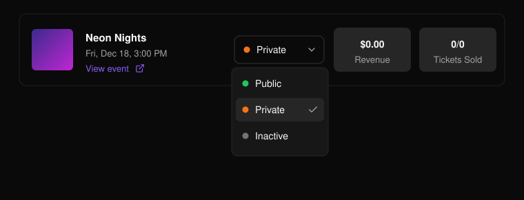
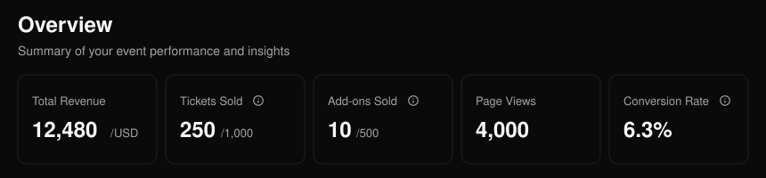
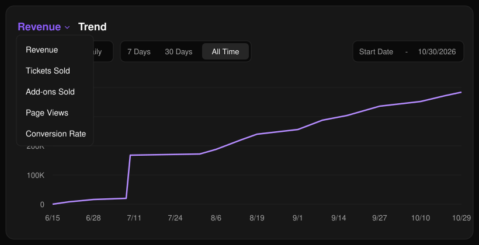
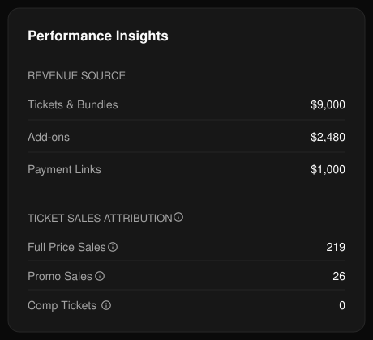
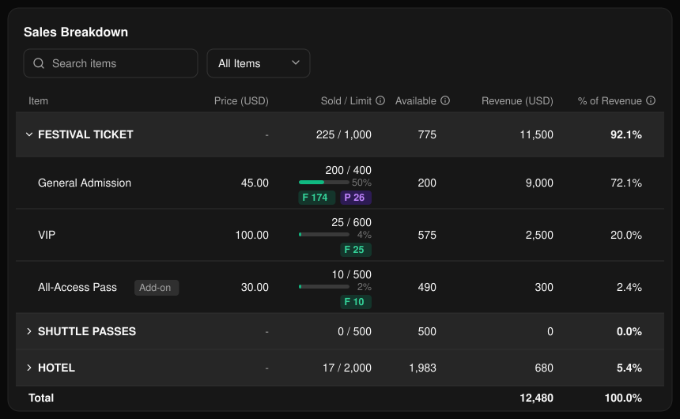

## イベント一覧

ヘッダーの **Events**（イベント）を開くか、**Home**（ホーム）の **Your events** の下にある **See all** を選択します。名前で検索し（1）、**All**、**Upcoming**、**Past** を切り替え（2）、行を選択するとイベントが開きます。**View event**（4）を選ぶと公開イベントページが開きます。

<Frame>
  
</Frame>

ステータスメニュー（3）で、イベントを **Public**（公開）、**Private**（非公開）、**Inactive**（無効）に設定できます。**Ended**（終了）したイベントはロックされます。

<Frame>
  
</Frame>

新しいイベントを作成するには、**Home** または **Events** で **Create event**（イベントを作成）を選択します。詳しくは[イベントを作成する](/ja/events/create-an-event)をご覧ください。

## イベントの概要ページ

イベントを開くと **Overview**（概要）が表示されます。サイドメニューからイベントのほかのページに移動できます。

<Frame>
  
</Frame>

Total Revenue（総売上）は、チケット、アドオン、支払いリンクの合計です。Conversion Rate（コンバージョン率）は、支払い済み注文数をページビュー数で割った値です。Personalization Progress と Add-ons Sold は、該当する場合のみ表示されます。

**Trend**（推移）チャートは、1つの指標を時系列で表示します。**Cumulative**（累計）と **Daily**（日別）を切り替えられます。プリセット（**7 Days**、**30 Days**、**All Time**）を選ぶか、任意の期間を設定してください。

<Frame>
  
</Frame>

**Performance Insights** では、売上を流入元別に、販売数を種類別（定価、プロモコード、招待チケット（購入手続きなしで直接付与））に分けて表示します。

<Frame>
  
</Frame>

**Ticket Breakdown** では、チケット種別ごとの販売数と売上を確認できます。

<Frame>
  
</Frame>

<Tip>
  販売の詳細は[チケットレポート](/ja/tickets/ticket-report)をご覧ください。
</Tip>
