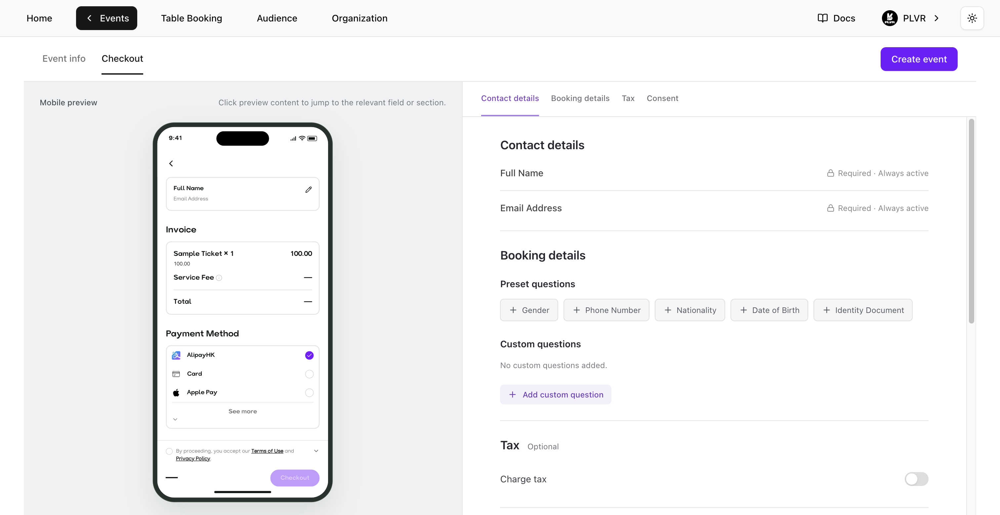
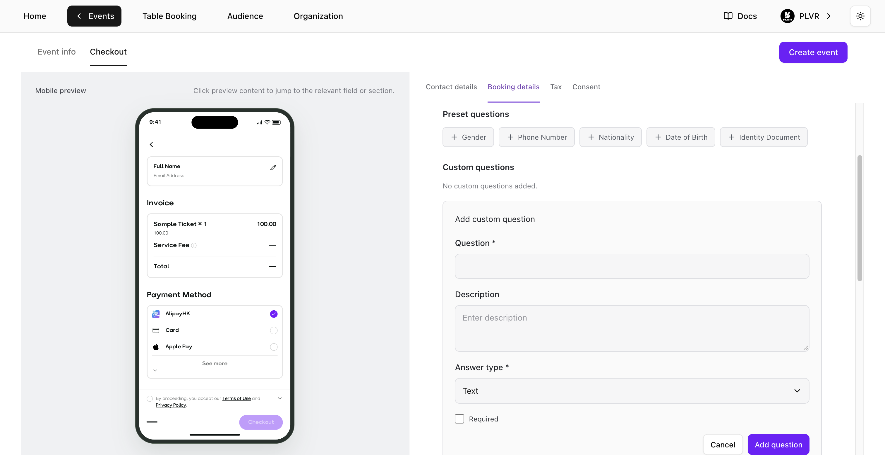

**Event Editor**（イベントエディター）を開き、**Checkout** を選択して **Booking details**（予約情報）に進みます。[イベントを作成する](/ja/events/create-an-event)ときに、**Checkout** タブでこれらの質問を設定することもできます。

<Frame>
  
</Frame>

## 質問を追加する

- **Preset questions**（定型の質問）— **Preset questions** の下から質問を選択します。
- **Custom questions**（カスタム質問）— **Add custom question** を選択し、質問を入力して、**Text**、**Number**、**Single choice**、**Multiple choice** から回答形式を選びます。選択式の場合は、選択肢を1つ以上入力してください。**Add question** を選ぶとフォームに反映されます。

<Frame>
  
</Frame>

## 質問を管理する

- カスタム質問の横にある **Edit** を選び、編集が終わったら **Save question** を選択します。
- **Required** を選ぶと、その質問が必須になります。**Show at checkout** をオフにすると、設定を残したまま質問を非表示にできます。
- **Preset questions** または **Custom questions** の中で、質問をドラッグして並べ替えられます。

チェックアウトに質問を反映するには、**Event Editor** で **Save changes** を、新しいイベントを作成中の場合は **Create event** を選択します。

<Note>
  **Contact details** の **Full Name** と **Email Address** は常に必須です。
</Note>

## 回答を確認する

- **RSVP の申し込み** — [RSVP](/ja/events/rsvp) ページの **Form Responses** で回答を確認できます。
- **RSVP を使わないイベント** — [Ticket Report](/ja/tickets/ticket-report) ページで回答を確認できます。

<Tip>
  PLVR Tap を使うイベントには、別途[パーソナライズフォーム](/ja/tap/personalization-form)があります。
</Tip>
