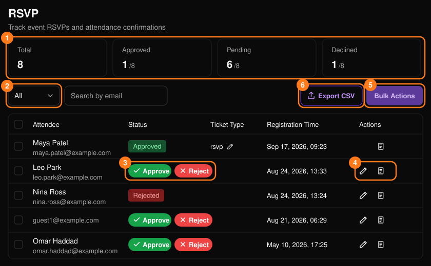
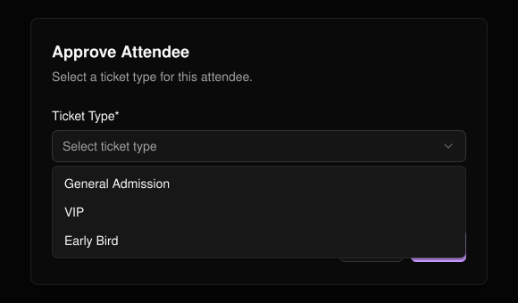
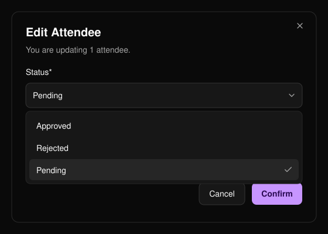
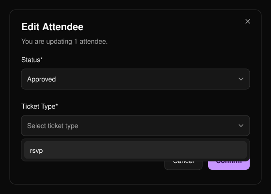
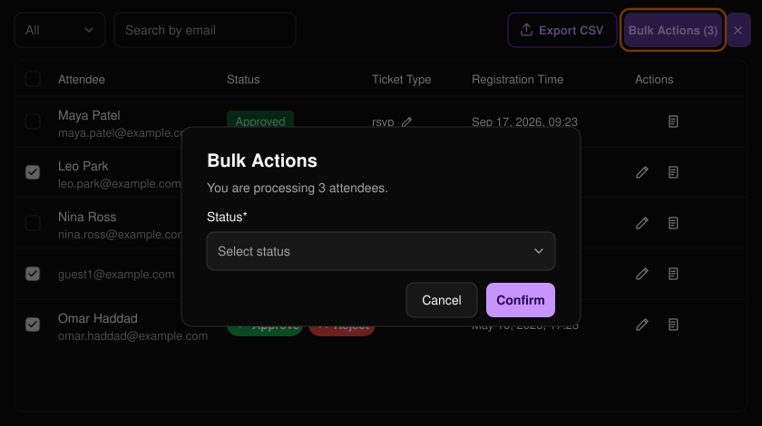

イベントメニューの **RSVP** では、参加の申し込みを確認できます。

<Note>
  RSVP はご依頼に応じて有効化します。
</Note>

<Frame>
  
</Frame>

**Total**、**Approved**、**Pending**、**Declined** の各カードに申し込み件数が表示され、リストの下のコントロールでページを移動できます。

**Pending**（保留中）、**Approved**（承認済み）、**Rejected**（却下）で絞り込めます（2）。サマリーカードでは却下された申し込みを「Declined」と表示しますが、同じものです。

## 承認または却下する

保留中の行で **Approve**（承認）または **Reject**（却下）を選択します（3）。チケット種別が複数ある場合は、承認時に **Ticket Type** を選びます。承認するには、イベントにチケット種別が1つ以上必要です。

<Frame>
  
</Frame>

## ステータスを編集する

鉛筆アイコン（4）で **Edit Attendee** が開きます。承認にはチケット種別が必要です。

- 承認済みの参加者は編集できません。
- 却下した参加者は、保留中に戻すことだけができます。

本のアイコン（4）を選ぶと、[登録フォーム](/ja/events/registration-form)に対するその参加者の **Form Responses**（フォーム回答）が開きます。

<Frame>
  
</Frame>

<Frame>
  
</Frame>

## 一括操作

行にチェックを入れ、**Bulk Actions**（一括操作）（5）を選択し、ステータス（承認の場合はチケット種別も）を選んでから **Confirm** を選択します。

- 一度に最大50人まで処理できます。
- 選択する参加者はすべて同じステータスである必要があり、承認済みの参加者は選択できません。

<Frame>
  
</Frame>

**Export CSV**（6）を選ぶと、リストをダウンロードできます。
