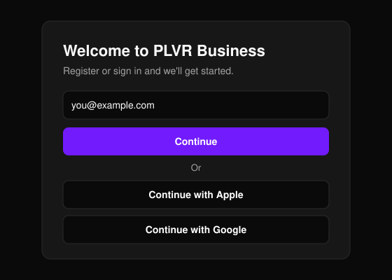
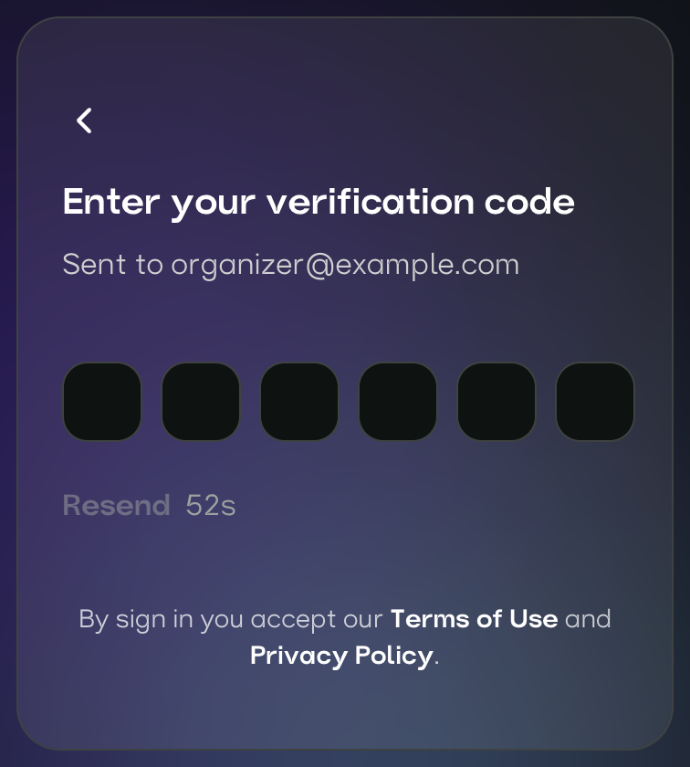
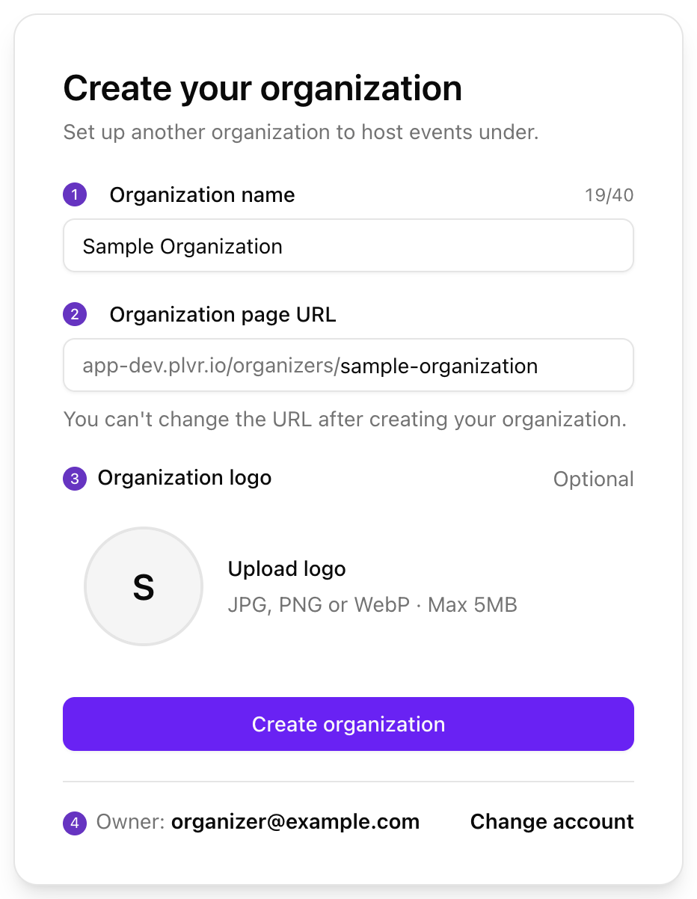

ゼロからイベント開催の準備が整った組織までを、すばやく進めるための手順です。アカウントはどなたでも作成できます。

## セットアップ

<Steps>
  <Step title="サインイン">
    [Business Portal](https://business.plvr.io) を開き、メール、Apple、Google のいずれかでサインインします。初回サインイン時にアカウントが作成されます。
  </Step>
  <Step title="組織を作成する">
    名前、ページ URL、ロゴ（任意）を入力します。
  </Step>
  <Step title="プロフィールを完成させる">
    **Organization**（組織）を開き、公開ページで参加者に表示される情報を入力します。
  </Step>
  <Step title="チームを追加する">
    **Team**（チーム）を開いて **Add**（追加）を選択し、各メンバーにロールを割り当てます。
  </Step>
  <Step title="最初のイベントを作成する">
    PLVR パートナーチームにご連絡ください。
  </Step>
</Steps>

## サインイン

<Frame>
  
</Frame>

メールでサインインする場合は、6桁のコードをお送りしますので、次の画面で入力してください。

<Frame>
  
</Frame>

<Tip>
  サインイン方法とメールアドレスは毎回同じものをお使いください。異なるものを使うと、組織が見つからなくなる場合があります。
</Tip>

## 組織を作成する

組織とは、イベントを開催する単位となるアカウントです。初回サインイン後、このフォームが表示されます。あとから別の組織を追加するには、アカウントメニューの **Create organization**（組織を作成）を使用します。

<Frame>
  
</Frame>

- **Name（1）：** 最大40文字。他と重複しない名前にする必要があります。
- **Page URL（2）：** 小文字の英字、数字、ハイフンで3〜60文字。先頭と末尾は英字または数字にしてください。`admin`、`support`、`help` などの予約語は使用できません。
- **Logo（3）：** 任意。JPG、PNG、WebP 形式で最大 5 MB。
- **Owner（4）：** サインイン中のアカウントがオーナーになります。違うアカウントの場合は **Change account**（アカウントを変更）を選択してください。

<Warning>
  組織の作成後はページ URL を変更できません。事前によくご確認ください。
</Warning>

## プロフィールを完成させる

ヘッダーの **Organization** を開き、ロゴ、名前、**About My Organization**（組織について）を入力して **Save**（保存）を選択します。すべての設定項目については[組織設定](/ja/organization/settings)をご覧ください。

## チームを追加する

{/* SCREENSHOT: images/getting-started/onboarding-team-add-button.png | Team Management page (Team in the header) with a few members listed; highlight the Add button at the top. Crop to the page title, Add button and the top of the member table. */}

| ロール | アクセス権限 |
| --- | --- |
| **Admin** | PLVR Business と PLVR Scan へのフルアクセス。 |
| **Manager** | Team Management を除く PLVR Business と PLVR Scan。 |
| **Scanner** | PLVR Scan のみ。 |

各メンバーには、業務に必要な最小限のロールを割り当ててください。入口スタッフは **Scanner** で十分です。詳しくは[チームとロール](/ja/organization/team)をご覧ください。

## 最初のイベントを作成する

イベントの作成は、現時点ではセルフサービスに対応していません。空の **Events**（イベント）ページから、パートナーチーム（partners@plvr.io）にメールでご連絡いただければ、イベントをセットアップいたします。セットアップ後、イベントが一覧に表示されます。詳しくは[イベントの概要](/ja/events/overview)をご覧ください。

{/* SCREENSHOT: images/getting-started/onboarding-no-events-yet.png | Events page for a brand-new organization showing the 'No events yet' empty state with the 'contact partners@plvr.io' message. Crop to the empty state card. */}

## 公開前に

<Steps>
  <Step title="イベントページを作成する">
    **Event Editor**（イベントエディター）でページを確認し、**Save Event**（イベントを保存）を選択します。保存するまでは何も公開されません。詳しくは[イベントエディター](/ja/events/event-editor)をご覧ください。
  </Step>
  <Step title="チケットを設定する">
    **Tickets**（チケット）で種別と価格を確認します。詳しくは[チケット管理](/ja/tickets/ticket-management)をご覧ください。
  </Step>
  <Step title="購入時の質問を追加する（任意）">
    [登録フォーム](/ja/events/registration-form)を使用します。
  </Step>
  <Step title="イベントのステータスを選ぶ">
    **Events** ページで **Public**（公開）、**Private**（非公開）、**Inactive**（無効）のいずれかを設定します。詳しくは[イベントのステータス](/ja/events/overview)をご覧ください。
  </Step>
  <Step title="参加者として表示を確認する">
    **View event**（イベントを表示）を選択して公開ページを確認します。
  </Step>
  <Step title="入口スタッフを招待する">
    [Team ページ](/ja/organization/team)で、スキャン担当スタッフを **Scanner** として追加します。
  </Step>
</Steps>

## よくある問題

| 問題 | 対処法 |
| --- | --- |
| **Access denied**（アクセス拒否） | ご自身のロールではそのページにアクセスできないか、別の組織を開いています。**Back to home**（ホームに戻る）を選択してアカウントメニューを確認するか、オーナーにロールの確認を依頼してください。 |
| 組織が見つからない、または新しい組織の作成を求められる | チームが使っているものとは別のアカウントでサインインしています。ログアウトし、元のメールアドレスまたはサインイン方法でサインインし直してください。 |
| チームに追加されたのに、その組織が表示されない | 追加されたメールアドレスでサインインし、アカウントメニューで組織を切り替えてください。 |
| 名前やページ URL がすでに使われている、または予約語になっている | 都市名を加えるなど、より特徴的なものにしてください。 |
| ロゴがアップロードできない | 5 MB 未満の JPG、PNG、WebP を使用してください。 |
| 確認コードが届かない | 迷惑メールフォルダを確認し、カウントダウン終了後に **Resend**（再送信）を選択してください。メールアドレスに誤りがないかもご確認ください。 |
| Apple または Google でのサインインに失敗する | もう一度お試しいただくか、メールでサインインしてください。 |
| 別のページ URL にしたい | ページ URL は変更できません。アカウントメニューから新しい組織を作成してください。 |

<Frame>
  
</Frame>

## 次のステップ

<Columns cols={2}>
  <Card title="最初のイベントを公開する" icon="rocket" href="/ja/getting-started/quickstart">
    イベントの設定から最初のチケット販売まで。
  </Card>

  <Card title="ポータルツアー" icon="compass" href="/ja/getting-started/portal-tour">
    各機能の場所を把握しましょう。
  </Card>
</Columns>
