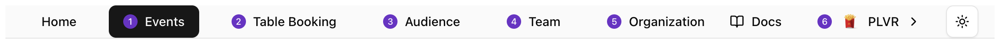
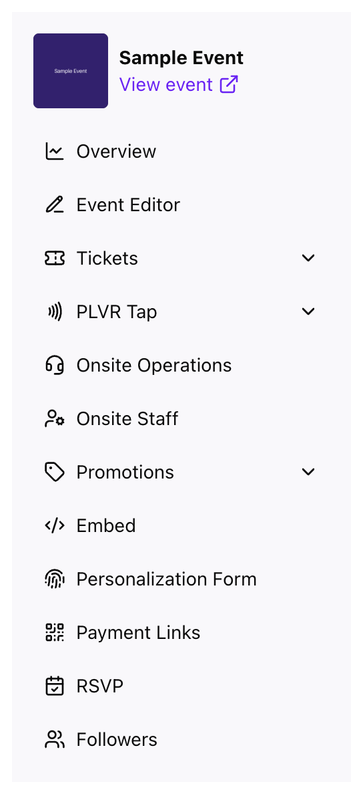

ナビゲーションは2階層になっています。組織全体のページを開く**ヘッダー**と、イベント内で使う**サイドメニュー**です。

## ヘッダー

<Frame>
  
</Frame>

| リンク | ページ | 表示対象 |
| --- | --- | --- |
| **Events** | [イベントの概要](/ja/events/overview) | 全員 |
| **Table Booking** | [テーブル予約](/ja/other/table-booking) | オーナー、管理者、マネージャー |
| **Audience** | [オーディエンス](/ja/organization/audience) | 全員 |
| **Team** | [チームとロール](/ja/organization/team) | オーナー、管理者 |
| **Organization** | [組織設定](/ja/organization/settings) | オーナー、管理者、マネージャー |

## アカウントメニュー

組織の切り替え、新しい組織の作成、表示テーマの変更、ログアウトができます。

<Frame>
  
</Frame>

<Tip>
  保存していない変更がある場合、ページを離れる、組織を切り替える、ログアウトする前にポータルが確認を求めます。
</Tip>

## イベントメニュー

イベント内では、左側のメニューにそのイベント用のツールが並びます。一番上の **View event**（イベントを表示）を選ぶと公開ページが開きます。

<Frame>
  
</Frame>

- **Overview**：[販売状況と成果](/ja/events/overview)
- **Event Editor**：[公開イベントページ](/ja/events/event-editor)
- **Tickets**：[チケットレポート](/ja/tickets/ticket-report)、チケット管理、招待チケット
- **PLVR Tap**：[キャッシュレスの設定と利用状況](/ja/tap/introduction)
- **Onsite Operations**：[コマンドセンター](/ja/onsite/command-center)
- **Onsite Staff**：[イベントの現場スタッフ](/ja/onsite/onsite-staff)
- **Promotions**：[プロモコード](/ja/promotions/promo-codes)、キャンペーン、トラッキングリンクなど
- **Registration Form**：[購入時の質問](/ja/events/registration-form)
- **Personalization Form**：[パーソナライズフォーム](/ja/tap/personalization-form)
- **Payment Links**：[支払いリンク](/ja/other/payment-links)
- **RSVP** と **Followers**：[RSVP](/ja/events/rsvp)、[フォロワー](/ja/events/followers)

<Note>
  **PLVR Tap** と **Personalization Form** は、PLVR Tap を利用するイベントでのみ表示されます。
</Note>

イベントから抜けるには、ヘッダーの **Events** を選択します。
