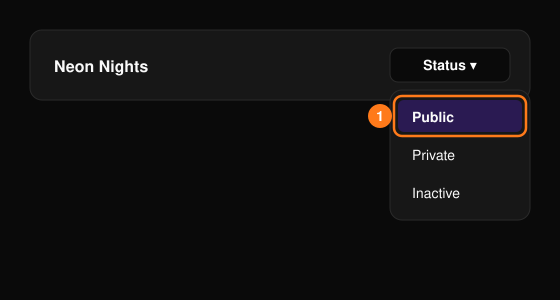

組織がすでに作成済みであることを前提としています。まだの場合は、[オンボーディング](/ja/getting-started/onboarding)から始めてください。

<Steps>
  <Step title="イベントを開く">
    ヘッダーの **Events**（イベント）を選択し、対象のイベントを選びます。イベントがまだない場合は、[最初のイベントを作成する](/ja/getting-started/onboarding)をご覧ください。
  </Step>
  <Step title="イベントページを作成する">
    **Event Editor**（イベントエディター）で各セクションを確認し、**Save Event**（イベントを保存）を選択します。詳しくは[イベントエディター](/ja/events/event-editor)をご覧ください。
  </Step>
  <Step title="チケットを設定する">
    **Tickets**（チケット）で種別と価格を確認します。詳しくは[チケット管理](/ja/tickets/ticket-management)をご覧ください。
  </Step>
  <Step title="イベントを公開する">
    **Events** ページのステータスメニューで **Public**（公開）を選択します。詳しくは[イベントのステータス](/ja/events/overview)をご覧ください。
  </Step>
  <Step title="宣伝する">
    [プロモコード](/ja/promotions/promo-codes)や[トラッキングリンク](/ja/promotions/tracking-links)を共有しましょう。
  </Step>
  <Step title="販売状況を確認する">
    [Overview](/ja/events/overview)（概要）と[チケットレポート](/ja/tickets/ticket-report)で状況を追いかけます。
  </Step>
</Steps>

<Frame>
  
</Frame>

<Note>
  イベントを **Public** にする前に、[公開前に](/ja/getting-started/onboarding)のチェック項目を確認してください。
</Note>
