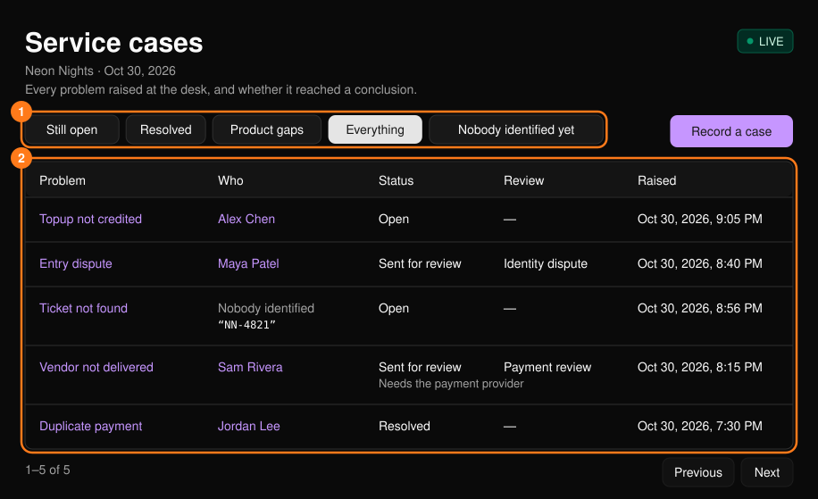
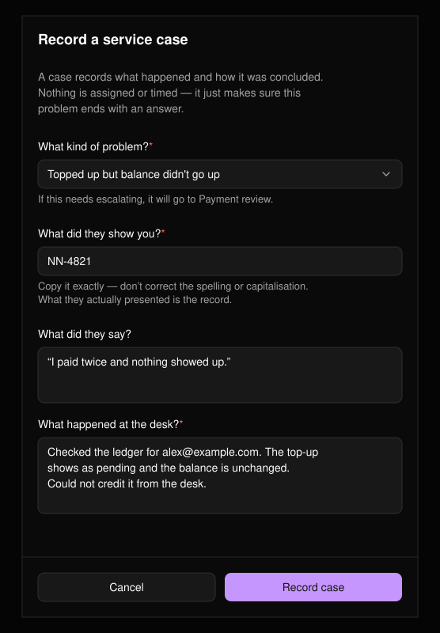
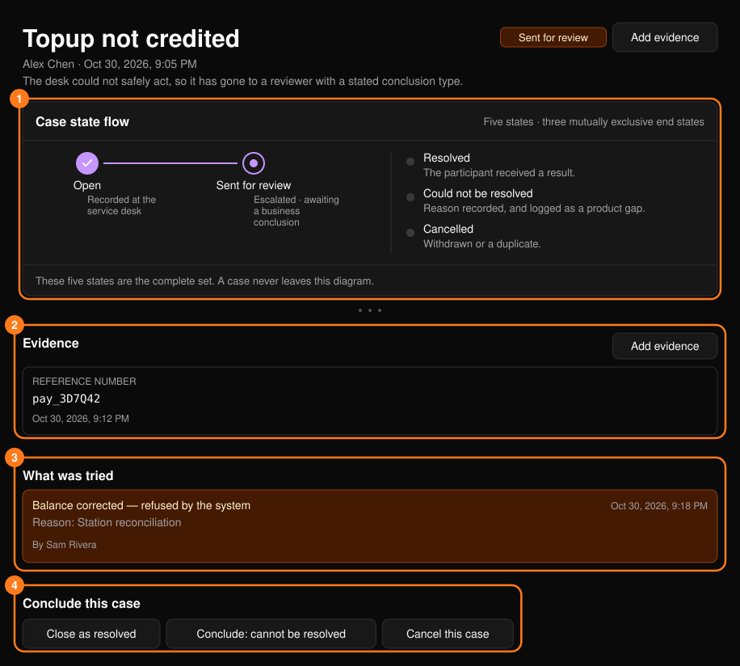
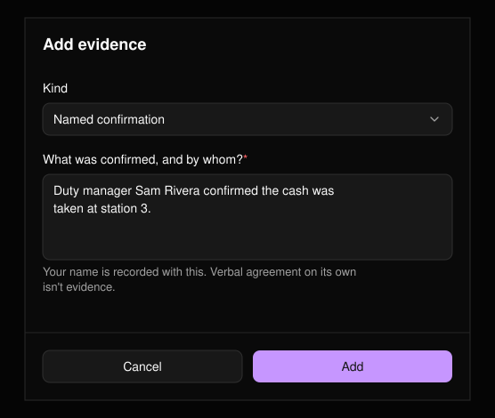
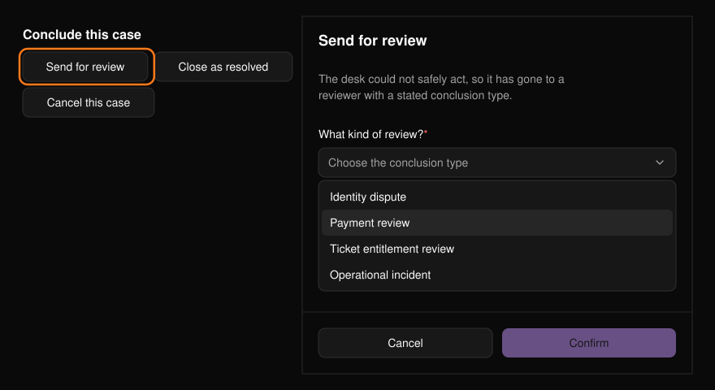

ケース（Service case）は、デスクで受け付けた問題とその結末を記録するものです。これにより、何も記録されないまま追い返される人がいなくなります。担当者の割り当てや期限の設定はありません。[コマンドセンター](/ja/onsite/command-center)の **Service cases** から一覧を開きます。

<Frame>
  
</Frame>

## ステータス

| ステータス | 意味 |
| --- | --- |
| **Open** | 対応中です。 |
| **Sent for review** | デスクでは安全に対応できないため、レビュー担当者に引き継がれています。 |
| **Resolved** | 参加者に明確な回答をしました。 |
| **Could not be resolved** | 理由とともに、対応不可となりました。プロダクトの不足点として集計されます。 |
| **Cancelled** | 取り下げ、または重複です。 |

リスク（High、Medium、Normal）はステータスとは別です。レビューの種類は、Identity dispute（本人確認の争い）、Payment review（支払い確認）、Ticket entitlement review（チケットの権利確認）、Operational incident（運営上のインシデント）です。

## ケースを記録する

**Record a case** を選択します。同じフォームはチケット、取引、結果が0件の検索からも開き、可能な範囲で事前入力されます。添付したチケットや取引の状態はケースとともに保存されるため、レビュー担当者はあなたが見たのと同じ内容を確認できます。

<Frame>
  
</Frame>

- 誰か特定できない場合は、提示された内容をそのまま入力してください。綴りや大文字・小文字を修正しないでください。
- 何を確認し、何がわかり、何ができなかったかを記述してください。

## ケースに対応する

ケースのページには、ステータス、ケースがフローのどこにあるか、作成時にポータルに何が表示されていたか、証拠、試みたすべての操作が表示されます。拒否された試行は意図的に残されます。「試したが拒否された」こと自体が証拠になるためです。

<Frame>
  
</Frame>

### 証拠を追加する

**Add evidence** を選び、**Reference number**（支払い参照番号、注文番号、現金の集計など）、**Named confirmation**（何を誰が確認したか）、**Note**（メモ）のいずれかを選びます。

<Frame>
  
</Frame>

<Tip>
口頭での合意は証拠になりません。参照番号や、誰が何を確認したかを記録してください。
</Tip>

### 参加者に紐づける

人物が特定されていないケースでは、[検索](/ja/onsite/search)でその人を探してから **Link to a participant** を選び、参加者のユーザー ID を入力します。紐づけてもステータスは変わりません。

### 結論を出す

**Conclude this case** には、あなたが実行できる操作のみが表示されます。たとえばデスクのオペレーターは「Conclude: cannot be resolved」を選べません。

<Frame>
  
</Frame>

| ボタン | 必要な入力 |
| --- | --- |
| **Send for review** | レビューの種類。 |
| **Close as resolved** | 結果：何を伝え、何を行ったか。 |
| **Conclude: cannot be resolved** | 理由：コンソールで何ができなかったか。 |
| **Cancel this case** / **Reopen** | なし。 |

**Confirm** を選ぶと適用されます。
