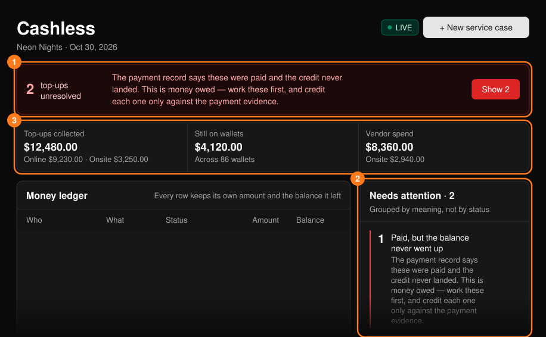
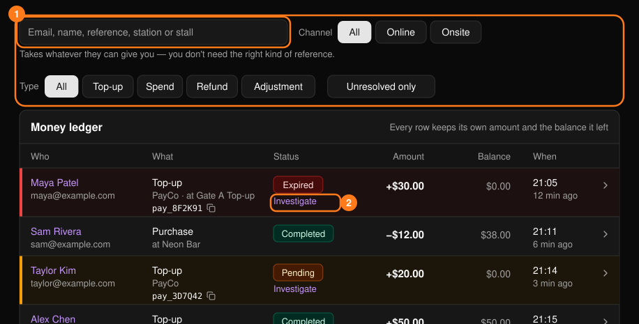
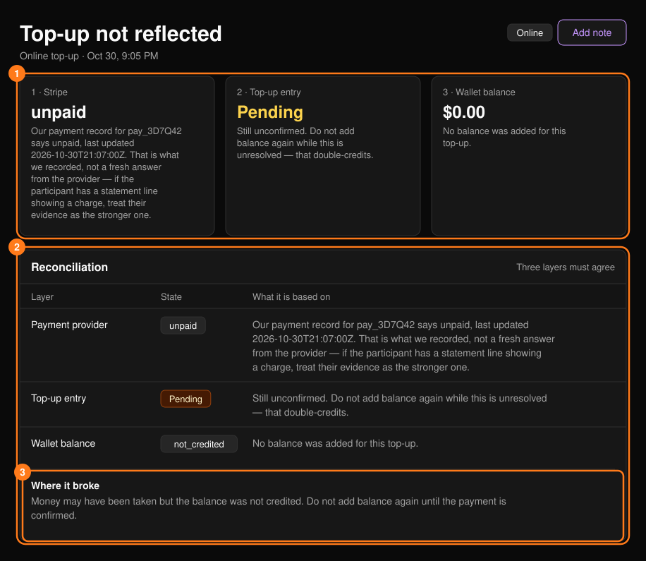
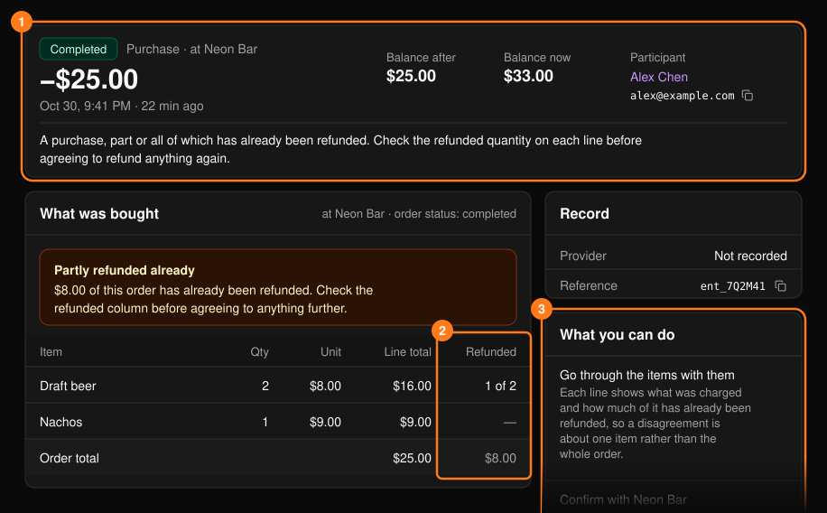

**Cashless**（キャッシュレス）ワークスペースでは、どこでお金を受け取ったか、残高に反映されたか、どこで使われたかを確認できます。キャッシュレスが有効な Tap イベントで利用できます。[コマンドセンター](/ja/onsite/command-center)から開きます。

<Note>
イベント全体のレポートについては[キャッシュレス取引履歴](/ja/tap/cashless-activity)をご覧ください。チャージの設定については[チャージ設定](/ja/tap/top-up-setup)をご覧ください。
</Note>

すべてはチャネル別に分かれています。**Online**（オンライン）のチャージは決済代行会社を経由しており、支払い参照番号があります。**Onsite**（会場）のチャージは、ステーションで現金または決済端末に対して記録されたもので、参照番号はありません。ステーション、支払い方法、現金の記録で突き合わせてください。

<Frame>
  
</Frame>

## 未解決のチャージ

上部のバーには、お金が動いた可能性があるのに残高に反映されていない（保留中、期限切れ、失敗）チャージの件数が表示されます。**Show N** を選ぶと、台帳がそれらに絞り込まれます。期限切れのチャージは無料扱いにはならず、誰かが確認するまでフラグが付いたままです。

凍結されたウォレットがある場合は、その数が通知されます。ウォレットを凍結すると利用は止まりますが、入場は止まりません。リストバンドの凍結は別の操作です。

## 入出金台帳

お金の動きはすべて、金額と処理後の残高とともに1行ずつ記録されます。メールアドレス、名前、参照番号、ステーション、ブースで検索でき、チャネル、種類、**Unresolved only** で絞り込めます。行の矢印を選ぶと、その取引の詳細（下記参照）が開きます。

<Frame>
  
</Frame>

**Top-up stations** パネルには、各ステーションの稼働状況が状態ラベル（Healthy、Watch、Degraded）とともに表示されます。

## コンソールでできないこと

金額を変更できる操作は、ウォレットから行う **Correct the balance**（残高の修正）のみです。[参加者](/ja/onsite/participants)をご覧ください。未確認のチャージの反映、ウォレット間でのチャージの移動、残高や出店者での決済の返金には、決済代行会社での確認やポリシー上の判断が必要なため、それぞれ[ケース](/ja/onsite/cases)として記録してください。

## チャージの詳細

未解決のチャージで **Investigate** を選ぶと、**Top-up not reflected** が開きます。ここには、一致している必要がある3つの層、**Payment provider**（決済代行会社）、**Top-up entry**（チャージ記録）、**Wallet balance**（ウォレット残高）が表示されます。**Where it broke** に診断結果が表示されます。

<Frame>
  
</Frame>

<Warning>
期限切れは、請求されていないという意味ではありません。確認するまでは、ゲストにお金は引き落とされていないと伝えないでください。
</Warning>

- 決済代行会社がお金を受け取ったのに残高が増えていないと PLVR に表示されている場合、ゲストはその金額を受け取る権利があります。再度支払うよう求めないでください。
- チャージが期限切れでも、ゲストが明細で請求を示せる場合は、その内容を信頼して支払い確認（**Open a payment review case**）を開始してください。
- 元の支払いが未解決の間は、二重に残高を付与することはできません。
- 参照番号が何にも一致しない場合は、0とO、1とIの取り違えを確認してください。領収書がある場合は、参照番号を提示されたとおりに入力して、未一致のケースとして記録します。

## 取引の詳細

上部の帯には、ステータス、種類、金額、取引後と現在の残高、参加者、そして参加者に読み上げられる文言が表示されます。その下の **What was bought** には購入した商品とこれまでの返金が、**What you can do** には次の手順が表示されます。

<Frame>
  
</Frame>

さらに対応に同意する前に、返金済みの列を確認してください。「Not on this event」は、参照番号が別のイベントのものか、入力ミスであることを意味します。
