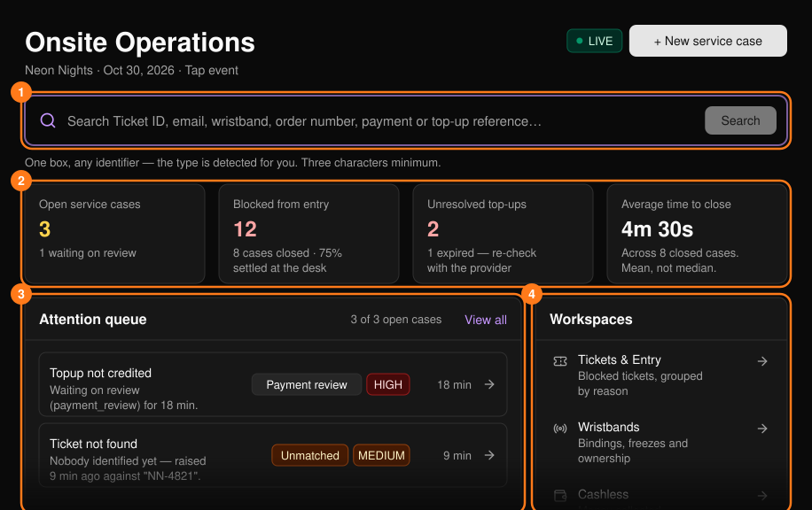
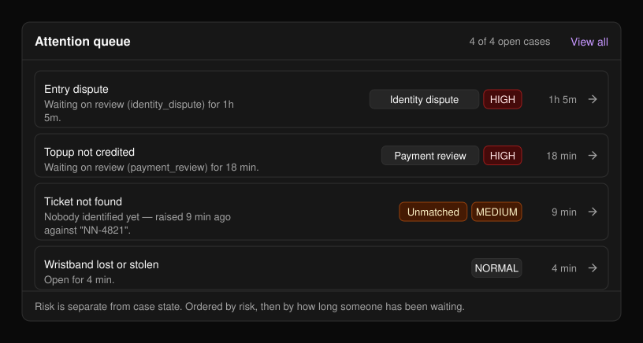
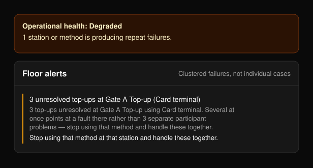

Onsite Operations（現場運営）は、イベント当日のデスク用コンソールです。イベントのサイドバーの **Onsite Operations** から開きます。Command Center（コマンドセンター）では、現場が正常に回っているかと、次に何をすべきかを確認できます。

利用できる機能はイベントの種類によって異なります。

- **チケットのみのイベント：** QR スキャンで入場します。コードが読み取れない場合は手動でチェックインします。リストバンドとキャッシュレスはありません。
- **Tap イベント：** リストバンドのタップでのみ入場します。Wristbands と Cashless のワークスペースが表示されます。[PLVR Tap](/ja/tap/introduction) をご覧ください。

<Frame>
  
</Frame>

ページは約30秒ごとに自動で更新されます。

## ゲストを探す

チケット ID、メールアドレス、リストバンド、注文番号、または支払い／チャージの参照番号（3文字以上）を入力し、**Search** を選択します。種類は自動で判別されます。結果は[検索](/ja/onsite/search)で開きます。

## 問題を記録する

問題を記録するには **+ New service case** を選択します。[ケース](/ja/onsite/cases)をご覧ください。

## サマリーカードと稼働状況

カードには、未対応のケース、入場がブロックされているチケット、未解決のチャージ（Tap イベントのみ）、平均対応完了時間が表示されます。カードを選ぶとその一覧が開きます。現場が通常どおり稼働していない場合は **Degraded** または **Incident** のバナーが表示され、問題がなければ何も表示されません。

## 対応待ちキュー

未対応のケースが、リスクの高い順、次に待ち時間の長い順に並びます。最初の8件が表示され、残りは **View all** で確認できます。行を選ぶとケースが開きます。

<Frame>
  
</Frame>

## ワークスペース

| ワークスペース | 用途 | 表示条件 |
| --- | --- | --- |
| [Tickets & Entry](/ja/onsite/tickets) | ブロックされたチケット | 常に表示 |
| [Wristbands](/ja/onsite/wristbands) | 紐づけ、凍結、所有権 | Tap イベント |
| [Cashless](/ja/onsite/cashless) | 受領・付与・利用された金額 | キャッシュレス有効時 |
| [Guests](/ja/onsite/guests) | 招待リスト、承認済みの追加分 | 常に表示 |
| [Service cases](/ja/onsite/cases) | デスクで受け付けたすべての案件 | 常に表示 |

**Desk activity** は、直近30分に記録された操作の数です。検索は記録されないため、対応した人数ではなく、実施した作業量を表します。**Floor alerts** パネルは複数の失敗が集中した場合にのみ表示され、それぞれに推奨される対応が示されます。

<Frame>
  
</Frame>

## 関連ページ

<CardGroup cols={2}>
  <Card title="検索" href="/ja/onsite/search" icon="magnifying-glass">
    あらゆる識別情報から参加者を探します。
  </Card>
  <Card title="ケース" href="/ja/onsite/cases" icon="file-lines">
    デスクでの問題を記録し、対応し、完了させます。
  </Card>
  <Card title="現場スタッフ" href="/ja/onsite/onsite-staff" icon="user-gear">
    ゲートやチャージ担当チーム用のログインコードを作成します。
  </Card>
</CardGroup>
