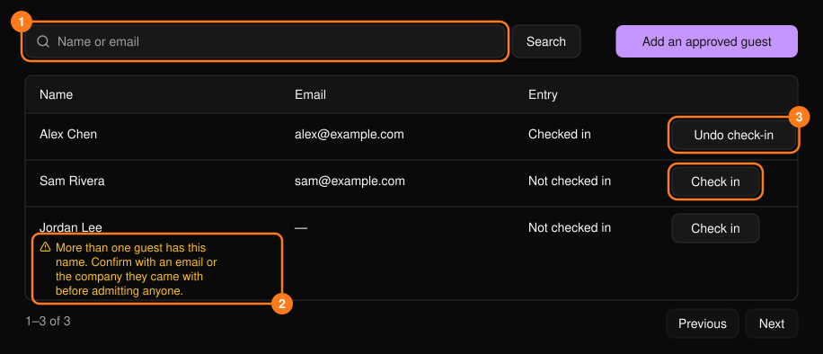
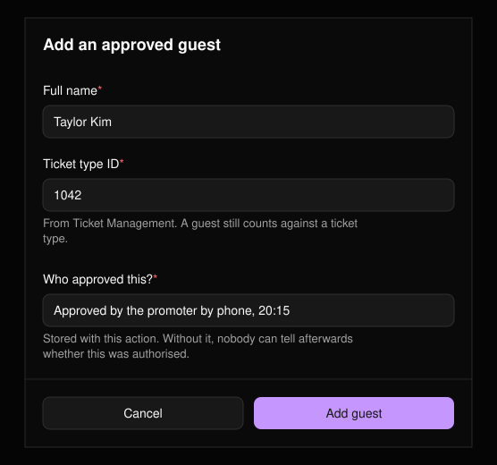

**Guests**（ゲスト）ワークスペースは招待リスト用です。[コマンドセンター](/ja/onsite/command-center)から開きます。名前やメールアドレスで検索でき、一覧は1ページに25件表示されます。

<Frame>
  
</Frame>

<Warning>
名前だけでは本人確認になりません。複数のゲストが該当する可能性がある場合は、名前の下に警告が表示されます。入場させる前に本人であることを確認してください。
</Warning>

## ゲストを入場させる

ゲストの行で **Check in** を選択します。理由は不要です。

## チェックインを取り消す

**Undo check-in** を選び、**Reason**（理由、必須）を選択し、必要に応じて **Note**（メモ）を追加して **Confirm** を選択します。ゲストリストのエントリーは再び使えるようになりますが、最初の入場記録はアクティビティログに残ります。

## 承認されたゲストを追加する

リストに載っていない人を追加するには、**Add an approved guest** を選択します。

<Frame>
  
</Frame>

3つの項目はすべて必須です。

- **Full name：** 入口で名乗るとおりの氏名。
- **Ticket type ID：** そのゲストを割り当てるチケット種別。[チケット管理](/ja/tickets/ticket-management)で確認できます。
- **Who approved this?：** 誰がいつ承認したか。例：「プロモーターが電話で承認、20:15」。これがないと、後から追加が正式に認められたものかどうか誰にも判断できません。
