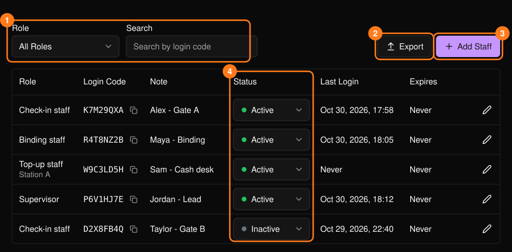
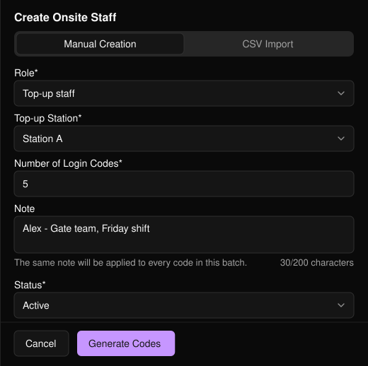
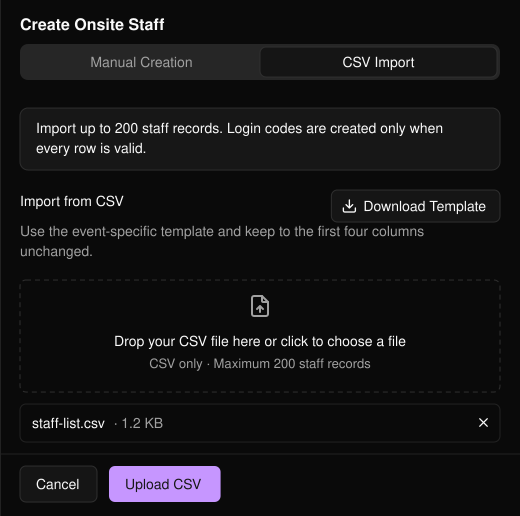

イベント当日のスタッフのアクセスを管理するには、イベントのサイドバーで **Onsite Staff**（現場スタッフ）を開きます。各スタッフはログインコードでサインインし、コードのロールによってできることが決まります。

<Note>
Business Portal の組織にメンバーを招待する場合は、[チーム](/ja/organization/team)をご覧ください。
</Note>

<Frame>
  
</Frame>

ロールで絞り込んだり、ログインコードで検索したりできます。**Export** を選ぶと、絞り込んだ内容の CSV がダウンロードされます。**Status** は一覧上で直接変更できます。

イベント前に、スタッフ一覧で **Status** と **Expires**（有効期限）を確認してください。**Last Login** で、そのコードがすでにサインインに使われたかどうかを確認できます。各ログインコードは、割り当てられたスタッフにのみ共有してください。

## スタッフを追加する

**Add Staff** を選び、2つのタブのいずれかを使います。

### 手動作成

<Steps>
  <Step title="ロールを選ぶ">
    チケットのみのイベントでは、**Check-in Ticket** を選ぶと、スタッフがチケットの QR コードをスキャンして参加者をチェックインできます。**Supervisor** を選ぶと、スタッフはそのイベントで利用できるすべてのワークスペースにアクセスでき、現場チームをサポートできます。チャージ担当のスタッフには **Top-up Station** も必要です。これは[チャージ設定](/ja/tap/top-up-setup)で設定します。
  </Step>
  <Step title="コードの数を設定する">
    1〜200個で、すべて同じロールとメモ（200文字以内）が設定されます。
  </Step>
  <Step title="ステータスを選び、Generate Codes を選択する">
    **Active**（初期設定）または **Inactive** を選びます。
  </Step>
</Steps>

<Frame>
  
</Frame>

### CSV インポート

氏名のわかっているスタッフのコードをまとめて作成する場合に使います。**Download Template**（このイベント専用。最初の4列は変更しないでください）を選び、入力してからアップロードします。CSV のみ対応で、最大200件です。

<Frame>
  
</Frame>

<Warning>
不正な行が1つでもあると、コードは1つも作成されません。表示された行を修正して、再度アップロードしてください。
</Warning>

## ログインを編集する

鉛筆アイコンを選んで **Note**、**Status**、または（チャージ担当スタッフの場合）**Top-up Station** を変更し、**Save Changes** を選択します。ロールは変更できないため、代わりに新しいコードを作成してください。

<Tip>
シフト終了時など、コードを削除せずに無効にするには **Inactive** に設定します。
</Tip>
