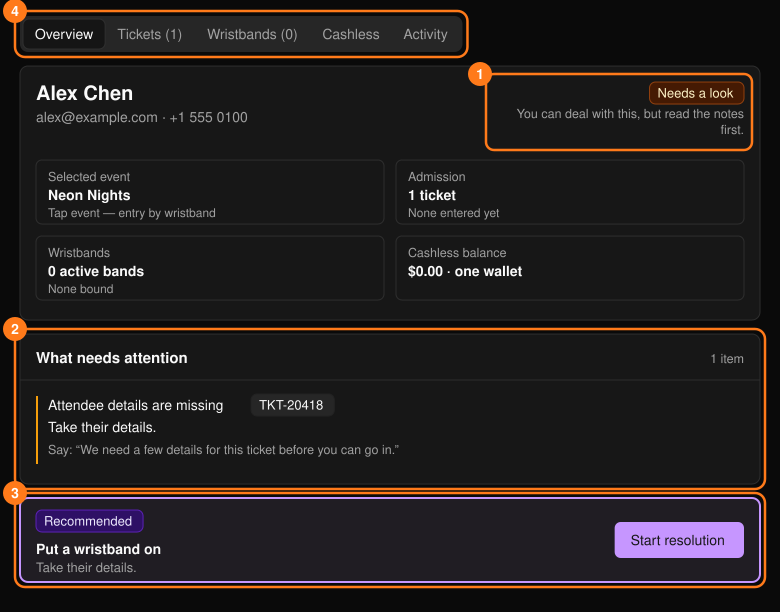
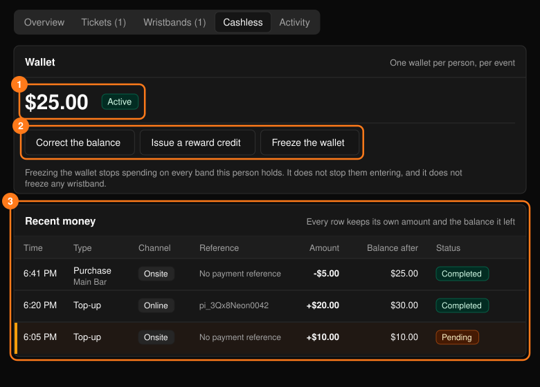
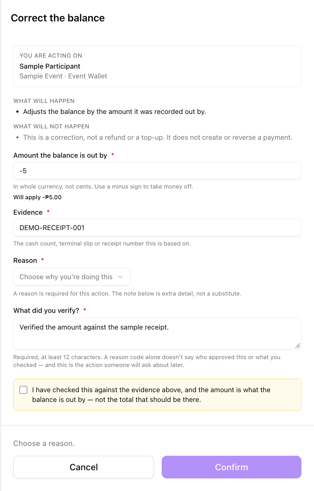
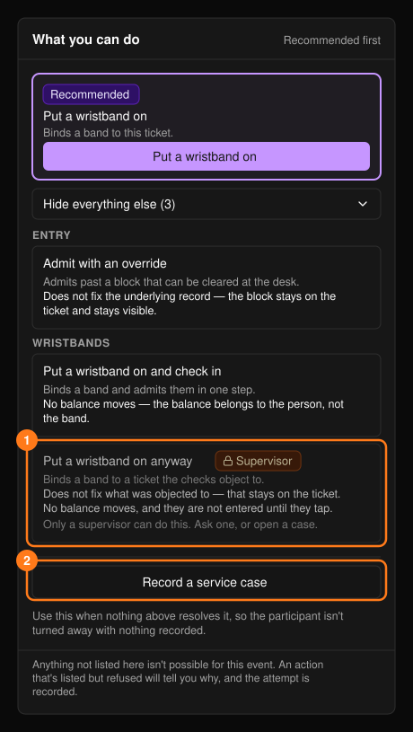

参加者のプロフィール（**Participant 360**）では、1人の本人情報、チケット、入場、キャッシュレス取引履歴を1つの画面で確認できます。[検索](/ja/onsite/search)で人物を選ぶか、チケット、リストバンド、取引、ケースのリンクから開きます。**+ Create service case** で問題を記録できます。

<Note>
複数セッションのイベントでは、1人が複数のチケットとリストバンドを持つことがありますが、ウォレットは1つを共有します。残高がリストバンドに保存されることはありません。
</Note>

## 概要

**Overview** タブには、まず判定が表示されます。**Ready**（対応してよい）、**Needs a look**（先にメモを確認）、**Blocked**（先に何かを解決する必要あり）のいずれかです。

<Frame>
  
</Frame>

- **What needs attention** には、何が問題か、次の手順、参加者に読み上げる「Say」の文言が表示されます。デスクで解決できない場合は **Record a service case** を使います。
- **Recommended action** の **Start resolution** を選ぶと、チケットのガイド付き解決画面が開きます。[Tickets & Entry](/ja/onsite/tickets) をご覧ください。
- **Bought for other people** には、この人がほかの人のために購入したチケットが一覧表示されます。この人自身はそれらのチケットを保有していないため、それを使って入場させないでください。**Open that person** を使います。

## タブ

**Tickets** タブでは、チケットごとに **Resolve** を選べます。**Wristbands** と **Cashless** は Tap イベントで表示され、交換済みのリストバンドも一覧に残ります。**Activity** は、この人に関して起きたことのタイムラインです。

### キャッシュレス

このタブには、ウォレットの残高、Active（有効）か Frozen（凍結中）か、最近の入出金が表示されます。イベント全体の台帳については[キャッシュレス](/ja/onsite/cashless)をご覧ください。

<Frame>
  
</Frame>

| 操作 | 用途 | 使わない場面 |
| --- | --- | --- |
| **Correct the balance** | 誤って記録された金額を修正します。 | 返金やチャージ。支払いの作成や取り消しは行いません。 |
| **Issue a reward credit** | 参加者に表示されるラベル付きで、お詫びやサービスとして残高を付与します。 | 修正。 |
| **Freeze the wallet** / **Unfreeze the wallet** | その人が持つすべてのリストバンドでのキャッシュレス利用を停止・再開します。 | 入場、またはリストバンドの凍結。 |

これらは[操作パネル](/ja/onsite/tickets)を使います。**Correct the balance** には、さらに次の入力が必要です。

- 残高の**ずれている額**（本来あるべき合計額ではありません）を通貨の整数単位で入力します。減額する場合はマイナスを付けます。確定前に **Will apply** に符号付きの金額が表示されます。
- 現金の集計、端末の控え、領収書番号などの **Evidence**（証拠）。
- **What did you verify?**（12文字以上）と確認用チェックボックス。

<Frame>
  
</Frame>

**Issue a reward credit** には、通貨の整数単位で正の金額とラベルが必要です。

## 実行できる操作

**What you can do** パネルには、選択したチケット、リストバンド、ウォレットに対するすべての操作が、推奨操作を先頭に表示され、残りは **Show everything else** の下にあります。[Tickets & Entry](/ja/onsite/tickets)、[リストバンド](/ja/onsite/wristbands)、および上記のウォレット操作をご覧ください。

<Frame>
  
</Frame>

- チケットが複数ある場合、操作は検索で選択したチケットに、選択していなければ最初のチケットに適用されます。確定する前に **You are acting on** を確認してください。
- **Supervisor** の操作は、スーパーバイザーでない場合は無効になっています。
- どの操作でも問題が解決しない場合は、**Record a service case** を使います。未対応のケースがある場合は **Service context** パネルも表示されます。[ケース](/ja/onsite/cases)をご覧ください。
