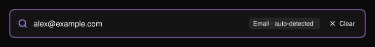
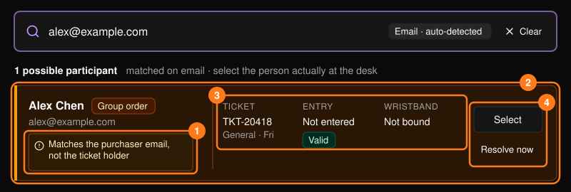
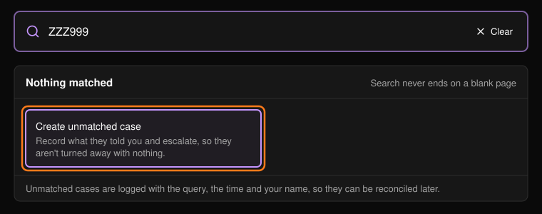

デスクでの対応の多くは検索から始まります。[コマンドセンター](/ja/onsite/command-center)の検索ボックス、または **Search results** ページを使います。3文字以上を入力して Enter キーを押してください。種類は自動で判別され、ボックス内に表示されます。

<Frame>
  
</Frame>

チケット ID、メールアドレスまたは名前（参加者または購入者）、QR コードの内容、注文番号、支払い参照番号、チャージまたは利用の参照番号、リストバンド ID または UID で検索できます。

## 結果を確認する

各カードは候補となる人物です。実際にデスクに来ている人を選んでください。

<Frame>
  
</Frame>

最も重要なのは **Why it matched**（一致した理由）です。チケット保有者での一致と購入者での一致は、入口では別の人物を意味します。購入者での一致はオレンジ色でハイライトされます。

<Warning>
チケットを購入したという理由だけで入場させないでください。カードに購入者で一致したと表示されている場合、そのチケットは別の人のものです。代わりにその人物を開いてください。
</Warning>

- **Select** を選ぶと、詳細なプロフィールが開きます。[参加者](/ja/onsite/participants)をご覧ください。
- **Resolve now** を選ぶと、プロフィールを経由せずにそのチケットのガイド付き解決画面が開きます。[Tickets & Entry](/ja/onsite/tickets) をご覧ください。

## 一致する結果がない場合

結果の下にある **Nothing matched**（または **Not the right person?**）に、次に試すべきことが表示されます。**Create unmatched case** を使うと、その人から聞いた内容を記録でき、何もせずに帰ってもらうことを避けられます。[ケース](/ja/onsite/cases)をご覧ください。

<Frame>
  
</Frame>

<Tip>
ゲストから提示された情報を整えないでください。提示されたとおりの綴りや大文字・小文字が、ケースにとって唯一の証拠になります。
</Tip>
