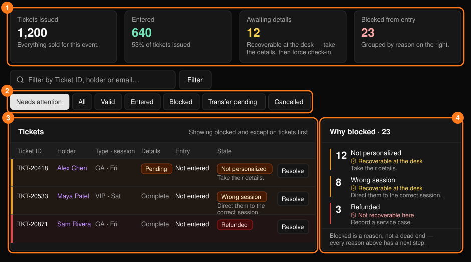
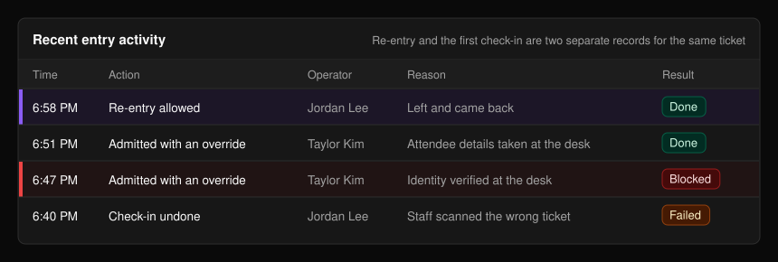
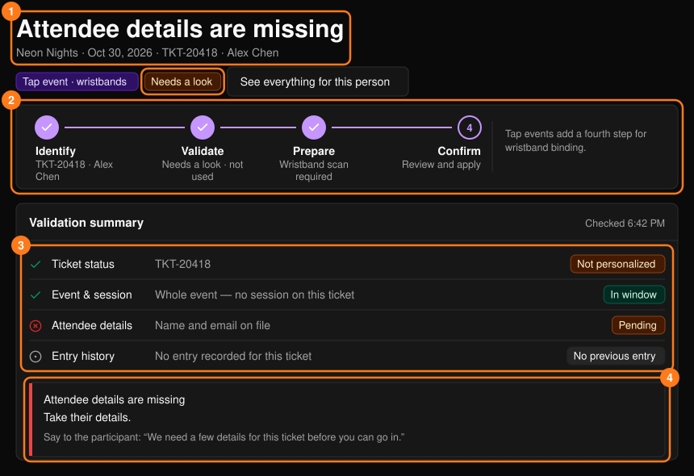
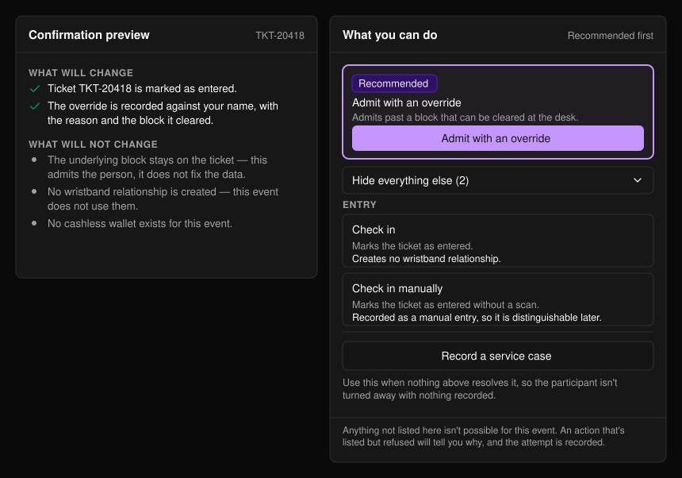
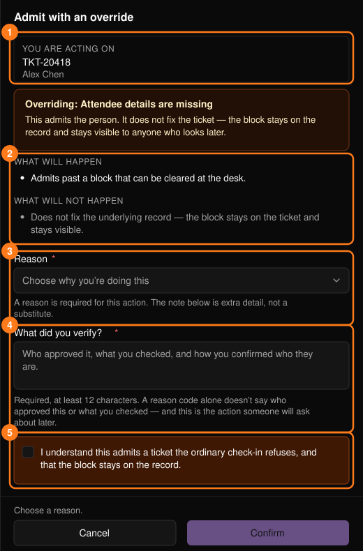

**Tickets & Entry**（チケットと入場）では、チケットが有効かどうか、入場できない理由、そしてその解決方法を確認できます。[コマンドセンター](/ja/onsite/command-center)から開くか、検索結果で **Resolve** を選択します。

<Note>
チケット種別、販売、招待チケットについては[チケット管理](/ja/tickets/ticket-management)をご覧ください。
</Note>

## チケット一覧

<Frame>
  
</Frame>

表示切替ボタン（初期設定は Needs attention）と **Filter** で、状態、チケット ID、保有者の名前やメールアドレスによって一覧を絞り込めます。**Awaiting details**（情報未入力）のチケットはデスクで対応できます。情報を聞き取ってから、オーバーライドで入場させます。

**Why blocked**（ブロック理由）パネルが作業キューです。各理由には件数と次の手順が表示され、次のいずれかに分類されます。

- **デスクで対応可能**：修正するか、オーバーライドを使います。上に表示されるので、その順に対応してください。
- **ここでは対応不可**：デスクでの操作では解決できません。[ケース](/ja/onsite/cases)を記録してください。

理由を選ぶと、該当するチケットに一覧が絞り込まれます。

下部の **Recent entry activity** には、デスクでの操作が記録されます。**Done** は成功、**Blocked** は拒否、**Failed** は完了しなかったことを表します。

<Frame>
  
</Frame>

## 1枚のチケットを解決する

チケットで **Resolve** を選択します。ページのタイトルに状況が表示され、判定は **Ready**（問題なし）、**Needs a look**（要確認）、**Blocked**（ブロック）のいずれかです。チケットが Valid（有効）でも、確認が必要な場合があります。

<Frame>
  
</Frame>

**Validation summary**（検証サマリー）では、チケットのステータス、セッション、参加者情報、入場履歴を確認します。その下のボックスには、何が問題か、次に何をすべきか、参加者に伝える文言が表示されます。**See everything for this person** を選ぶと[参加者のプロフィール](/ja/onsite/participants)が開きます。

Tap イベントでは、イベントの設定により、リストバンドの紐づけと同時にチェックインする（**Bind wristband & check in**。どちらかが失敗した場合は両方とも適用されません）か、ゲートでのタップを待って入場とする（**Bind wristband only**）かが決まります。スタッフが選ぶ必要はありません。

## 実行できる操作

最初の推奨操作がハイライトされたボックスに表示されます。**Show everything else** で残りの操作が展開されます。そのイベントに存在しない操作は表示されません。拒否された操作には理由が表示され、試行は記録されます。どれもうまくいかない場合は **Record a service case** を使います。

<Frame>
  
</Frame>

| 操作 | 備考 |
| --- | --- |
| **Check in** / **Check in manually** | チケットのみのイベント。チケットを入場済みにします。手動の場合はその旨が記録されます。 |
| **Admit with an override** | デスクで解除できるブロックを越えて入場させます。ブロックはチケット上に表示されたままです。 |
| **Allow re-entry** | 再入場を独立した記録として残します。最初のチェックインが上書きされることはありません。 |
| **Undo check-in** | チケットを未使用に戻します。その後の購入は取り消されず、入場記録もログから削除されません。 |

Tap イベントではリストバンドのタップで入場するため、対応はリストバンドを通じて行います。[リストバンド](/ja/onsite/wristbands)をご覧ください。ウォレットの操作については[参加者](/ja/onsite/participants)と[キャッシュレス](/ja/onsite/cashless)をご覧ください。取り消しの前に、**If you undo this entry** にその後に発生した事項が一覧表示されます。

## 操作パネル

どの操作も同じサイドパネルで開きます。

<Frame>
  
</Frame>

まず **You are acting on**（1）を確認してください。**Reason**（3）を選びます。メモだけでは不十分です。必須項目がすべて入力されるまで **Confirm** は無効のままです。操作が失敗した場合は何も変更されず、再試行するかケースを記録できます。

<Warning>
オーバーライドには、**What did you verify?** への12文字以上の入力（誰が承認したか、何を確認したか、本人確認をどう行ったか）とチェックボックスへのチェックが必要です。操作者の名前が記録されます。
</Warning>

## 権限

**Supervisor** と表示された操作は全員に表示されますが、使用できるのはスーパーバイザーのみです。それ以外の場合は、スーパーバイザーに依頼するか、ケースを作成してください。

<Note>
コンソールでは返金やチケットの無効化はできません。確認のために[ケース](/ja/onsite/cases)として記録してください。
</Note>
