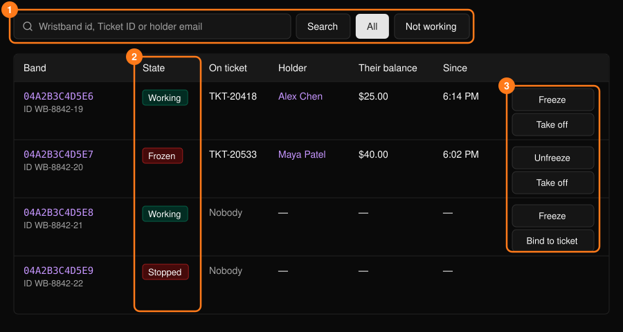
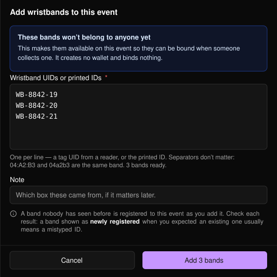
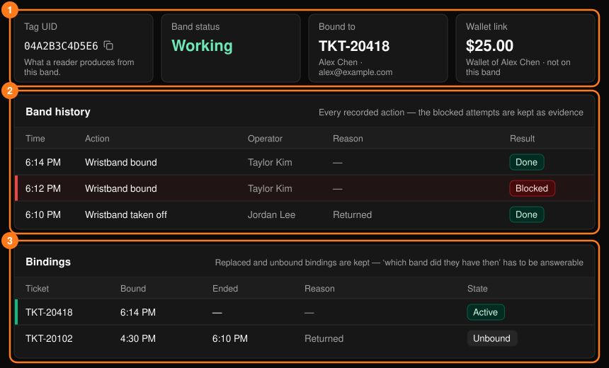
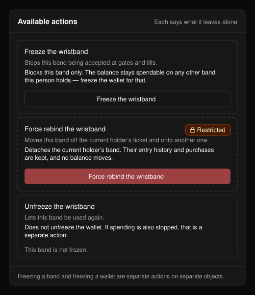
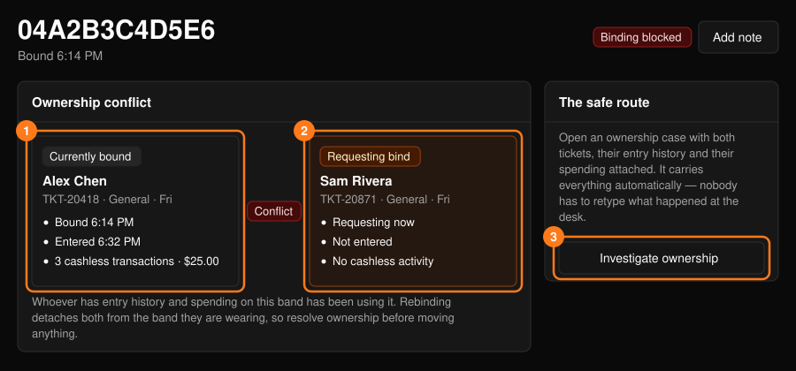

**Wristbands**（リストバンド）ワークスペースは Tap イベント専用です。[コマンドセンター](/ja/onsite/command-center)から開きます。

<Warning>
残高はリストバンドではなく人に属します。リストバンドを交換しても残高は移動せず、リストバンドを凍結しても残高は凍結されません。利用を止めるには、参加者のプロフィールからウォレットを凍結してください。[参加者](/ja/onsite/participants)をご覧ください。
</Warning>

## リストバンド一覧

リストバンド ID、チケット ID、保有者のメールアドレスで検索できます。**Not working** には停止中のリストバンドが一覧表示されます。

<Frame>
  
</Frame>

行の操作：**Freeze** / **Unfreeze**（入場と支払いでのリストバンドの利用を停止・再開）、**Take off**（紐づけを解除）、**Bind to ticket**（チケット ID を入力して紐づけ）。これらは[操作パネル](/ja/onsite/tickets)を使います。凍結しても残高とチケットは変わりません。取り外しても残高、入場履歴、購入履歴はそのままです。

**Bind to ticket** はイベントの設定に従い、**Put a wristband on and check in**（リストバンドを装着してチェックイン）または **Put a wristband on**（リストバンドを装着。ゲートでタップした時点で入場）となります。

## リストバンドを追加する

開場前に予備のリストバンドを登録するには、**+ Add wristbands** を選択します。

<Frame>
  
</Frame>

<Steps>
  <Step title="リストバンドを入力する">
    1行に1つの UID または印字された ID を入力します。タップごとに改行を送るスキャナーを使えば、自動で入力されます。書式は問わず、重複は無視されます。
  </Step>
  <Step title="メモを追加する（任意）">
    たとえば、どの箱から出したリストバンドかなどを記入します。
  </Step>
  <Step title="Add を選択する">
    一度に最大200個まで追加できます。
  </Step>
</Steps>

この操作ではウォレットは作成されず、紐づけも行われません。結果には、各リストバンドが新規登録、登録済み、または理由付きで拒否のいずれかとして表示されます。各行を確認してください。既存のはずのリストバンドが新規登録と表示された場合は、通常 ID の入力ミスです。

<Frame>
  
</Frame>

## リストバンドのページ

リストバンドを選ぶと、サマリー、**Band history**（リストバンド履歴）、**Bindings**（紐づけ）が表示されます。拒否された試行や置き換えられた紐づけは意図的に残されるため、「何が起きたか」「その時点でどのリストバンドを持っていたか」をいつでも確認できます。**Add note** を選ぶと[ケースのフォーム](/ja/onsite/cases)が開きます。

<Frame>
  
</Frame>

### 利用可能な操作

各操作には、何を行い、何には影響しないかが表示されます。使えない操作には、その理由が表示されます。

<Frame>
  
</Frame>

| 操作 | 備考 |
| --- | --- |
| **Put a wristband on** | リストバンドをチケットに紐づけます。残高は移動しません。 |
| **Replace the wristband** | 古いリストバンドを無効にし、新しいリストバンド（ID を入力）を同じチケットに紐づけます。 |
| **Take the wristband off** | 紐づけを解除します。チェックアウトや残高には影響しません。 |
| **Report the wristband lost or stolen** | リストバンドを停止し、紐づけを解除します。代わりのリストバンドは発行されず、ウォレットも凍結されません。 |
| **Freeze** / **Unfreeze the wristband** | このリストバンドのみを停止・再開します。残高は、本人が持つほかのリストバンドで引き続き利用できます。 |
| **Put a wristband on anyway**（制限付き） | チェックに失敗しても紐づけます。指摘された問題は解決されません。 |
| **Force rebind the wristband**（制限付き） | リストバンドを現在の保有者のチケットから別のチケットに移します。現在の保有者の入場履歴と購入履歴は残ります。 |

ほとんどの操作では理由の入力が求められます。**Restricted**（制限付き）の操作はスーパーバイザー専用で、操作者の名前が記録され、**What did you verify?** への12文字以上の入力と確認用チェックボックスへのチェックが必要です。

### 所有権の競合

すでに別の人に紐づいているリストバンドをチケットに紐づけようとした場合、ページに **Binding blocked** と表示され、**Currently bound**（現在の紐づけ先）と **Requesting bind**（紐づけの要求元）を比較する **Ownership conflict** パネルが表示されます。そのリストバンドで入場や利用の記録がある人が、実際に使っていた人です。

<Frame>
  
</Frame>

紐づけし直すと、両者とも身に着けているリストバンドとの紐づけが外れるため、先に所有者を確定させてください。**Investigate ownership** を選ぶと、ケースを記録してエスカレーションできます。その後、スーパーバイザーが **Force rebind the wristband** を使えます。
