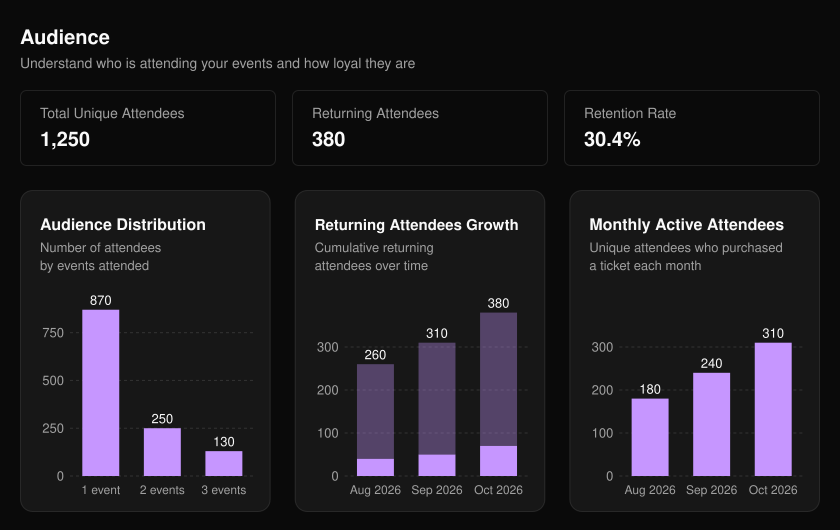
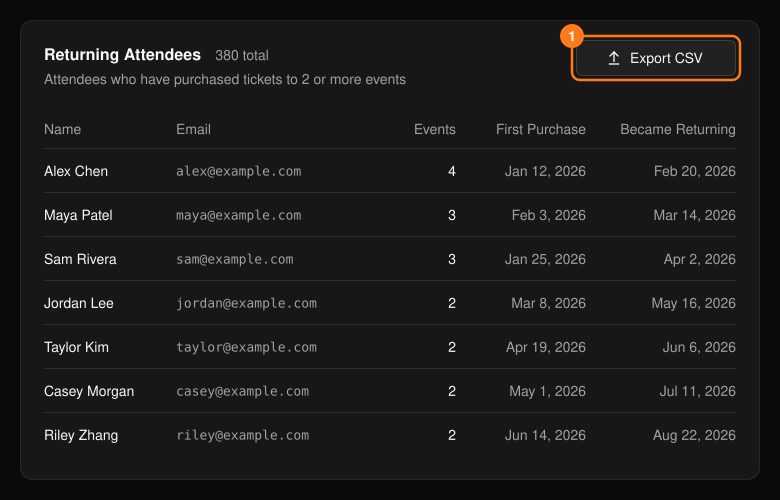

ヘッダーの **Audience**（オーディエンス）では、単一のイベントではなく、組織全体での参加者のロイヤルティを確認できます。Retention Rate（継続率）は、ユニーク参加者の総数に対するリピーターの割合です。

<Frame>
  
</Frame>

- **Audience Distribution**（オーディエンス分布）：参加したイベント数ごとに参加者をグループ化します。
- **Returning Attendees Growth**（リピーターの推移）：リピーターの累計数の推移を表示します。
- **Monthly Active Attendees**（月間アクティブ参加者）：各月にチケットを購入したユニーク参加者の数を集計します。

## リピーター

**Returning Attendees**（リピーター）の表には、主催イベントのうち2つ以上でチケットを購入したすべての人が表示されます。**Export CSV** を選択するとダウンロードできます。

<Frame>
  
</Frame>

<Note>
  エクスポートには名前とメールアドレスが含まれます。必要なチームメンバーとのみ共有してください。
</Note>
