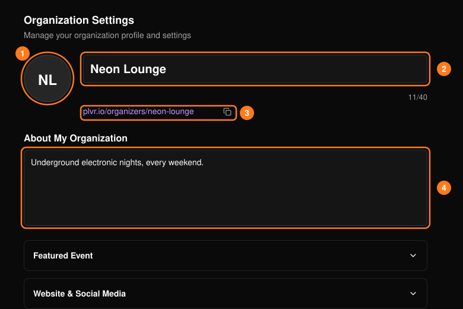
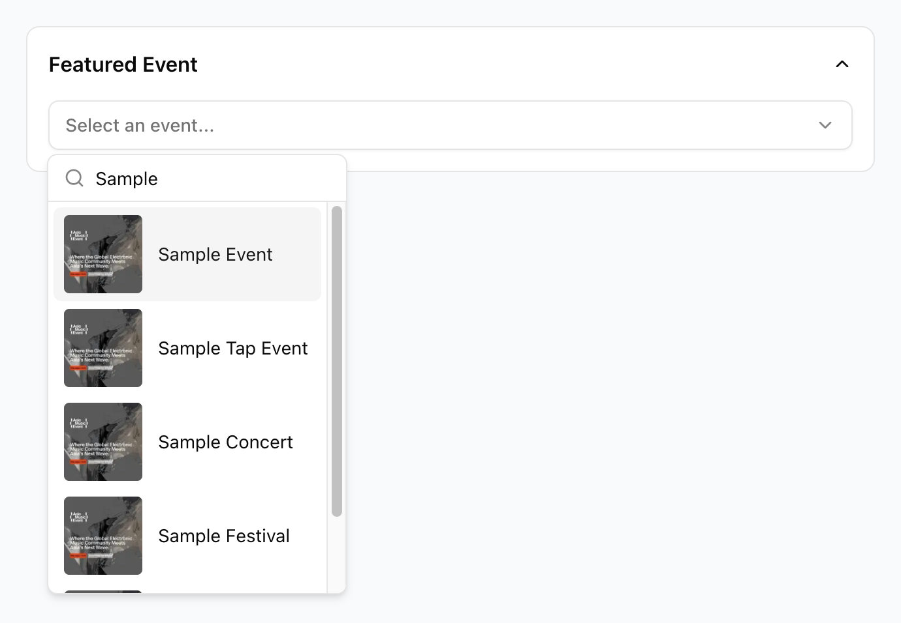
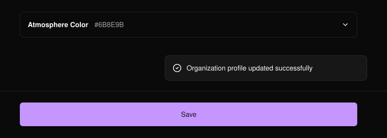

ヘッダーの **Organization**（組織）では、公開される主催者ページでの組織の見え方を管理します。

<Note>
  このページを開けるのは、オーナー、管理者、マネージャーのみです。
</Note>

<Frame>
  
</Frame>

- **Logo（1）：** PNG、WebP、JPG、JPEG 形式で最大 4 MB。
- **Name（2）：** 必須。最大40文字。
- **Page URL（3）：** 組織の作成時に設定され、ここでは変更できません。
- **About（4）：** 公開ページに表示されます。

## 任意のセクション

セクションを展開すると、公開される主催者ページに詳細情報を追加できます。

- **Featured Event**（注目イベント）：ドロップダウンからイベントを選んでハイライトし、保存します。
  <Frame>
    
  </Frame>
- **Website & Social Media**（ウェブサイトと SNS）：ウェブサイト、Instagram、X / Twitter、Facebook、TikTok、YouTube の公開リンクを追加します。ウェブサイトは `http://` または `https://` で始まる必要があります。
- **Community Groups**（コミュニティグループ）：WhatsApp または Telegram の招待リンクを1つ追加します。一方を保存すると、もう一方は消去されます。
- **Music**（音楽）：SoundCloud または Spotify のアーティストやプレイリストのリンクを追加します。
- **Venue Information**（会場情報）：組織が実店舗の会場を運営している場合は、チェックボックスを選択します。
- **Public Metrics**（公開指標）：**Display Number of Attendees**（参加者数を表示）で、参加者数の表示・非表示を切り替えます。
- **Atmosphere Color**（テーマカラー）：組織のカラーを選びます。カスタムカラーの場合は **Apply Color**（カラーを適用）を選択してから保存します。

## 保存

ページ下部の **Save**（保存）を選択します。保存していない変更がある状態でページを離れようとすると、確認を求められます。

<Frame>
  
</Frame>
