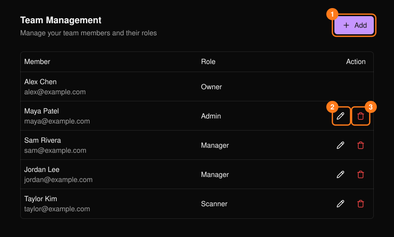
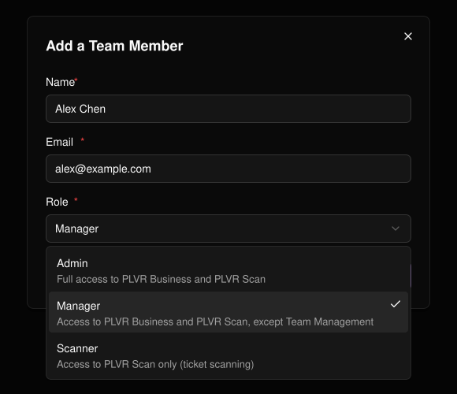

ヘッダーの **Team**（チーム）では、組織で作業できるメンバーを管理します。

<Note>
  このページを開けるのは、オーナーと管理者のみです。
</Note>

| ロール | アクセス権限 |
| --- | --- |
| **Admin** | PLVR Business と PLVR Scan のすべて。 |
| **Manager** | Team Management を除く PLVR Business と PLVR Scan。 |
| **Scanner** | PLVR Scan のみ（チケットのスキャン）。 |

**オーナー**（組織を作成した人）は一覧に表示されますが、編集や削除はできません。

<Frame>
  
</Frame>

## メンバーを追加する

<Steps>
  <Step title="Add（1）を選択する">
    名前、メールアドレス、ロールを入力します。すべて必須です。
  </Step>
  <Step title="Save を選択する">
    メンバーが一覧に表示されます。
  </Step>
</Steps>

<Frame>
  
</Frame>

## ロールを変更する、またはメンバーを削除する

ロールを変更するには鉛筆アイコン（2）を使います。名前とメールアドレスは変更できません。削除するにはゴミ箱アイコン（3）を使い、確認します。

<Warning>
  ご自身に Team にアクセスできないロールを設定すると、その場でこのページにアクセスできなくなる場合があります。
</Warning>
