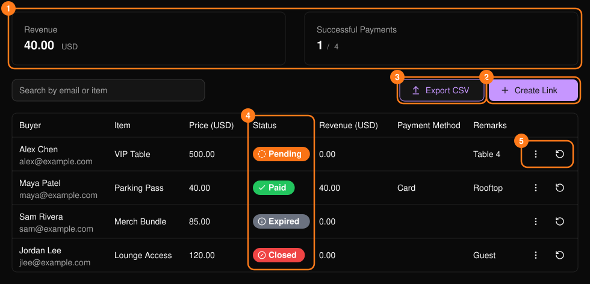
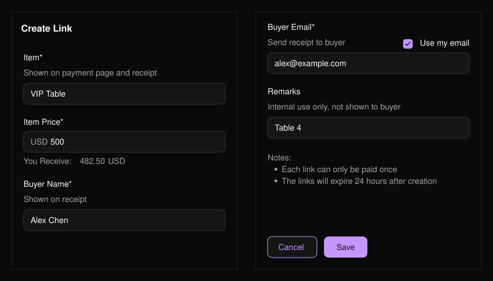
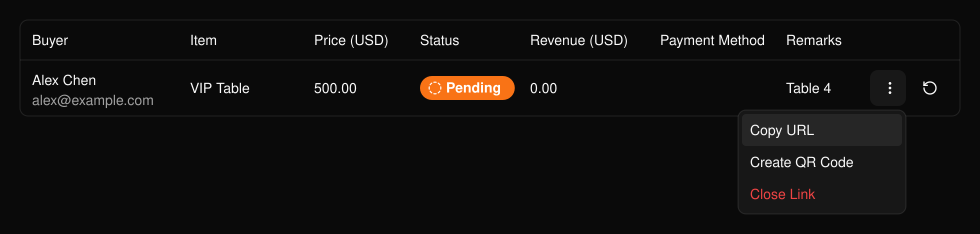
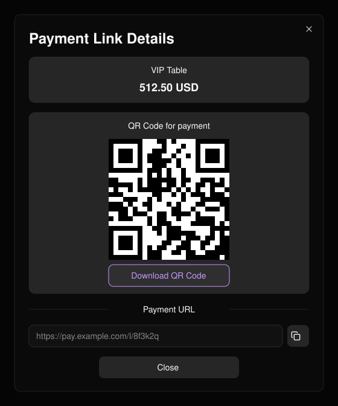

**Payment Links**（支払いリンク）を使うと、チケットを作成せずに、VIP テーブルなど特定のアイテムに対して特定の金額を請求できます。リンクを作成して購入者に送り、支払い状況を確認します。

<Frame>
  
</Frame>

<Warning>
  各リンクは1回のみ支払い可能で、作成から24時間後に期限切れになります。
</Warning>

## リンクを作成する

<Steps>
  <Step title="Create Link（2）を選択する">
    **Item**（アイテム）と **Item Price**（0より大きい金額）を入力します。**You Receive** には手数料差し引き後の受取額が表示されます。
  </Step>
  <Step title="購入者の情報を入力する">
    購入者の名前とメールアドレスは必須で、領収書はそのメールアドレスに送られます。**Remarks** は社内用です。
  </Step>
  <Step title="Save を選択する">
    その後、リンクを共有します。
  </Step>
</Steps>

<Frame>
  
</Frame>

## リンクを管理する

行メニュー（5）から、**Copy URL**、**Create QR Code**、**Close Link**（未払いのリンク）、**Download Receipt**（支払い済みのリンク）を選べます。閉じたリンクは再度開けません。リンクが支払われたかどうかは、更新ボタンで確認できます。

<Frame>
  
</Frame>

<Frame>
  
</Frame>
