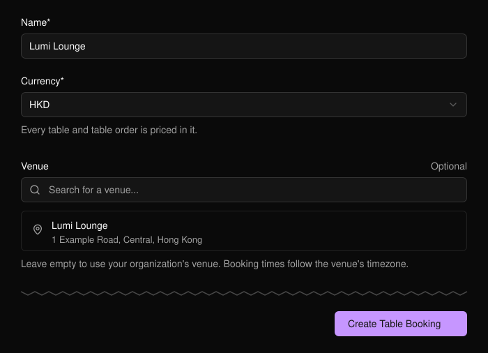
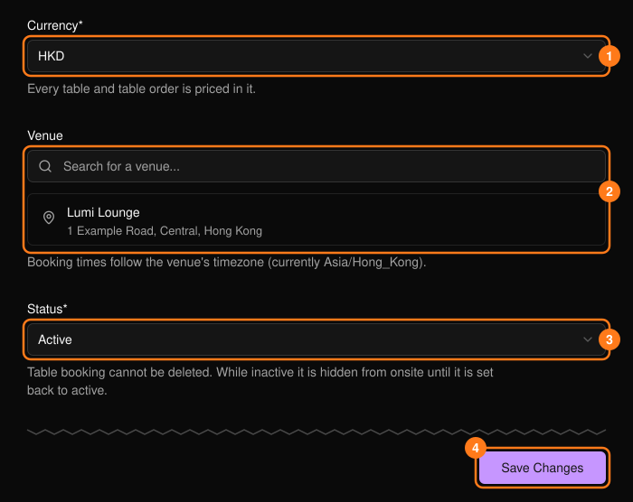
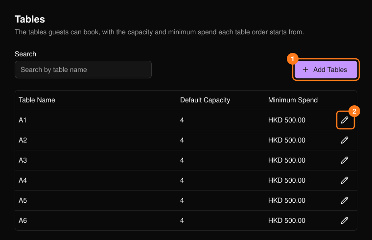
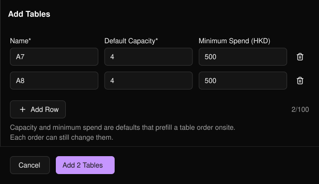

テーブル予約を使うと、ゲストがテーブルを予約できます。イベントごとではなく組織ごとに一度設定するもので、**Settings**（設定）と **Tables**（テーブル）の2つで構成されます。

<Note>
  **Table Booking** は、オーナー、管理者、マネージャーにのみ上部ナビゲーションに表示されます。
</Note>

## 設定する

<Steps>
  <Step title="Table Booking を開く">
    設定フォームに入力します。**Name**（名前）と **Currency**（通貨）は必須です。
  </Step>
  <Step title="Create Table Booking を選択する">
    そのまま **Tables** に移動します。
  </Step>
  <Step title="テーブルを追加する">
    テーブルを作成するまで、予約はできません。
  </Step>
</Steps>

<Frame>
  
</Frame>

## 設定

設定には、ロゴ、名前、通貨、会場、座席表、ドリンクメニュー、ルールが含まれます。

<Frame>
  
</Frame>

- **Venue**（会場）を空欄にすると、組織の会場が使われます。予約時刻はその会場のタイムゾーンに従います。
- **Status**（3）を Inactive にすると、会場でのテーブル予約が非表示になります。削除はできません。

<Warning>
  通貨（1）を変更しても、既存の金額は換算されません。500で設定したテーブルは500のままです。
</Warning>

## テーブル

各テーブルには、会場でのテーブル注文に事前入力される既定の定員と最低利用金額があり、注文ごとに変更できます。テーブルは削除できません。

<Frame>
  
</Frame>

**Add Tables**（1）で複数のテーブルをまとめて追加できます。最初の行を入力してから **Add Row** を使うと、名前は連番（A1、A2）になり、定員と利用金額は引き継がれます。一度に最大100行まで追加できます。

<Frame>
  
</Frame>

- 名前は一意である必要があり（大文字・小文字とスペースは区別しません）、64文字以内です。
- 定員は1〜100です。最低利用金額にマイナスは設定できません。
- テーブルを編集するには鉛筆アイコン（2）を使います。既存の注文はそれぞれの値を保持します。
