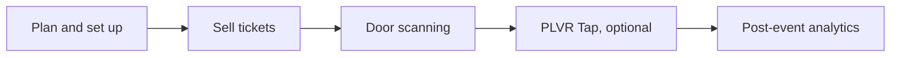

どのイベントも3つのフェーズを経て進みます。次に何をすべきかは、以下のページでご確認ください。

<Steps>
  <Step title="開催前">
    イベントを企画し、チケットとフォームを設定し、宣伝を行い、チームを準備します。任意：キャッシュレスイベントの場合は PLVR Tap を設定します。
  </Step>
  <Step title="開催中">
    ゲストをスキャンして入場させ、当日券を販売し、受付デスクを運営し、キャッシュレスの問題やケースに対応します。
  </Step>
  <Step title="開催後">
    レポートを確認し、支出やプロモーションの結果をチェックし、オーディエンスへのフォローアップを行います。
  </Step>
</Steps>

<CardGroup cols={3}>
  <Card title="開催前" icon="calendar-check" href="/ja/phases/before">
    企画と販売。
  </Card>
  <Card title="開催中" icon="ticket" href="/ja/phases/during">
    スキャン、当日販売、会場運営。
  </Card>
  <Card title="開催後" icon="chart-line" href="/ja/phases/after">
    レポートとフォローアップ。
  </Card>
</CardGroup>

## プレイブック

- [公開前チェックリスト](/ja/guides/launch-checklist)
- [イベントを宣伝する](/ja/guides/promote-your-event)
- [キャッシュレスフェスティバルの設定](/ja/guides/cashless-festival-setup)
- [イベント当日の運営手順書](/ja/guides/event-day-runbook)
- [イベント終了後](/ja/guides/after-the-event)

## イベントのタイプから探しますか？

[小規模イベント](/ja/organizers/small-events)、[中規模イベント](/ja/organizers/mid-size-events)、[フェスティバル](/ja/organizers/festivals)、[定期開催のコミュニティイベント](/ja/organizers/recurring-community)をご覧ください。担当業務ごとに確認したい場合は、[チーム別ガイド](/ja/roles)をご覧ください。
