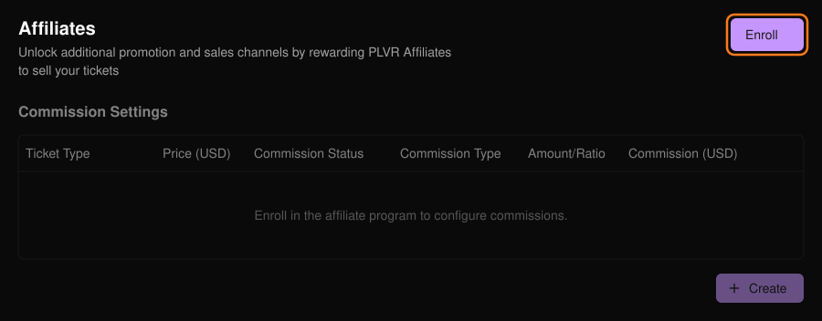
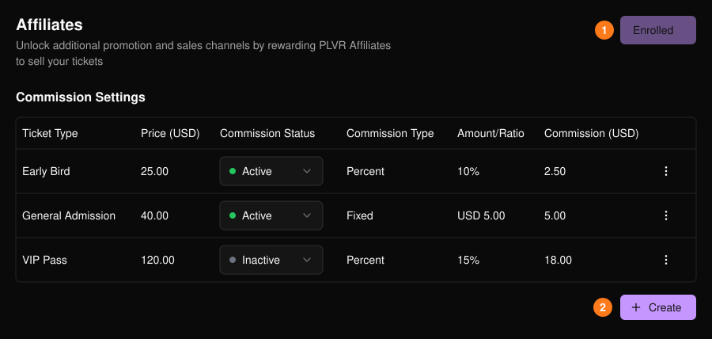
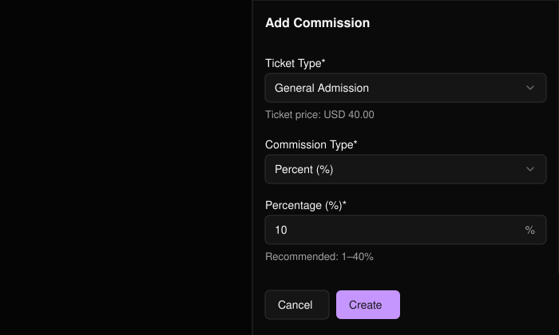

チケットを販売してくれた PLVR アフィリエイトに報酬を支払えます。イベントを一度登録し、チケット種別ごとに報酬を設定します。

<Warning>
  登録は取り消せません。登録するまで、報酬設定はグレーアウトされたままです。
</Warning>

<Frame>
  
</Frame>

## 報酬を追加する

<Steps>
  <Step title="登録する">**Enroll**（1）を選択します。</Step>
  <Step title="作成する">Commission Settings テーブルの下にある **Create**（2）を選択します。</Step>
  <Step title="チケットを選ぶ">すでに報酬が設定されているチケットは選択肢に表示されません。</Step>
  <Step title="報酬を設定する">**Percent (%)** または **Fixed Amount** を選び、金額を入力して **Create** を選択します。割合は100以下の整数で指定します（1〜40% を推奨）。</Step>
</Steps>

<Frame>
  
</Frame>

<Frame>
  
</Frame>

## 編集または一時停止する

行の末尾にあるメニューから **Edit** を選ぶと、タイプや金額を変更できます。報酬を一時停止するには、**Commission Status** を **Inactive** に設定します。

<Tip>
  独自のリンクでパートナーを計測するには、アフィリエイト ID 付きの[トラッキングリンク](/ja/promotions/tracking-links)を作成します。アフィリエイトコードは[チケットレポート](/ja/tickets/ticket-report)にも表示されます。
</Tip>
