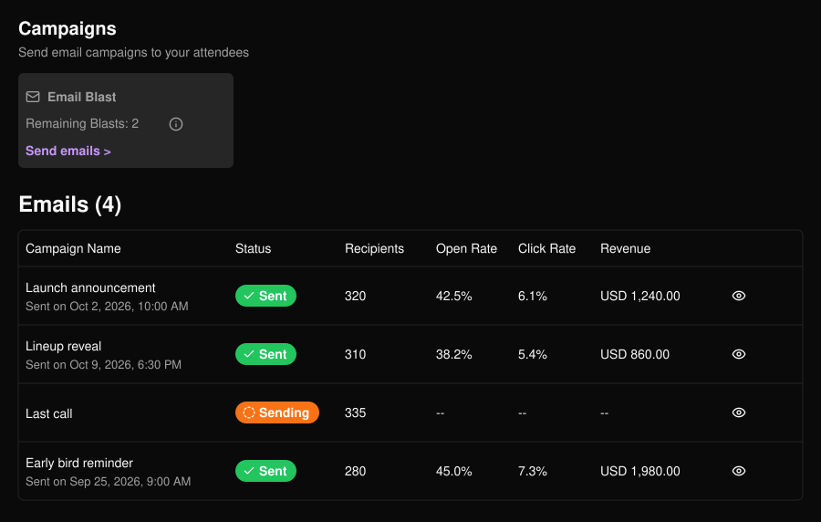
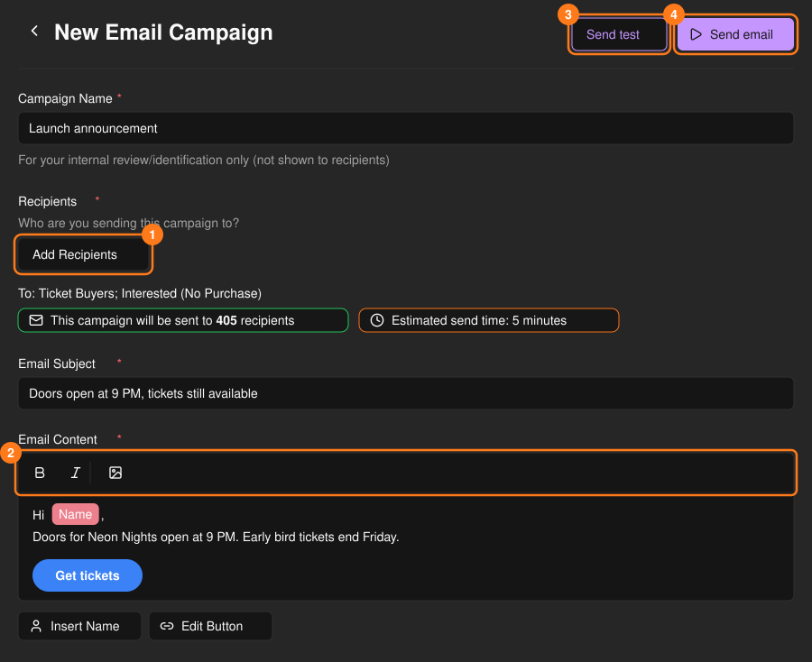
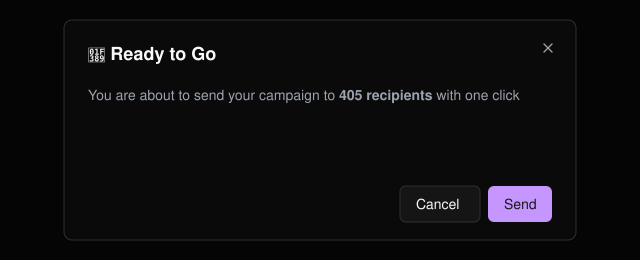
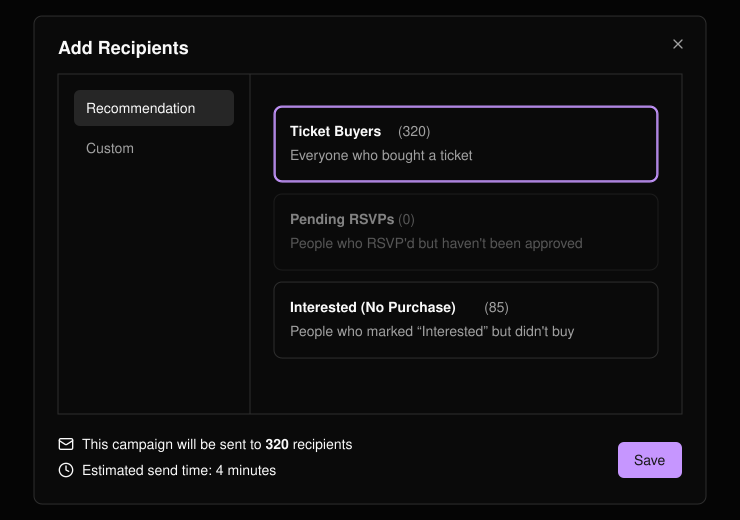
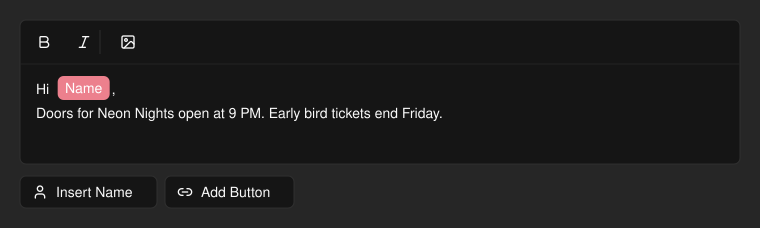
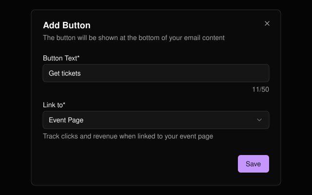

イベントに関する一斉メールを送信し、開封数、クリック数、売上を同じページで確認できます。キャンペーンは確定するとすぐに送信されます。下書き機能はなく、送信済みのキャンペーンは編集できません。

<Note>
  各イベントには、一斉メールの週ごとの送信上限があります。**Remaining Blasts** に残り回数が表示され、0になると送信できなくなります。
</Note>

<Frame>
  
</Frame>

## キャンペーンを作成して送信する

**Send emails >** を選択します。

<Steps>
  <Step title="名前を付ける">キャンペーン名は主催者用です。受信者には表示されません。</Step>
  <Step title="受信者を追加する">送信先を選びます（下記参照）。</Step>
  <Step title="メールを書く">件名と本文を入力します。</Step>
  <Step title="テスト送信する">**Send test** を選ぶと、プレビューが自分宛てに送信されます。</Step>
  <Step title="送信する">**Send email** を選び、受信者数を確認してから確定します。</Step>
</Steps>

<Frame>
  
</Frame>

<Frame>
  
</Frame>

<Warning>
  件名や本文に制限された語句が含まれている場合は、テスト送信も含めてブロックされます。メッセージに変更が必要な語句が表示されます。
</Warning>

## 受信者を選ぶ

保存時に開いているタブの設定のみが使われます。

<Tabs>
  <Tab title="Recommendation">
    **Ticket Buyers**（チケット購入者）、**Pending RSVPs**（保留中の RSVP）、**Interested (No Purchase)**（興味あり・未購入）から1つ以上のグループを選びます。該当者がいないグループは選択できません。
  </Tab>
  <Tab title="Custom">
    CSV をアップロードする（**Download Template** を使用。**Email** 列が必要です）か、アドレスを1件ずつ入力します。無効なアドレスや重複したアドレスはスキップされます。
  </Tab>
</Tabs>

<Frame>
  
</Frame>

選択するとすぐに、受信者数と送信時間の目安が表示されます。

## メールエディター

テキストの書式設定や画像の挿入ができ、**Insert Name** を使うと受信者一人ひとりに名前で呼びかけられます。**Add Button** を使うと、メールの末尾に行動を促すボタンを追加できます。

<Frame>
  
</Frame>

<Frame>
  
</Frame>

<Tip>
  ボタンの **Link to** を **Event Page** に設定すると、クリック数と売上がキャンペーン一覧で計測されます。**Custom URL** は計測できません。
</Tip>
