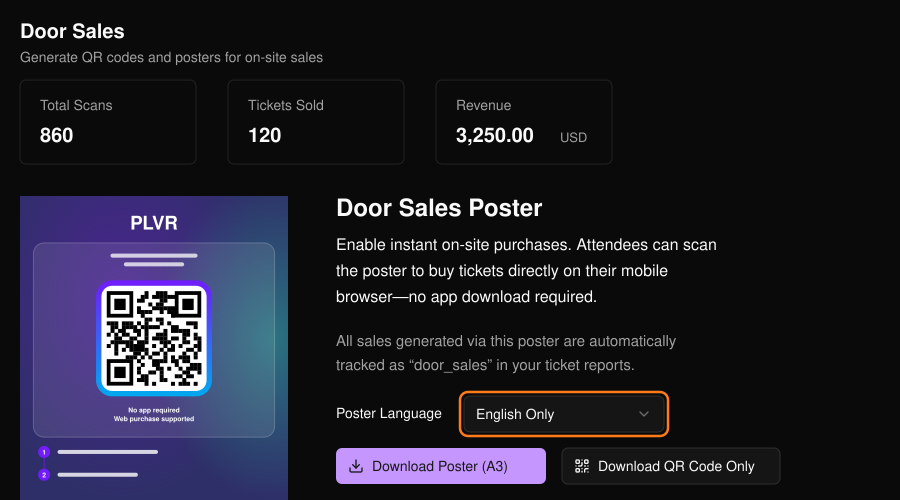
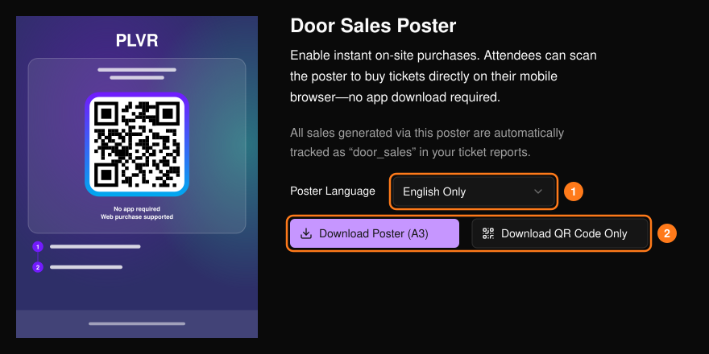

来場者は QR コードをスキャンしてイベントページを開き、スマートフォンでチケットを購入します。これらの購入は当日販売としてカウントされ、スキャン数、販売チケット数、売上が上部に表示されます。ポスターの QR コード経由の購入は、[チケットレポート](/ja/tickets/ticket-report)で `door_sales` として記録されます。

<Frame>
  
</Frame>

## ポスターまたは QR コードを入手する

<Steps>
  <Step title="言語を選ぶ">ポスターの言語を選択します（1）。プレビューが更新されます。</Step>
  <Step title="ダウンロードする">印刷用ポスターには **Download Poster (A3)** を、QR コードのみの場合は **Download QR Code Only** を選択します（2）。</Step>
</Steps>

<Frame>
  
</Frame>

<Tip>
  印刷する前に、スマートフォンでポスターをスキャンしてください。イベントページが開くこと、販売したいチケットが購入可能なこと、チェックアウトが正常に動作することを確認しましょう。

  ポスターは入口やチケット売り場に掲示します。QR コード単体は、テーブルカード、スクリーン、スタッフ証などに使えます。スタッフには、来場者をポスターに案内し、チェックアウトを手伝い、イベントの入場手順に沿って電子チケットを確認してもらいましょう。その他のチャネルについては[トラッキングリンク](/ja/promotions/tracking-links)をご覧ください。
</Tip>
