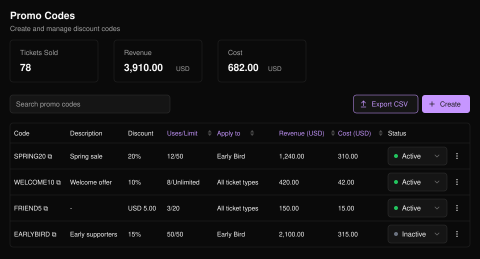
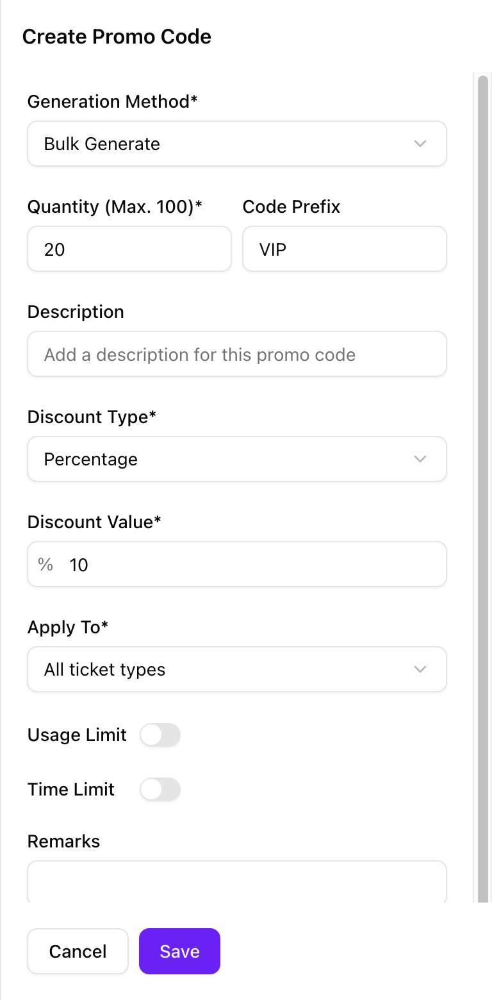
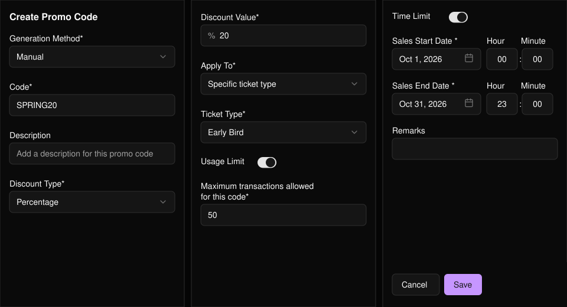
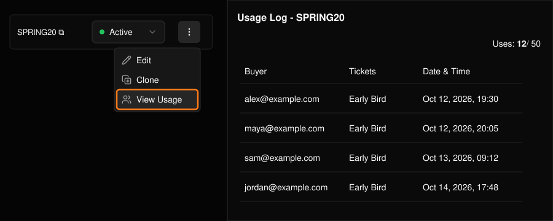

割合または定額の割引を提供できます。コードは1つずつ作成することも、まとめて生成することもできます。

<Frame>
  
</Frame>

一覧には、各コードの上限に対する利用数と、売上・割引額が表示されます。コードの **Status** はテーブル上で直接変更でき、**Export CSV** を選ぶと一覧をダウンロードできます。

## プロモコードを作成する

**Create** を選択します。

<Steps>
  <Step title="作成方法を選ぶ">
    自分で入力した1つのコードを作るなら **Manual**、任意のプレフィックス付きで最大100個のコードを作るなら **Bulk Generate** を選びます。

    <Frame>
      
    </Frame>
  </Step>
  <Step title="割引を設定する">
    **Percentage**（割合）または **Fixed Amount**（定額）を選び、値を入力します。
  </Step>
  <Step title="適用対象を選ぶ">
    すべてのチケット種別、または特定のセッションとチケットを選びます。
  </Step>
  <Step title="上限を追加する（任意）">
    **Usage Limit**（最大注文数）や **Time Limit**（開始・終了日時）をオンにします。設定しない場合、コードは使い切られることも期限切れになることもありません。
  </Step>
  <Step title="保存する">
    **Description** は一覧に表示され、**Remarks** は主催者自身のメモ用です。
  </Step>
</Steps>

<Frame>
  
</Frame>

## 編集・複製・利用状況の確認

行の末尾にあるメニューを使います。

- **Edit**：設定を変更したり、コードのオン・オフを切り替えたりします。コードの文字列は変更できません。
- **Clone**：同じ設定で新しいコードを作成します。
- **View Usage**：そのコードが使われた各注文を確認します。

<Frame>
  
</Frame>

<Tip>
  個々の注文で使われたプロモコードを確認するには、[チケットレポート](/ja/tickets/ticket-report)で **Promo Code** 列を追加します。
</Tip>
