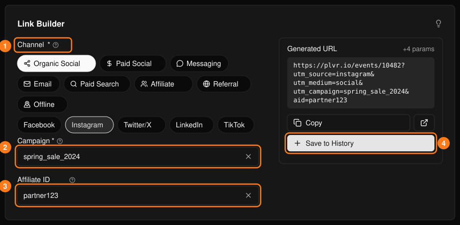
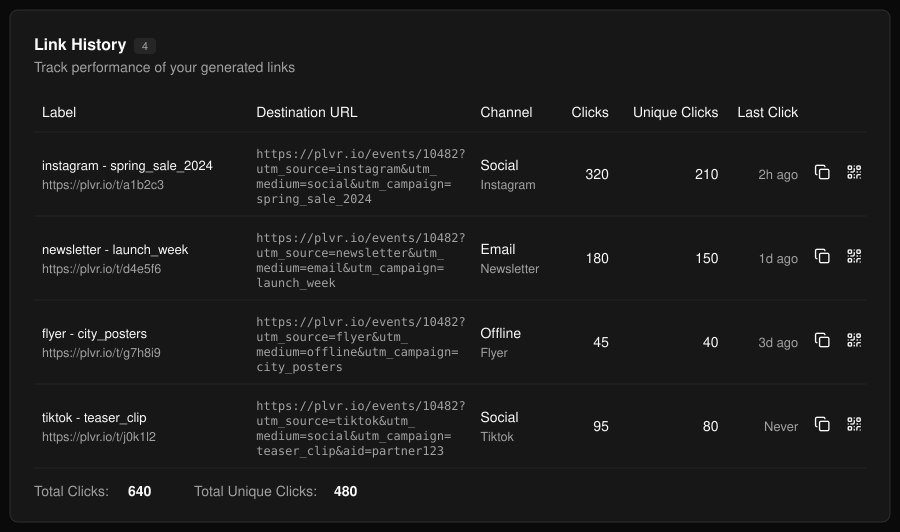
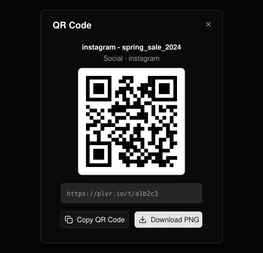

Instagram、ニュースレター、チラシなどのチャネルでイベントページを共有し、どのチャネルから訪問者が来ているかを確認できます。

## リンクを作成する

<Steps>
  <Step title="チャネルを選ぶ">カテゴリを選び、続いてサブチャネルを選びます（1）。</Step>
  <Step title="キャンペーン名を付ける">必須です。チャネル間で一貫した名前を使い、スペースの代わりにアンダースコアを使ってください（2）。</Step>
  <Step title="アフィリエイト ID を追加する（任意）">特定のパートナーからの紹介を計測します（3）。</Step>
  <Step title="保存する">**Copy** を選ぶとリンクを使えます。**Save to History**（4）を選ぶとリンクが保存され、クリック数の計測が始まります。</Step>
</Steps>

<Frame>
  
</Frame>

<Note>
  短縮 URL とクリック数が付くのは、保存したリンクのみです。共有する予定のリンクはすべて保存してください。
</Note>

## リンク履歴

保存したリンクは、総クリック数とユニーククリック数とともにここに表示されます。行のボタンで短縮 URL をコピーしたり、**QR Code** を開いたりできます。QR コードはコピーするか PNG でダウンロードできます。

<Frame>
  
</Frame>

<Frame>
  
</Frame>

会場での販売については[当日販売](/ja/promotions/door-sales)をご覧ください。
