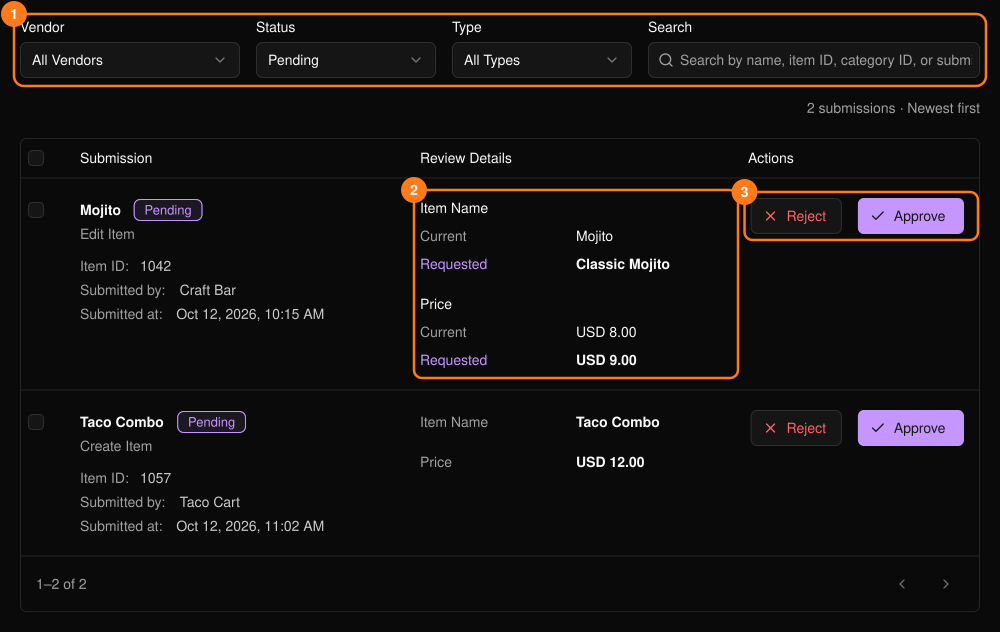
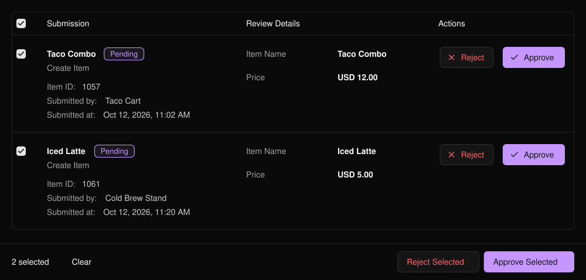

出店者が商品やカテゴリを追加・変更すると、申請はここで待機し、承認されるまでメニューには反映されません。イベントのサイドバーの **PLVR Tap** の下にあります。

<Frame>
  
</Frame>

初期設定では **Pending**（保留中）の申請が表示されます。フィルター（1）を使うと、ステータス、種類、出店者でほかの申請を探せます。変更の申請では、**Current**（現在）と **Requested**（申請内容）を比較します（2）。

## 申請を確認する

<Steps>
  <Step title="詳細を確認する">画像をクリックすると拡大表示されます。</Step>
  <Step title="承認または却下する（3）">**Approve** を選ぶと申請内容が反映されます。**Reject** には理由の入力が必要で、その理由は出店者に表示されます。</Step>
</Steps>

## 一括で確認する

行またはヘッダーのチェックボックスにチェックを入れると、**Approve Selected** と **Reject Selected** が表示されます。最大50件まで選択でき、一括却下ではすべてに同じ理由が使われます。その間に変更された申請はスキップされます。

<Frame>
  
</Frame>

<Tip>
無効な出店者からの申請も確認できます。承認する前に **Inactive** タグを確認してください。
</Tip>

## 関連ページ

- [出店者](/ja/tap/vendors)
- [PLVR Tap の概要](/ja/tap/introduction)
