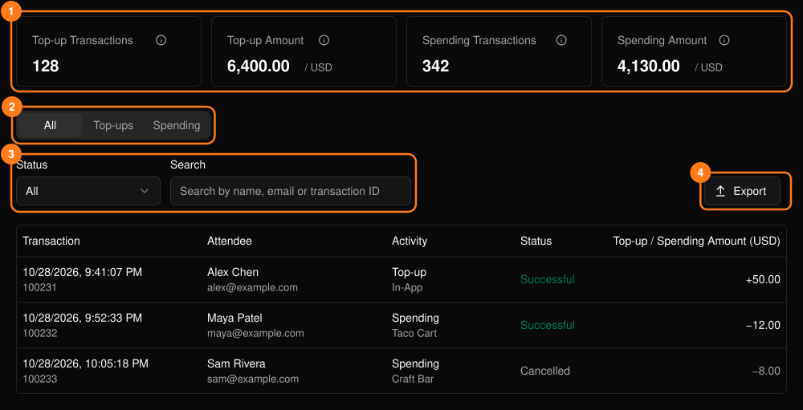
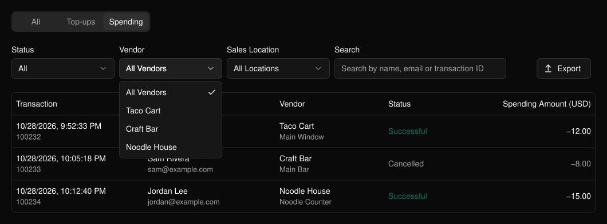

参加者のウォレットへのチャージと、出店者での利用が一覧表示されます。イベントのサイドバーの **PLVR Tap** の下にあります。

<Frame>
  
</Frame>

サマリーカード（1）は成功した取引のみを集計します。Top-up Amount（チャージ額）にはサービス手数料と税は含まれません。

## 絞り込みとエクスポート

**All**、**Top-ups**（チャージ）、**Spending**（利用）を切り替えます（2）。各タブには、ステータス、チャージ経路とステーション、出店者と販売場所、名前・メールアドレス・取引 ID による検索など、それぞれ独自のフィルター（3）があります。

キャンセルされた取引はグレーで表示されます。**Export**（4）を選ぶと、フィルターを適用した現在のタブの CSV をダウンロードできます。

<Frame>
  
</Frame>

## 関連ページ

- [利用額レポート](/ja/tap/spending-report)：出店者別・商品別の合計
- [会場でのキャッシュレス取引](/ja/onsite/cashless)：個々の取引の対応
