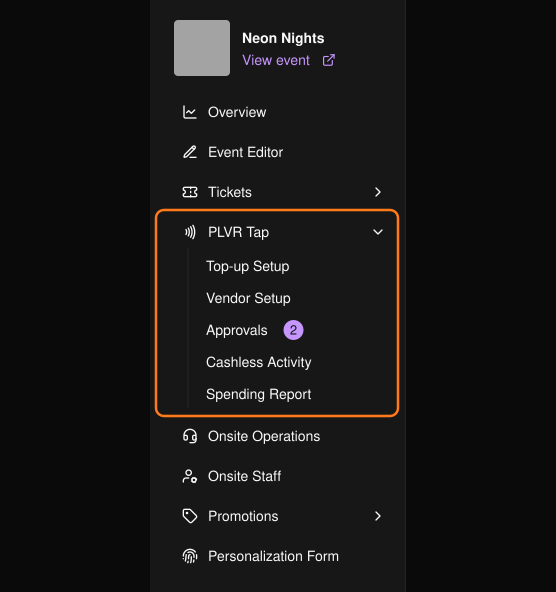

PLVR Tap を使うと、参加者はリストバンドをタップして支払いができます。参加者はそれぞれ Event Wallet（イベントウォレット）を持ち、チャージした残高を出店者のブースで使います。主催者はイベント前に設定を行い、イベント後に状況を確認します。

<Note>
PLVR Tap のページは、PLVR Tap が有効なイベントでのみ表示されます。
</Note>

<Frame>
  
</Frame>

## 仕組み

<Steps>
  <Step title="イベント前">
    [チャージステーション](/ja/tap/top-up-setup)を作成し、[出店者](/ja/tap/vendors)を設定してログインコードを発行し、[パーソナライズフォーム](/ja/tap/personalization-form)で参加者に尋ねる項目を選び、[出店者のメニューを承認](/ja/tap/approvals)します。
  </Step>
  <Step title="イベント当日">
    スタッフが入場時に各チケットにリストバンドを紐づけます。参加者はオンライン、またはステーションで現金やカードでチャージします。出店者はリストバンドをスキャンして決済します。
  </Step>
  <Step title="イベント後">
    [キャッシュレス取引履歴](/ja/tap/cashless-activity)と[利用額レポート](/ja/tap/spending-report)を確認し、出店者と精算します。
  </Step>
</Steps>

## 次のステップ

<CardGroup cols={2}>
  <Card title="チャージ設定" icon="wallet" href="/ja/tap/top-up-setup">ステーションと支払い方法。</Card>
  <Card title="出店者" icon="store" href="/ja/tap/vendors">出店者、販売場所、商品、ログインコード。</Card>
  <Card title="承認" icon="circle-check" href="/ja/tap/approvals">出店者からの申請を確認します。</Card>
  <Card title="会場でのリストバンド管理" icon="nfc" href="/ja/onsite/wristbands">イベント中にリストバンドを管理します。</Card>
</CardGroup>
