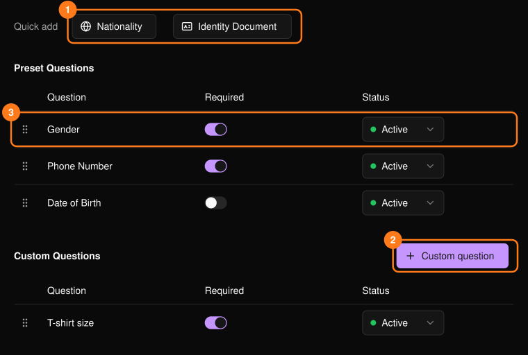
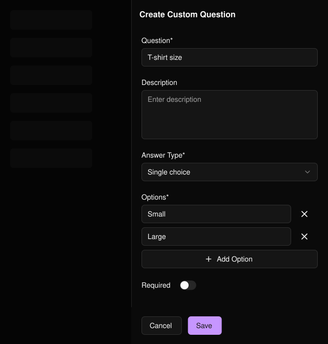

参加者は、チケットをパーソナライズまたは受け取るときにこれらの質問に回答します。[登録フォーム](/ja/events/registration-form)とは別のものです。名前とメールアドレスは常に収集されるため、一覧には表示されません。

<Frame>
  
</Frame>

## 質問を追加する

- **Quick add**（1）：標準の質問（Gender、Nationality、Phone Number、Date of Birth、Identity Document）を追加します。初期設定で必須になります。
- **Custom question**（2）：回答形式（テキスト、数値、単一選択、複数選択）を選びます。選択式には選択肢が1つ以上必要です。

<Frame>
  
</Frame>

## 質問を管理する

各行（3）で **Required** を切り替えたり、**Status** を **Inactive** にして質問を停止したり、ハンドルをドラッグして並べ替えたりできます。

## 関連ページ

- [PLVR Tap の概要](/ja/tap/introduction)
- [リストバンド](/ja/onsite/wristbands)
