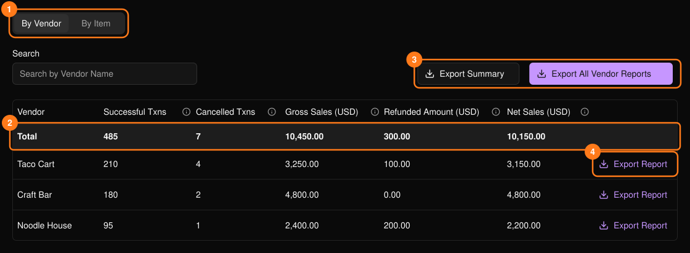
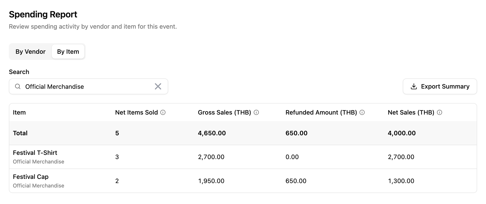

イベントでどれだけ利用されたかを表示します。イベントのサイドバーの **PLVR Tap** の下にあります。

<Frame>
  
</Frame>

**By Vendor**（出店者別）と **By Item**（商品別）を切り替え（1）、**Search** で絞り込みます。**Total** 行（2）は、現在のページだけでなく、検索条件に一致するすべてを合計します。Net Sales（純売上）は Gross Sales（総売上）から返金を差し引いた金額です。各列の情報アイコンにカーソルを合わせると定義が表示されます。

<Frame>
  
</Frame>

## エクスポート

エクスポートは Excel ファイルでダウンロードされます。

- **Export Summary**（3）：検索条件を適用した現在のタブ。
- **Export Report**（4）：1つの出店者の精算レポート。その出店者と精算するときに使います。
- **Export All Vendor Reports**（3）：出店者ごとに1つのレポート。準備ができるとファイルがダウンロードされます。

## 関連ページ

- [キャッシュレス取引履歴](/ja/tap/cashless-activity)
- [出店者](/ja/tap/vendors)
