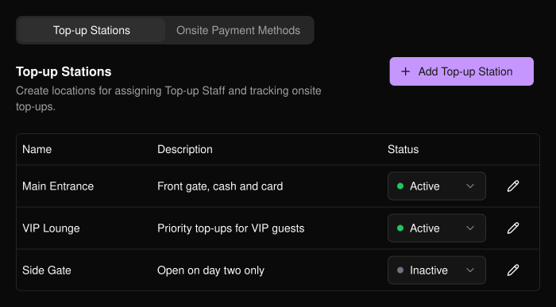
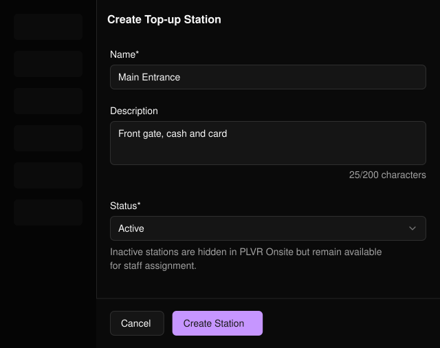
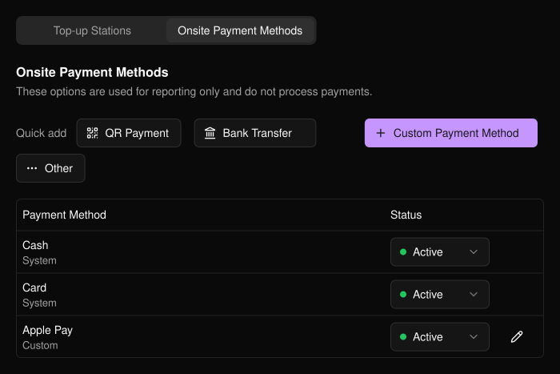

会場で参加者がどこで、どのようにチャージするかを準備します。イベントのサイドバーの **PLVR Tap** の下にあります。

## チャージステーション

ステーションとは、メインエントランスや VIP エリアなど、スタッフが入金を行う物理的な場所です。ステーションを使うと、スタッフを場所ごとに割り当て、チャージを場所ごとに集計できます。

<Frame>
  
</Frame>

<Steps>
  <Step title="Add Top-up Station">選択するとフォームが開きます。</Step>
  <Step title="詳細を入力する">名前は必須です。説明とステータス（初期設定は Active）は任意です。</Step>
  <Step title="Create Station">後から鉛筆アイコンで編集したり、テーブルで **Status** を変更したりできます。</Step>
</Steps>

<Frame>
  
</Frame>

<Note>
無効なステーションは PLVR Onsite には表示されませんが、スタッフの割り当てには引き続き使えます。
</Note>

## 会場での支払い方法

スタッフが、参加者の支払い方法を記録するときに選ぶ選択肢です。

<Warning>
これらは記録用であり、決済処理は行いません。支払いはご自身の決済端末、現金、その他の方法で受け取ってください。
</Warning>

Cash、Card、QR Payment、Bank Transfer、Other は **Quick add** で追加でき、Apple Pay など独自の方法は **Custom Payment Method** で追加できます。編集できるのはカスタムの支払い方法のみです。どの方法も **Active** または **Inactive** に設定できます。

<Frame>
  
</Frame>

## 関連ページ

- [PLVR Tap の概要](/ja/tap/introduction)
- [キャッシュレス取引履歴](/ja/tap/cashless-activity)
