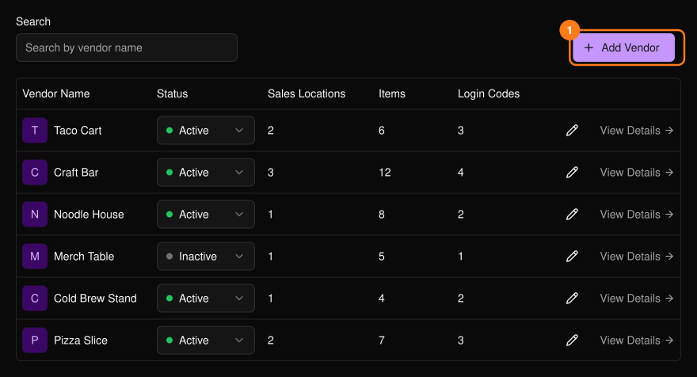
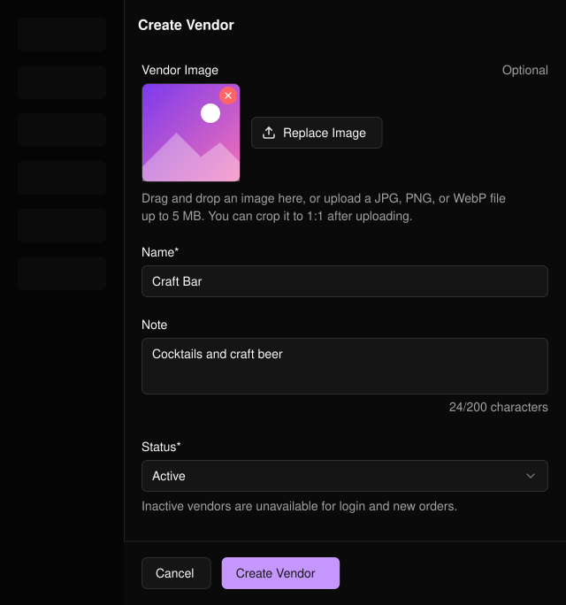
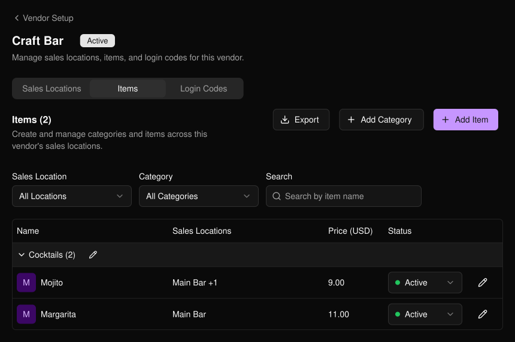
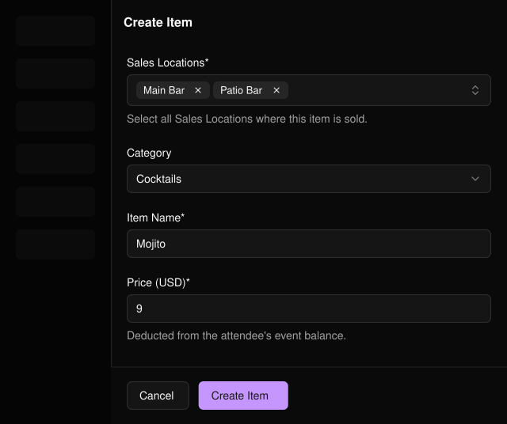
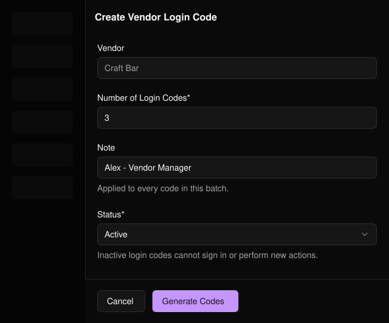

出店者は、参加者のリストバンドをスキャンして決済するブースです。イベントのサイドバーの **PLVR Tap** の下にある **Vendor Setup**（出店者設定）から開きます。

<Frame>
  
</Frame>

## 出店者を追加する

<Steps>
  <Step title="Add Vendor（1）">選択するとフォームが開きます。</Step>
  <Step title="詳細を入力する">名前は必須です。画像、内部メモ、ステータスは任意です。</Step>
  <Step title="Create Vendor">出店者名をクリックすると詳細が開きます。</Step>
</Steps>

<Frame>
  
</Frame>

<Note>
無効な出店者、販売場所、商品は、ログインや新規注文に使用できません。無効なカテゴリ内の商品は、どこでも使用できません。
</Note>

## 出店者を設定する

<Frame>
  
</Frame>

<Steps>
  <Step title="Sales Locations">「Main Bar」など、出店者が販売する場所をそれぞれ追加します。</Step>
  <Step title="Items">カテゴリと商品を追加します。各商品には0より大きい価格と、1つ以上の販売場所が必要です。</Step>
  <Step title="Login Codes">一度に1〜200個のコードを生成します。メモは生成したコード全体に適用されます。</Step>
</Steps>

<Frame>
  
</Frame>

出店者自身が申請した商品やカテゴリは、まず[承認](/ja/tap/approvals)を経由します。Items タブと Login Codes タブの **Export** で CSV をダウンロードできます。

<Frame>
  
</Frame>

<Warning>
無効なログインコードではサインインできません。ブースを離れた人がいる場合や、コードを誤って共有した場合は、そのコードを Inactive に設定してください。
</Warning>

## 関連ページ

- [承認](/ja/tap/approvals)
- [利用額レポート](/ja/tap/spending-report)
- [PLVR Tap の概要](/ja/tap/introduction)
