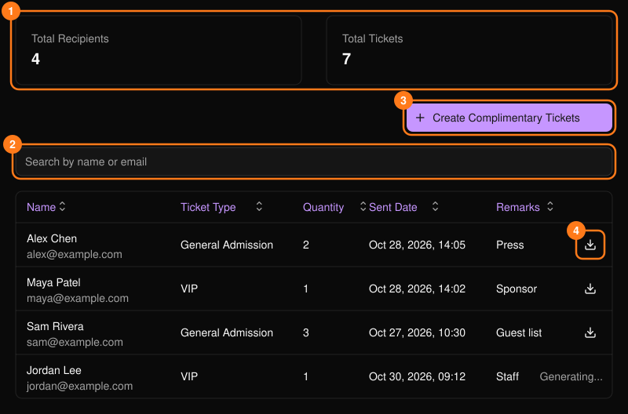
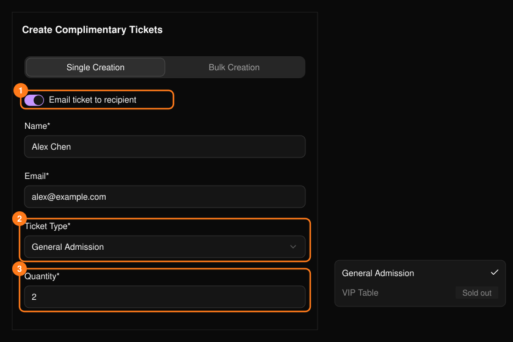
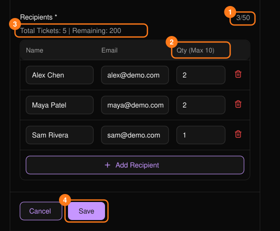
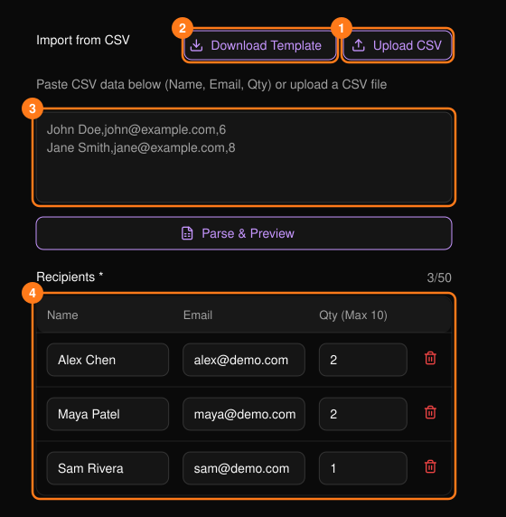

**Complimentary Tickets**（招待チケット）を使うと、ゲスト、スポンサー、プレス、スタッフに無料チケットを発行できます。招待チケットは、ほかのチケットと同じようにチケット在庫から差し引かれます。

<Frame>
  
</Frame>

名前やメールアドレスで検索でき、列見出しで並べ替えられます。ダウンロードアイコンを使うと、受取人のチケットを PDF で取得できます。**Generating...** と表示されている行はまだ準備中のため、しばらくしてから確認してください。

## 個別作成

**Create Complimentary Tickets** を選択し、**Single Creation** タブを使います。

<Frame>
  
</Frame>

- 名前と有効なメールアドレスは必須です。
- 売り切れのチケット種別はグレーで表示されます。
- 数量は最大50で、残数を超えることはできません。
- **Email ticket to recipient**（受取人にメールで送付）は、数量が10以下の場合のみ利用できます。
- **Remarks**（備考、200文字以内）は主催者側の参照用です。

## 一括作成

1つのチケット種別を、一度に最大 **50人の受取人** に発行します。

<Frame>
  
</Frame>

<Steps>
  <Step title="送付方法とチケットを選ぶ">
    チケットをメールで送るかどうかを選び、**Session** と **Ticket Type** を選択します。
  </Step>
  <Step title="受取人を追加する">
    行を追加するか、CSV をインポートします。各行に名前、メールアドレス、数量が必要です。
  </Step>
  <Step title="数量を確認する">
    1人あたりの上限は50枚（メール送付時は10枚）で、残りのチケットが少ない場合はさらに少なくなります。合計が残数を超える場合は、調整を求められます。
  </Step>
  <Step title="保存する">
    **Remarks** はまとめて発行したチケット全体に適用されます。
  </Step>
</Steps>

### CSV からインポートする

**Upload CSV** を使うか、行を貼り付けて **Parse & Preview** を選択します。**Download Template** でひな形ファイルを取得できます。列は次の順序です。

```csv
Name,Email,Quantity
John Doe,john@example.com,1
```

- ヘッダー行は任意です。名前にカンマは使えません。
- 無効な行がある場合はインポートが停止し、修正が必要な行が表示されます。
- インポートした行は50件の上限に含まれ、保存前に編集できます。

<Frame>
  
</Frame>
