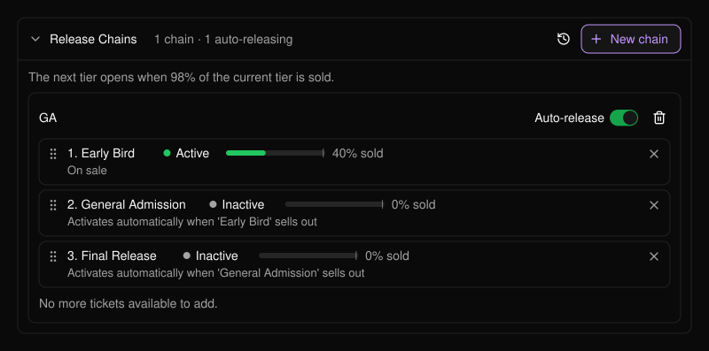
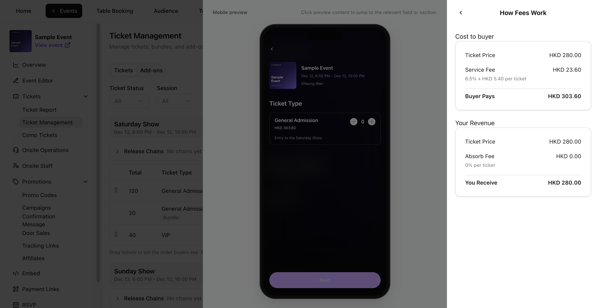

```text
Event
 └── Session (a day, a show, a time slot)
      ├── Tickets  (Early Bird, General Admission, VIP ...)
      │     └── optionally in a Release Chain (one tier opens after another)
      ├── Bundles  (a ticket sold as a pack)
      └── Add-ons  (parking, merchandise, extras)
```

これらはすべて [Ticket Management](/ja/tickets/ticket-management) で管理します。

## セッション

**セッション**とは、参加者が来場できる1回の開催枠のことで、たとえば金曜の夜や1公演日などです。すべてのチケットとバンドルは、いずれか1つのセッションに属します。たとえば金曜日のチケットは金曜日のセッションで有効です。セッションのフィルターや列は、イベントに複数のセッションがある場合にのみ表示されます。[複数日開催のフェス](/ja/tickets/scenario-multi-day-festival)もご覧ください。

## チケット種別

**チケット種別**は、チケットの種類を表し、それぞれに価格、数量、販売期間、ステータス、購入上限（必須）があります。

<Frame>
  
</Frame>

| ステータス | 意味 |
| --- | --- |
| **Active** | 販売開始日になると販売中となり、表示されます。 |
| **Inactive** | 購入者には表示されません。チケットの販売を保留・一時停止するときに使います。 |
| **Ended** | 販売終了時刻を過ぎると自動で設定されます。再度有効にすることはできません。 |

- **Total ticket quantity**（総チケット数）は、そのチケットの在庫上限です。会場のキャパシティに合わせて各チケット種別の数量を計画し、招待チケットの分も在庫に含めておきましょう。
- **Tickets per order**（1注文あたりの枚数、1〜10）と **Tickets per buyer**（1購入者あたりの枚数、1〜20）は必須で、チケット枚数で数えます。上限はチケット種別ごとに個別に適用されます。
- **Ticket name**（チケット名）と **Price per ticket**（チケット単価）は、そのチケットの在庫から最初に販売または発行された時点でロックされます。ロックと在庫のルールについては[チケットまたはバンドルを編集する](/ja/tickets/ticket-management)をご覧ください。

## リリースチェーン

**リリースチェーン**は、Early Bird、General Admission、Final Release のようにチケット種別に順番を付け、現在の段階が完売間近になると次の段階を自動で販売開始する仕組みです。[リリースチェーン](/ja/tickets/ticket-management)と[一般入場チケットを段階的に販売する](/ja/tickets/scenario-ga-tiers)をご覧ください。

<Frame>
  
</Frame>

## バンドル

**バンドル**は、1つのセッションの同じチケットを複数枚まとめたもの（例：4枚セット）です。含まれるチケットと在庫を共有します。**Bundle sales limit**（バンドル販売上限）で、販売できるセット数の合計を制限します。**Available now**（現在の販売可能数）には、残りのセット上限と、共有しているチケット在庫の残数の両方が反映されます。

**Bundles per order**（1注文あたりのバンドル数）と **Bundles per buyer**（1購入者あたりのバンドル数）はセット単位で設定します。PLVR はこれをチケット枚数に換算し、1注文あたり10枚、1購入者あたり20枚の上限を適用します。4枚セットの場合、1注文あたり最大2セット、1購入者あたり最大5セットとなります。**Sold**（販売数）は、バンドルではセット数、チケット種別では個々のチケット枚数を数えます。

[バンドルを作成する](/ja/tickets/ticket-management)と[グループパッケージ](/ja/tickets/scenario-bundles)をご覧ください。

## アドオン

**アドオン**は、駐車場などチケットと一緒に購入するオプションです。それぞれ一緒に購入できるチケットに紐づいており、独自の数量を持つか、チケットの数量を共有します。[VIP とアドオン](/ja/tickets/scenario-vip-addons)をご覧ください。

## 手数料

**Price per ticket** と **Price per bundle** は、購入者手数料と税を含まない、入力する基本価格です。バンドル価格はセット全体の価格です。

- **All-in pricing**（総額表示）では、該当する購入者手数料と税を含めた総額を最初から購入者に表示します。
- **Split pricing**（分割表示）では、最初に基本価格を表示し、該当する購入者手数料と税をチェックアウト時に加算します。

**Pricing** で **Buyer pays**（購入者の支払額）と **You receive**（受取額）を確認し、**How fees work** を開くと、購入者サービス手数料、主催者が負担する手数料、税を確認できます。税が有効な場合、**You Receive (incl. tax)** には徴収した税が含まれます。税を除いた金額は **Revenue excluding tax** で確認してください。バンドルの内訳はセット全体の金額で表示されます。以下の例は Sample Event の手数料設定を使用しています。

<Frame>
  
</Frame>

## プロモコードと招待チケット

[プロモコード](/ja/promotions/promo-codes)は、すべてのチケット、または特定のチケットやバンドルを割引します。[招待チケット](/ja/tickets/comp-tickets)は特定の人に発行する無料チケットで、有料チケットと同じ在庫から割り当てられます。[割引キャンペーン](/ja/tickets/scenario-promo-discounts)と[ゲストへの招待チケット発行](/ja/tickets/scenario-comp-guests)をご覧ください。
