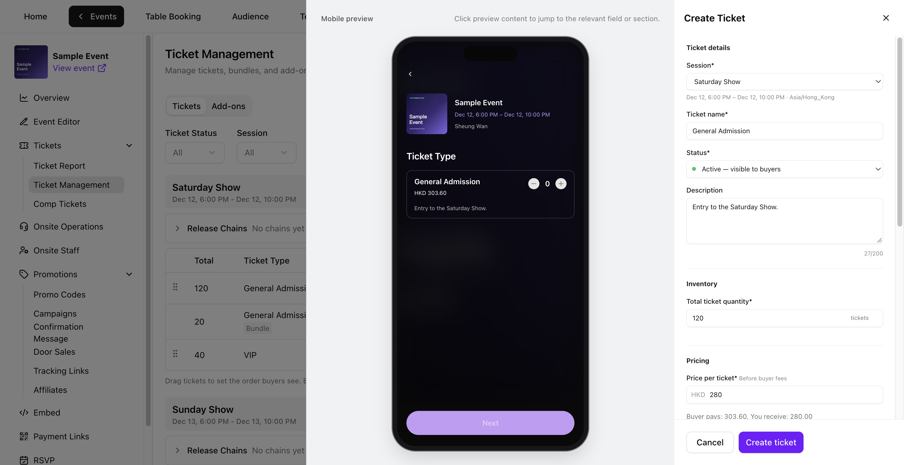
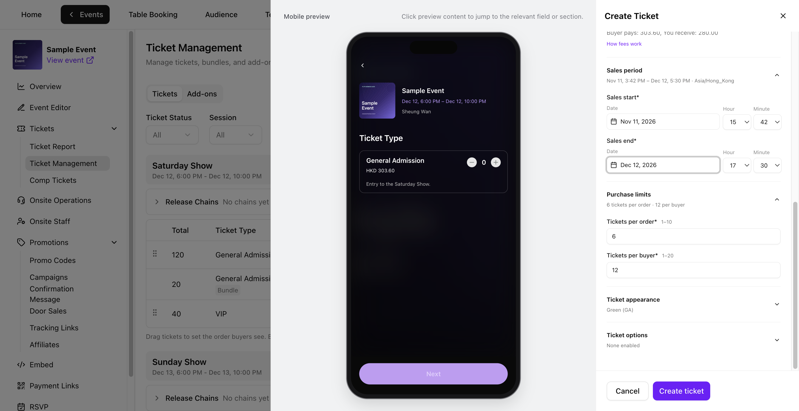
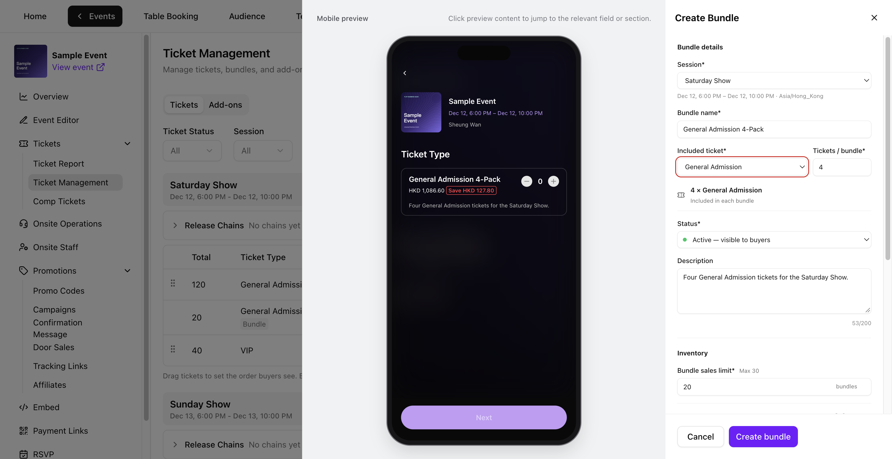
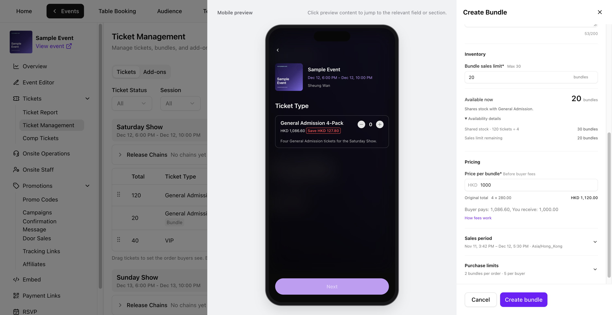
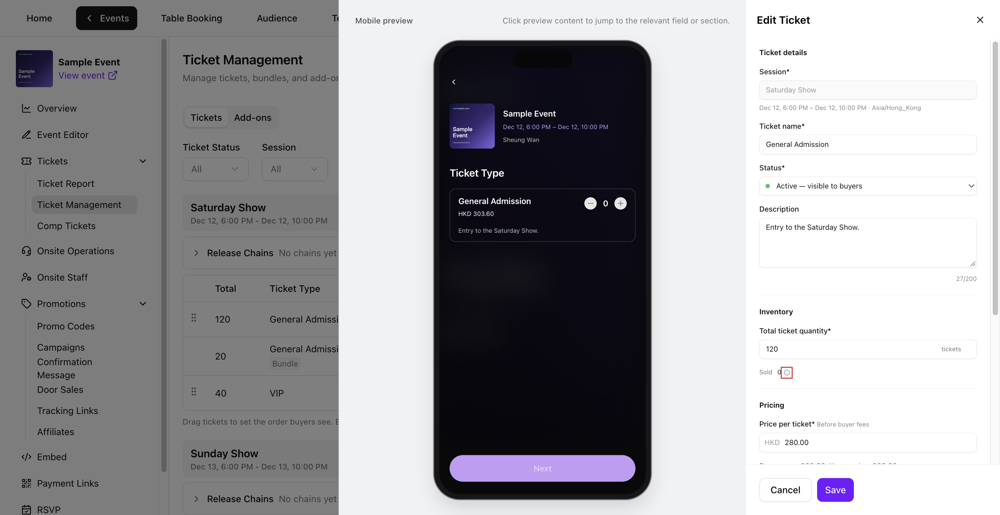
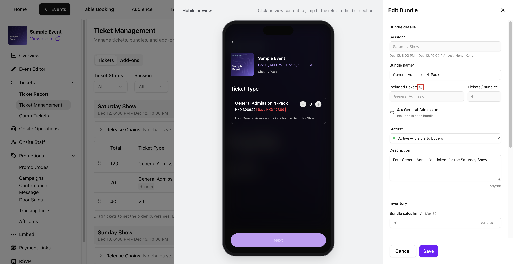
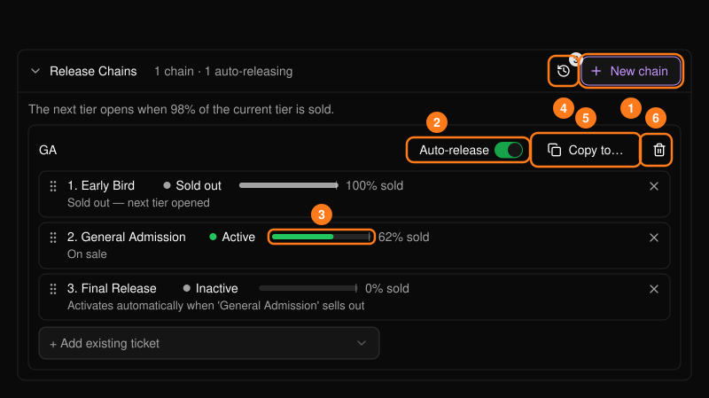
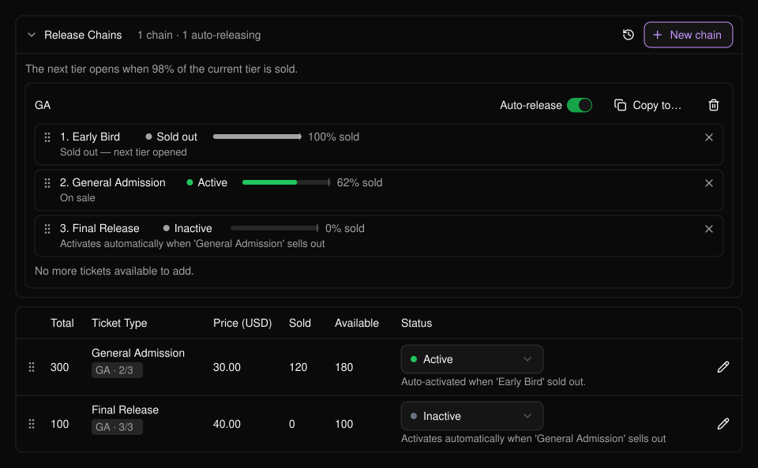
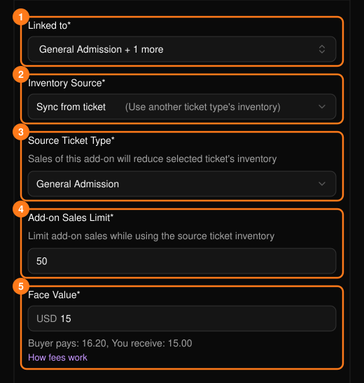
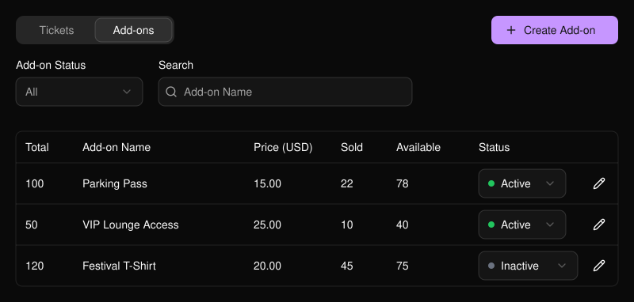

イベントを開き、**Tickets → Ticket Management**（チケット管理）に移動します。**Tickets** タブでは、**Ticket Status** で絞り込んだり、チケット名やバンドル名で検索したりできます。複数セッションのイベントでは、**Session** フィルターを使うか、セッションを展開します。オプション商品は **Add-ons** タブにあります。

<Frame>
  
</Frame>

## チケットを作成する

**Tickets** タブで **Create ticket**（チケットを作成）を選択します。**Mobile preview** で名前、説明、価格を選ぶと、その項目に移動できます。

<Frame>
  
</Frame>

<Steps>
  <Step title="チケットの詳細を入力する">
    - イベントに複数のセッションがある場合は、**Session** を選択します。
    - **Ticket name**（チケット名）を入力し、**Status** を選びます。**Inactive** にするとチケットは非表示のままになります。
    - 必要に応じて、200文字以内の **Description**（説明）を追加します。
  </Step>
  <Step title="在庫と価格を設定する">
    - **Inventory** で、**Total ticket quantity**（総チケット数）を1以上で入力します。
    - **Pricing** で、イベント通貨での基本価格 **Price per ticket** を入力します。無料チケットの場合は **0** を入力します。
    - **Buyer pays** と **You receive** を確認します。**How fees work** を選ぶと、手数料と税の内訳を確認できます。[手数料](/ja/tickets/concepts)もご覧ください。
  </Step>
  <Step title="購入できる期間と枚数を設定する">
    - **Sales period**（販売期間）を開き、イベントのタイムゾーンで **Sales start** と **Sales end** の日時を設定します。販売終了は、開始より後かつ未来の日時で、セッション終了までに設定してください。
    - **Purchase limits**（購入上限）を開き、**Tickets per order**（1〜10）と **Tickets per buyer**（1〜20）を設定します。どちらも必須です。
  </Step>
  <Step title="チケット設定を確認して作成する">
    - **Ticket appearance** で色を選び、QR のプレビューを確認します。
    - **Ticket options** で、必要に応じて **Require Personalization** や **Allow ticket transfer** を設定します。パーソナライズの質問は[パーソナライズフォーム](/ja/tap/personalization-form)で設定します。PLVR Tap が有効な場合は、**Support wristband binding** をオンにすることもできます。
    - **Mobile preview** を確認し、**Create ticket** を選択します。新しいチケットが一覧に表示されます。
  </Step>
</Steps>

<Frame>
  
</Frame>

## バンドルを作成する

同じチケットをセットで販売するには、まずそのチケットを作成します。**Tickets** で **Create bundle**（バンドルを作成）を選択します。

<Steps>
  <Step title="含めるチケットを選ぶ">
    表示された場合は **Session** を選択します。**Bundle name**（バンドル名）を入力し、そのセッションから **Included ticket**（含めるチケット）を1つ選び、**Tickets / bundle**（1〜10）を設定します。**Status** を設定し、必要に応じて200文字以内の **Description** を追加します。
  </Step>
  <Step title="バンドルの上限と価格を設定する">
    **Bundle sales limit**（バンドル販売上限）と、セット全体の基本価格 **Price per bundle** を設定します。**Original total** には、同じ枚数を個別に購入した場合の基本価格が表示されます。
  </Step>
  <Step title="販売期間と購入上限を設定する">
    必須の **Sales period**、**Bundles per order**、**Bundles per buyer** を設定します。販売はセッション終了までに終える必要があります。上限は1注文あたり10枚、1購入者あたり20枚です。4枚セットの場合、1注文あたり最大2バンドル、1購入者あたり最大5バンドルとなります。
  </Step>
  <Step title="確認して作成する">
    **Mobile preview** を確認し、**Create bundle** を選択します。バンドルは含まれるチケットとともに表示されます。
  </Step>
</Steps>

<Frame>
  
</Frame>

### 共有在庫を確認する

各バンドルは、含まれるチケットの在庫を使用します。**Bundle sales limit** の最大値は、含まれるチケットの総数を **Tickets / bundle** で割り、小数点以下を切り捨てた数です。

**Available now** は、残りのバンドル上限と、共有在庫でまかなえる完全なセット数のうち、小さいほうの値です。**Availability details** を展開すると両方を確認できます。Sample Event では、120枚のチケットで4枚セットを30セット用意できます。販売上限の残りが20なので、**Available now** には20と表示されます。

<Frame>
  
</Frame>

## チケットのオン・オフを切り替える

**Status** 列のドロップダウンを使います。**Active** にすると、販売期間中は購入者に表示されます。**Inactive** にすると購入者には表示されません。**Ended** は販売終了後に自動で設定され、ステータスのドロップダウンでは変更できません。

あるセッションの販売をすべて一時停止するには、そのセッションの各チケットとバンドルを **Inactive** に設定します。再開するには、販売したいものを **Active** に戻します。

## チケットまたはバンドルを編集する

行の鉛筆アイコンを選ぶと、**Edit Ticket** または **Edit Bundle** が開きます。**Save** を選ぶと変更が適用されます。**Cancel** の後に確認が表示された場合は、**Keep editing** または **Discard changes** を選びます。

<Frame>
  
</Frame>

| 項目 | ロックされるタイミング |
| --- | --- |
| **Ticket name** と **Price per ticket** | そのチケットの在庫から最初に販売または発行された後。無料チケット、招待チケット、バンドルや同期したアドオンで使われた在庫も含みます。 |
| **Bundle name** と **Price per bundle** | そのバンドルが最初に販売または発行された後。 |
| **Session** | チケットまたはバンドルの作成時。 |
| **Included ticket** と **Tickets / bundle** | バンドルの作成時。 |

後で返金されたり在庫が戻されたりしても、名前と価格はロックされたままです。

<Frame>
  
</Frame>

### 数量と販売設定を調整する

- **Total ticket quantity** は、**Sold** 以上の整数（最小1）に調整できます。チケットの **Sold** は、販売または発行された個々のチケット枚数で、招待チケットや、バンドル・同期したアドオンで使われた在庫も含みます。詳細は **Sold** の横の情報アイコンを選択してください。
- **Bundle sales limit** は、そのバンドルの **Sold** 以上の整数（最小1）に調整できます。バンドルの **Sold** はセット数です。バンドルの上限はそのバンドルにのみ適用されます。
- **Status**、**Description**、**Sales period**、**Purchase limits** は更新できます。**Sales end** を変更する場合は、未来の日時で、かつセッション終了以前の時刻を選んでください。

## リリースチェーン

リリースチェーンは、チケットの段階を順番に販売し、現在の段階が完売間近になると次の段階を自動で販売開始します。次の段階は、最後の1枚が売れた時点ではなく、パネルに表示される割合（例：98%）に達した時点で開始されます。具体例：[一般入場チケットを段階的に販売する](/ja/tickets/scenario-ga-tiers)。

<Frame>
  
</Frame>

<Steps>
  <Step title="チェーンを作成する">
    **Release Chains** を開き、**New chain** を選択して名前を付け、**Create** を選択します。新しいチェーンは一時停止の状態で作成されます。
  </Step>
  <Step title="チケットを順番に追加する">
    **+ Add existing ticket** を使い、ドラッグして並べ替えます。1つのチケットは1つのチェーンにのみ追加できます。バンドルとアドオンは追加できません。
  </Step>
  <Step title="Auto-release をオンにする">
    オフの間はチェーンが一時停止し、後の段階は有効になりません。
  </Step>
</Steps>

各段階には、待機中、**On sale**（販売中）、完売して次の段階を開始済み、または警告のいずれかの状態が表示されます。チェーンに含まれるチケットにはテーブル内で「GA - 2/3」のようなバッジが表示され、完了したチェーンには **Exhausted** と表示されます。

<Frame>
  
</Frame>

知っておきたい警告が2つあります。

- 「won't auto-activate」と表示された段階は、後の段階がすでに販売中であることを意味します。手動で有効にするか、チェーンから削除してください。
- すべての段階に、まだ過ぎていない販売終了時刻が適切な順序で設定されている必要があります。警告が出た段階を修正してから、Auto-release を再度オンにしてください。

その他の操作：**Activity log**（完売と販売開始の履歴）、**Copy to...**（チケット名で照合してチェーンを他のセッションにコピー。コピーは一時停止の状態で作成されます）、**Delete**（チケットのステータスはそのまま残ります）。

## アドオン

**Add-ons** タブで **Create Add-on** を選択します。

<Frame>
  
</Frame>

- **Linked to**：アドオンと一緒に購入できるチケット。
- **Inventory Source**（在庫元）：**Own inventory** はアドオン独自の数量を持ちます。**Sync from ticket** はチケットの在庫から割り当てるため、アドオンが1つ売れるごとにそのチケットの販売可能数が減ります。
- **Face Value**：価格。
- 販売日時は任意です。在庫元は作成後に変更できません。

<Frame>
  
</Frame>

[チケットの基本概念](/ja/tickets/concepts)、[チケットレポート](/ja/tickets/ticket-report)、[招待チケット](/ja/tickets/comp-tickets)もご覧ください。
