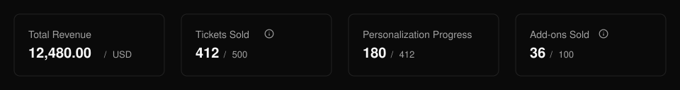
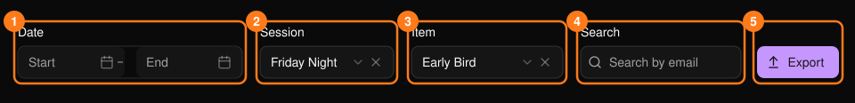
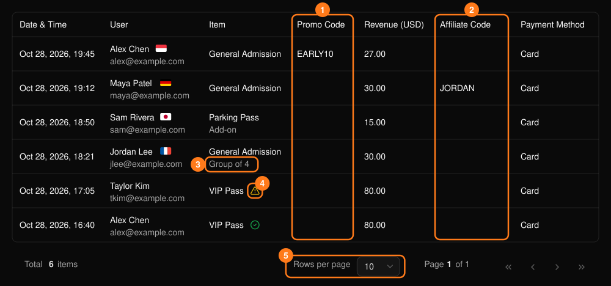

**Ticket Report**（チケットレポート）には、販売した各チケットとアドオンが、購入者、日時、売上とともに一覧表示されます。

<Frame>
  
</Frame>

サマリーカードには、売上、販売チケット数、パーソナライズの進捗、アドオンの販売数が表示されます。後の2つは、イベントで使用している場合にのみ表示されます。

## 絞り込み

<Frame>
  
</Frame>

- **Start** と **End** の日付で、集計期間を絞り込みます。
- **Session** は複数セッションのイベントでのみ表示されます。
- **Item** を選ぶ前にセッションを選んでください。セッションを変更するとアイテムの選択はクリアされます。
- **Search** は購入者のメールアドレスに対して部分一致で検索します。

## テーブルの見方

<Frame>
  
</Frame>

各行は1枚のチケットまたは1つのアドオンです。アドオンにはラベルが付き、バンドルのチケットにはバンドル名が表示されます。パーソナライズが必要なイベントでは、警告アイコンは **Personalization Required**（パーソナライズ未完了）、緑のチェックは **Personalized**（パーソナライズ済み）を表します。

テーブルには次の情報が含まれます。

- **取引の詳細：** 日時、購入者、チケット種別、売上、支払い方法。
- **Promo Code と Affiliate Code：** 販売に関連するプロモーションやアフィリエイトを示します。

## エクスポート

**Export** を選ぶと、現在のフィルターが適用された CSV がダウンロードされます。先に期間、セッション、アイテム、検索条件を設定してください。

何が販売につながっているかを知るには、**Promo Code** と **Affiliate Code** の列を確認しましょう。[プロモコード](/ja/promotions/promo-codes)と[アフィリエイト](/ja/promotions/affiliates)もご覧ください。
