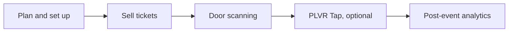

Every event moves through three phases. Use these pages to see what to do next.

<Steps>
  <Step title="Before">
    Plan the event, set up tickets and forms, promote, and prepare your team. Optional: set up PLVR Tap if the event is cashless.
  </Step>
  <Step title="During">
    Scan guests in, sell at the door, run the desk, and handle cashless issues and cases.
  </Step>
  <Step title="After">
    Read the reports, check spending and promo results, and follow up with your audience.
  </Step>
</Steps>

<CardGroup cols={3}>
  <Card title="Before the event" icon="calendar-check" href="/phases/before">
    Planning and selling.
  </Card>
  <Card title="During the event" icon="ticket" href="/phases/during">
    Scanning, door sales and onsite operations.
  </Card>
  <Card title="After the event" icon="chart-line" href="/phases/after">
    Reports and follow-up.
  </Card>
</CardGroup>

## Playbooks

- [Launch checklist](/guides/launch-checklist)
- [Promote your event](/guides/promote-your-event)
- [Cashless festival setup](/guides/cashless-festival-setup)
- [Event day runbook](/guides/event-day-runbook)
- [After the event](/guides/after-the-event)

## Looking for your event type?

See [small events](/organizers/small-events), [mid-size events](/organizers/mid-size-events), [festivals](/organizers/festivals) or [recurring community events](/organizers/recurring-community). To follow by job instead, see [Guides by team](/roles).
