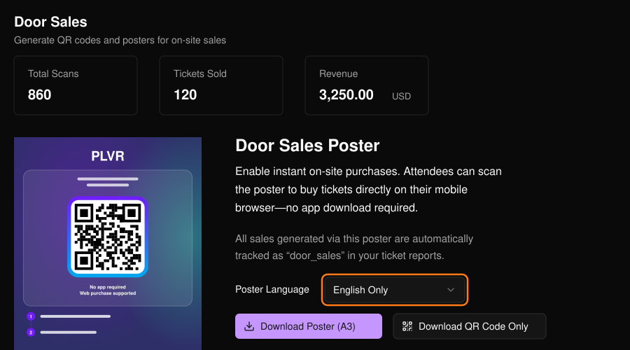
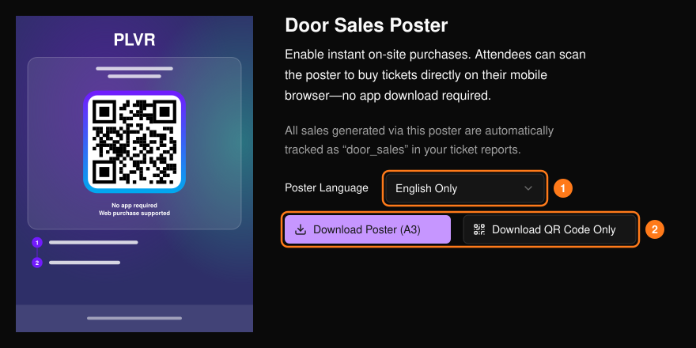

Guests scan the QR code, land on your event page, and buy on their phones. Those purchases are counted as door sales, with scans, tickets sold, and revenue shown at the top.

<Frame>
  
</Frame>

## Get your poster or QR code

<Steps>
  <Step title="Pick a language">Choose the poster language (1). The preview updates.</Step>
  <Step title="Download">Select **Download Poster (A3)** for a print-ready poster, or **Download QR Code Only** (2).</Step>
</Steps>

<Frame>
  
</Frame>

**Pending Review** — Before printing, scan the poster with your phone. Check that the event page opens, the tickets you want to sell are available, and checkout works. Have staff direct guests to the poster, help with checkout, and verify e-tickets according to your event's entry process. Purchases through the poster QR code are tracked as `door_sales` in the Ticket Report.

<Tip>
  Put the poster at the entrance or box office. Use the QR code alone for table cards, screens, or staff badges. For other channels, see [Tracking Links](/promotions/tracking-links).
</Tip>
