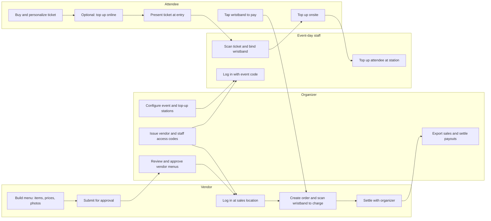

PLVR Tap lets attendees pay at your event by tapping a wristband instead of using cash or cards. Each attendee has an Event Wallet. They add money to it (a top-up), then spend it at vendor stalls such as food and drink.

The Business Portal is where you, as the organizer, set all of this up before the event and keep an eye on it afterwards.

<Note>
PLVR Tap pages only appear for events that have PLVR Tap enabled. If you don't see the **PLVR Tap** group or **Personalization Form** in the event sidebar, the event isn't a Tap event.
</Note>

## The main pieces

<CardGroup cols={2}>
  <Card title="Attendees and wristbands" icon="nfc">
    An attendee's ticket is linked to a physical wristband at entry. The wristband is tied to their Event Wallet.
  </Card>
  <Card title="Top-ups" icon="wallet">
    Attendees add funds online in the PLVR app, or onsite at a top-up station by cash or card.
  </Card>
  <Card title="Vendors" icon="store">
    Stalls that sell items. They build their menu, you approve it, and they charge attendees by scanning wristbands.
  </Card>
  <Card title="Approvals" icon="circle-check">
    Vendor menu changes (new or edited items and categories) wait for your review before going live.
  </Card>
</CardGroup>

## End-to-end flow

The flow below shows who does what. Money actually moves when an attendee tops up and when they pay at a stall.

### Before the event

1. **Organizer** configures the event and creates top-up stations (see [Top-up setup](/tap/top-up-setup)).
2. **Organizer** creates vendors and issues login codes to vendors and onsite staff (see [Vendors](/tap/vendors) and [Onsite staff](/onsite/onsite-staff)).
3. **Vendors** build their menu and submit it. You review it on the [Approvals](/tap/approvals) page.
4. **Attendees** buy tickets and personalize them. You choose what to ask them on the [Personalization form](/tap/personalization-form). They can also top up online ahead of time.

### At the event

1. Entry staff log in to the PLVR Onsite app with an event code, scan the attendee's ticket, and bind a wristband to it.
2. Attendees top up at a station (cash or card) or in the app.
3. Vendors log in at their sales location, create an order, and scan the attendee's wristband to charge the Event Wallet.

### After the event

Review [Cashless activity](/tap/cashless-activity) and the [Spending report](/tap/spending-report), export sales data, and settle with vendors.

## Where to go next

<CardGroup cols={2}>
  <Card title="Top-up setup" icon="wallet" href="/tap/top-up-setup">Stations and payment methods.</Card>
  <Card title="Vendors" icon="store" href="/tap/vendors">Vendors, sales locations, items, and login codes.</Card>
  <Card title="Approvals" icon="circle-check" href="/tap/approvals">Review vendor submissions.</Card>
  <Card title="Wristbands onsite" icon="nfc" href="/onsite/wristbands">Look up and manage wristbands during the event.</Card>
</CardGroup>
