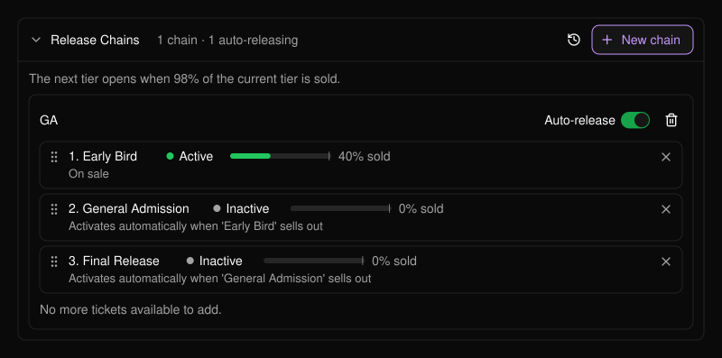
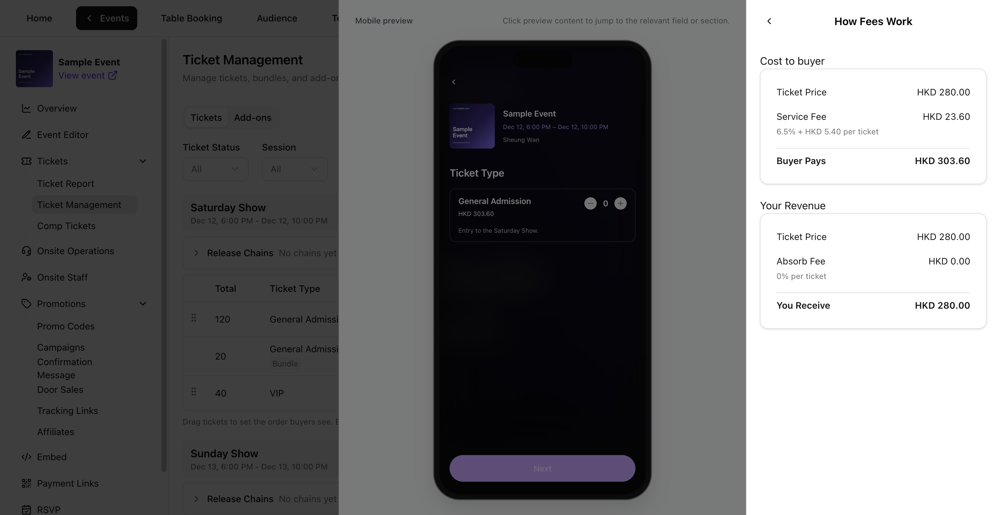

```text
Event
 └── Session (a day, a show, a time slot)
      ├── Tickets  (Early Bird, General Admission, VIP ...)
      │     └── optionally in a Release Chain (one tier opens after another)
      ├── Bundles  (a ticket sold as a pack)
      └── Add-ons  (parking, merchandise, extras)
```

All of it is managed in [Ticket Management](/tickets/ticket-management).

## Sessions

A **session** is one occasion people can attend, such as Friday night or one show date. Every ticket and bundle belongs to one session. For example, a Friday ticket is valid for the Friday session. Session filters and columns only appear when your event has more than one. See [Multi-day festival](/tickets/scenario-multi-day-festival).

## Ticket types

A **ticket type** is one kind of ticket, with its own price, quantity, sales period, status and required purchase limits.

<Frame>
  
</Frame>

| Status | Meaning |
| --- | --- |
| **Active** | On sale and visible, once its sales start date arrives. |
| **Inactive** | Hidden from buyers. Use it to hold back or pause a ticket. |
| **Ended** | Set automatically after the sales end time. Cannot be reactivated. |

- **Total ticket quantity** is the ticket’s inventory limit. Plan quantities across your ticket types against the venue capacity and allow for comp tickets in that stock.
- **Tickets per order** (1–10) and **Tickets per buyer** (1–20) are required and counted in tickets. The limits apply separately to each ticket type.
- **Ticket name** and **Price per ticket** lock after the first sale or issuance from that ticket’s stock. See [Edit a ticket or bundle](/tickets/ticket-management#edit-a-ticket-or-bundle) for the lock and stock rules.

## Release chains

A **release chain** puts ticket types in order, such as Early Bird, General Admission, Final Release, and opens the next tier automatically when the current one is nearly sold out. See [Release chains](/tickets/ticket-management#release-chains) and [Selling General Admission in tiers](/tickets/scenario-ga-tiers).

<Frame>
  
</Frame>

## Bundles

A **bundle** groups several of the same ticket from one session, such as a 4-pack. It shares the included ticket’s inventory. **Bundle sales limit** caps the total packs you can sell. **Available now** reflects both the remaining pack limit and the remaining shared ticket stock.

Set **Bundles per order** and **Bundles per buyer** in packs. PLVR converts the quantities to tickets to enforce the caps of 10 tickets per order and 20 per buyer. For a 4-pack, that means up to 2 packs per order and 5 per buyer. **Sold** counts packs for a bundle and individual tickets for a ticket type.

See [Create a bundle](/tickets/ticket-management#create-a-bundle) and [Group packages](/tickets/scenario-bundles).

## Add-ons

**Add-ons** are extras bought alongside a ticket, such as parking. Each is linked to the tickets it can be bought with and has its own quantity or shares a ticket's. See [VIP and add-ons](/tickets/scenario-vip-addons).

## Fees

**Price per ticket** and **Price per bundle** are the base prices you enter, before buyer fees and tax. A bundle price is for the whole pack.

- **All-in pricing** shows the full price to buyers up front, including applicable buyer fees and tax.
- **Split pricing** shows the base price up front and adds applicable buyer fees and tax at checkout.

Under **Pricing**, check **Buyer pays** and **You receive**, then open **How fees work** to see the buyer service fee, any fee you absorb and any tax. When tax is enabled, **You Receive (incl. tax)** includes the tax collected. See **Revenue excluding tax** for the amount without it. The bundle breakdown shows amounts for the whole pack. The example below uses Sample Event’s fee settings.

<Frame>
  
</Frame>

## Promo codes and comp tickets

A [promo code](/promotions/promo-codes) discounts all tickets or one ticket or bundle. [Comp tickets](/tickets/comp-tickets) are free tickets for named people and come out of the same inventory as paid ones. See [Discount campaigns](/tickets/scenario-promo-discounts) and [Comping guests](/tickets/scenario-comp-guests).
