Open your event and go to **Tickets → Ticket Management**. On the **Tickets** tab, filter by **Ticket Status** or search by ticket or bundle name. For a multi-session event, use the **Session** filter or expand a session. Find extras on the **Add-ons** tab.

<Frame>
  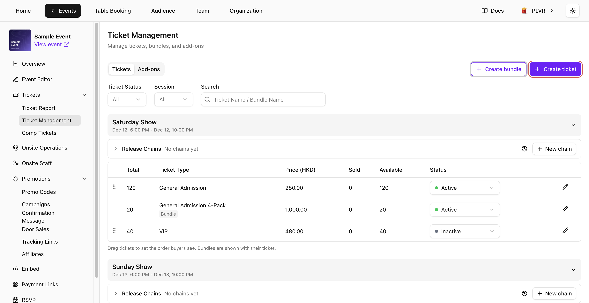
</Frame>

## Create a ticket

On the **Tickets** tab, select **Create ticket**. Select the name, description or price in **Mobile preview** to jump to that field.

<Frame>
  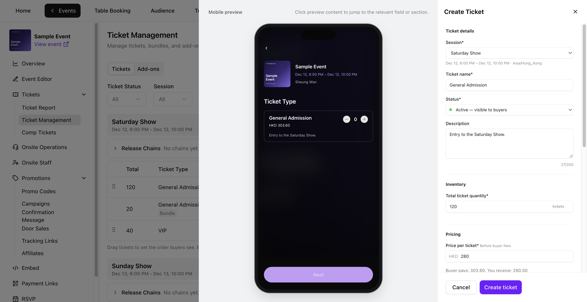
</Frame>

<Steps>
  <Step title="Enter the ticket details">
    - Select a **Session** if the event has more than one.
    - Enter the **Ticket name** and choose a **Status**. **Inactive** keeps the ticket hidden.
    - Add an optional **Description** of up to 200 characters.
  </Step>
  <Step title="Set inventory and price">
    - Under **Inventory**, enter a **Total ticket quantity** of at least one.
    - Under **Pricing**, enter the base **Price per ticket** in the event currency. Enter **0** for a free ticket.
    - Check **Buyer pays** and **You receive**. Select **How fees work** for the breakdown of fees and any tax. See [Fees](/tickets/concepts#fees).
  </Step>
  <Step title="Set when and how many tickets buyers can purchase">
    - Open **Sales period** and set a date and time for **Sales start** and **Sales end** in the event time zone. End sales after the start, in the future, and by the end of the session.
    - Open **Purchase limits** and set **Tickets per order** (1–10) and **Tickets per buyer** (1–20). Both are required.
  </Step>
  <Step title="Review ticket settings and create">
    - Under **Ticket appearance**, choose a color and check the QR preview.
    - Under **Ticket options**, set **Require Personalization** or **Allow ticket transfer** as needed. Configure personalization questions in the [Personalization form](/tap/personalization-form). With PLVR Tap enabled, you can also turn on **Support wristband binding**.
    - Review **Mobile preview**, then select **Create ticket**. The new ticket appears in the list.
  </Step>
</Steps>

<Frame>
  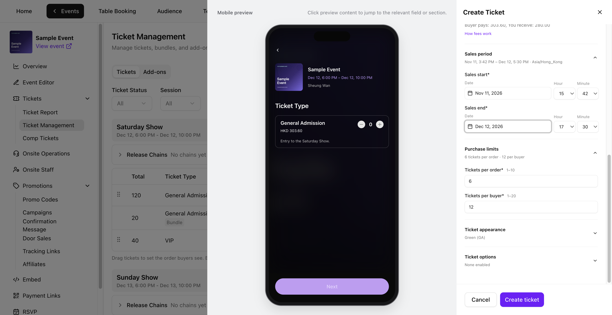
</Frame>

## Create a bundle

To sell a pack of the same ticket, create that ticket first. On **Tickets**, select **Create bundle**.

<Steps>
  <Step title="Choose the included ticket">
    Select a **Session** if prompted. Enter a **Bundle name**, choose one **Included ticket** from that session, and set **Tickets / bundle** (1–10). Set **Status** and add an optional **Description** of up to 200 characters.
  </Step>
  <Step title="Set the bundle limit and price">
    Set **Bundle sales limit** and the base **Price per bundle** for the whole pack. **Original total** shows the base price of the same number of individual tickets.
  </Step>
  <Step title="Set the sales period and purchase limits">
    Set the required **Sales period**, **Bundles per order** and **Bundles per buyer**. Sales must end by the end of the session. The caps are 10 tickets per order and 20 per buyer. A 4-pack allows up to 2 bundles per order and 5 per buyer.
  </Step>
  <Step title="Review and create">
    Check **Mobile preview**, then select **Create bundle**. The bundle appears with its included ticket.
  </Step>
</Steps>

<Frame>
  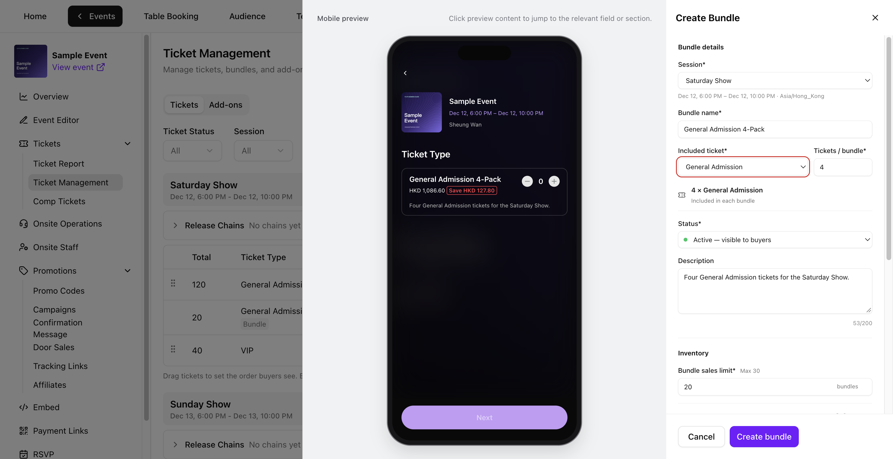
</Frame>

### Check shared stock

Each bundle uses the included ticket’s inventory. The maximum **Bundle sales limit** is the included ticket’s total quantity divided by **Tickets / bundle**, rounded down.

**Available now** is the smaller of the remaining bundle limit and the number of full packs shared stock can cover. Expand **Availability details** to see both. In Sample Event, 120 tickets can cover 30 four-packs. The sales limit has room for 20, so **Available now** shows 20.

<Frame>
  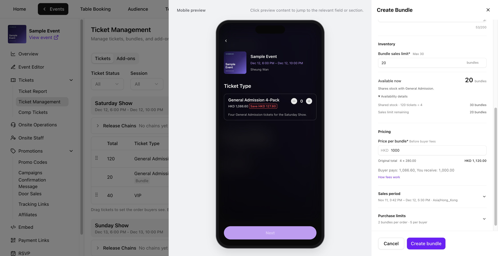
</Frame>

## Turn a ticket on or off

Use the dropdown in the **Status** column. **Active** makes the item visible to buyers when its sales period is open. **Inactive** hides it from buyers. **Ended** is set automatically after sales end and cannot be changed in the status dropdown.

To pause all sales for a session, set each ticket and bundle in that session to **Inactive**. To resume, set the ones you want to sell back to **Active**.

## Edit a ticket or bundle

Select the row’s pencil icon to open **Edit Ticket** or **Edit Bundle**. Select **Save** to apply changes. After **Cancel**, choose **Keep editing** or **Discard changes** if prompted.

<Frame>
  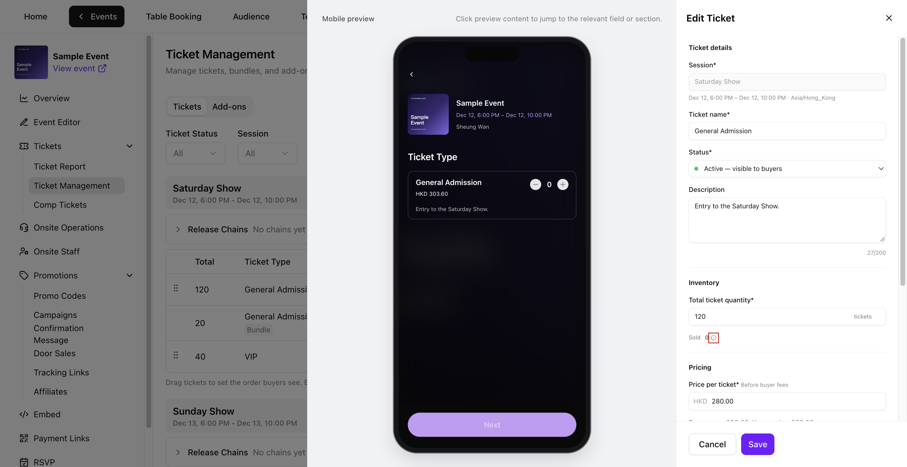
</Frame>

| Field | When it locks |
| --- | --- |
| **Ticket name** and **Price per ticket** | After the first sale or issuance from that ticket’s stock, including free tickets, comp tickets and stock used through a bundle or a synced add-on. |
| **Bundle name** and **Price per bundle** | After that bundle first sells or is issued. |
| **Session** | When the ticket or bundle is created. |
| **Included ticket** and **Tickets / bundle** | When the bundle is created. |

Name and price stay locked if sales are later refunded or stock is restored.

<Frame>
  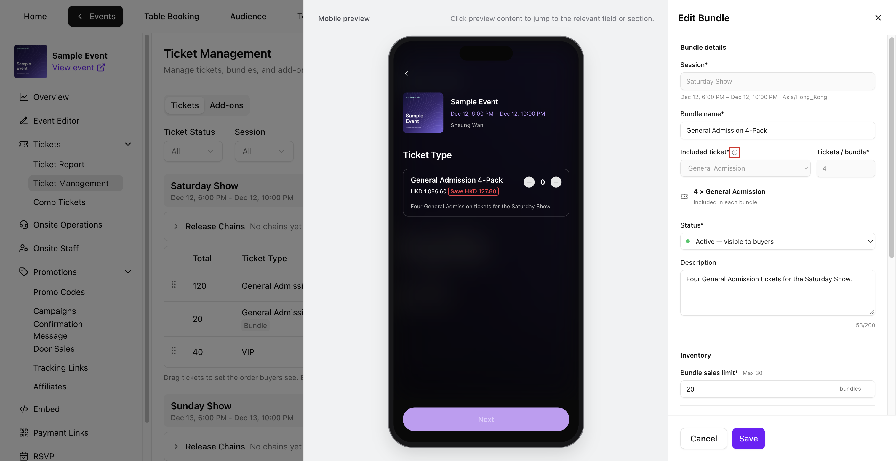
</Frame>

### Adjust quantity and sales settings

- **Total ticket quantity** can be adjusted to a whole number at least as high as **Sold**, with a minimum of one. Ticket **Sold** counts individual tickets sold or issued, including comps and stock used by bundles and synced add-ons. Select the info icon next to **Sold** for details.
- **Bundle sales limit** can be adjusted to a whole number at least as high as the bundle’s **Sold**, with a minimum of one. Bundle **Sold** counts packs. The bundle limit applies only to the bundle.
- You can update the **Status**, **Description**, **Sales period** and **Purchase limits**. When changing **Sales end**, choose a time in the future and no later than the end of the session.

## Release chains

A release chain sells tiers one after another and opens the next tier automatically when the current one is nearly sold out. The next tier opens at the percentage shown in the panel (for example 98%), not necessarily at the last ticket. Worked example: [General Admission in tiers](/tickets/scenario-ga-tiers).

<Frame>
  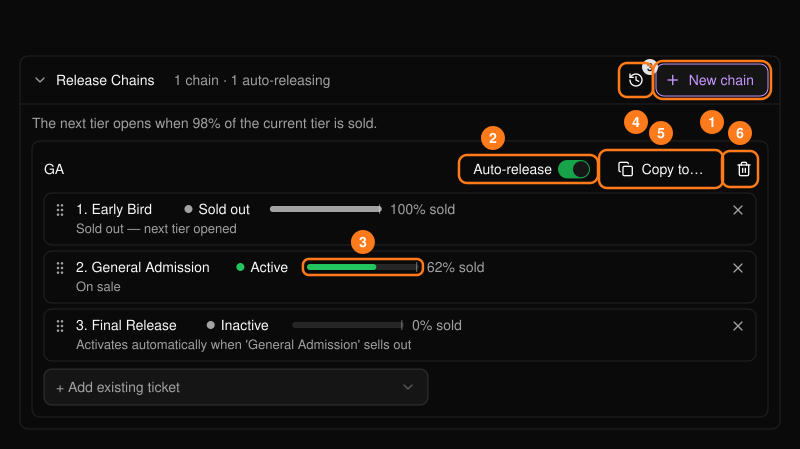
</Frame>

<Steps>
  <Step title="Create a chain">
    Open **Release Chains**, select **New chain**, name it and select **Create**. New chains start paused.
  </Step>
  <Step title="Add tickets in order">
    Use **+ Add existing ticket**, then drag to reorder. A ticket can be in only one chain. Bundles and add-ons cannot be added.
  </Step>
  <Step title="Turn on Auto-release">
    While it is off the chain is paused and later tiers will not activate.
  </Step>
</Steps>

Each tier shows its state: waiting, **On sale**, sold out with the next tier opened, or a warning. Chained tickets show a badge such as "GA - 2/3" in the table, and a finished chain shows **Exhausted**.

<Frame>
  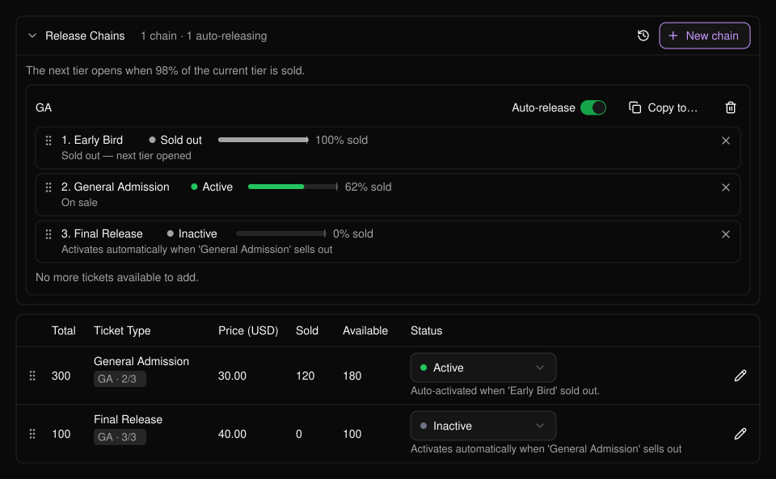
</Frame>

Two warnings worth knowing:

- A tier marked "won't auto-activate" means a later tier is already on sale. Activate it manually or remove it.
- Every tier needs a sales end time that has not passed, in a sensible order. Fix flagged tiers, then turn Auto-release on again.

Other controls: **Activity log** (history of sell-outs and activations), **Copy to...** (copies the chain to other sessions, matched by ticket name, copies start paused) and **Delete** (tickets keep their status).

## Add-ons

On the **Add-ons** tab, select **Create Add-on**.

<Frame>
  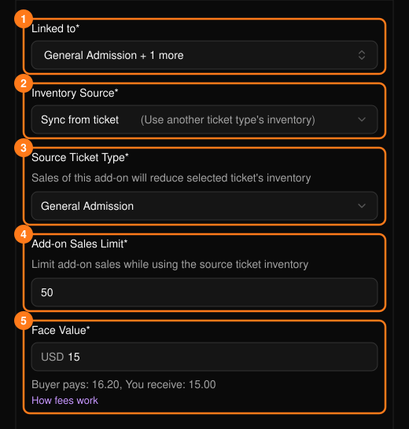
</Frame>

- **Linked to**: the tickets the add-on can be bought with.
- **Inventory Source**: **Own inventory** gives it its own quantity. **Sync from ticket** draws from a ticket's inventory, so each add-on sold reduces that ticket's availability.
- **Face Value**: the price.
- Sales dates are optional. The inventory source cannot be changed after creation.

<Frame>
  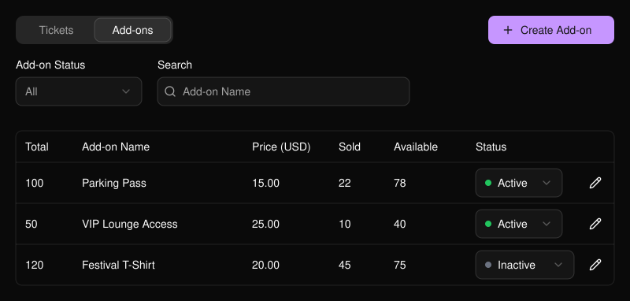
</Frame>

See also [Ticketing Concepts](/tickets/concepts), [Ticket Report](/tickets/ticket-report) and [Complimentary Tickets](/tickets/comp-tickets).
