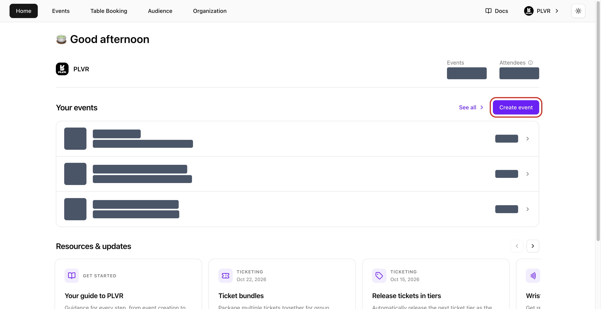
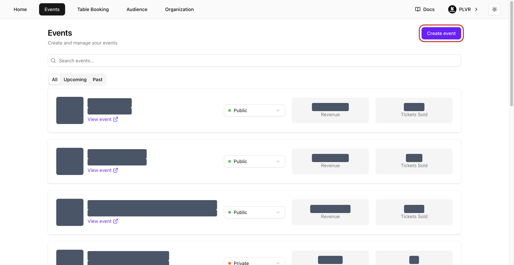
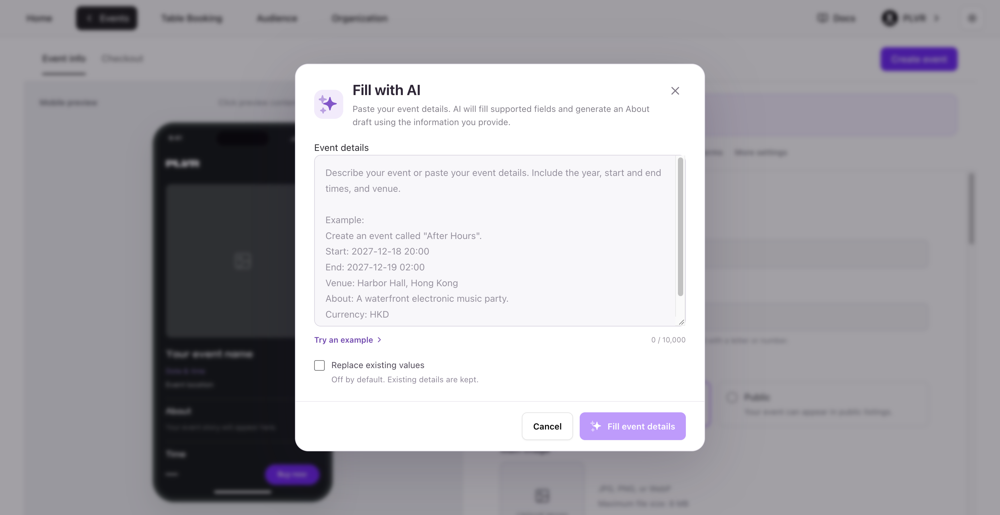
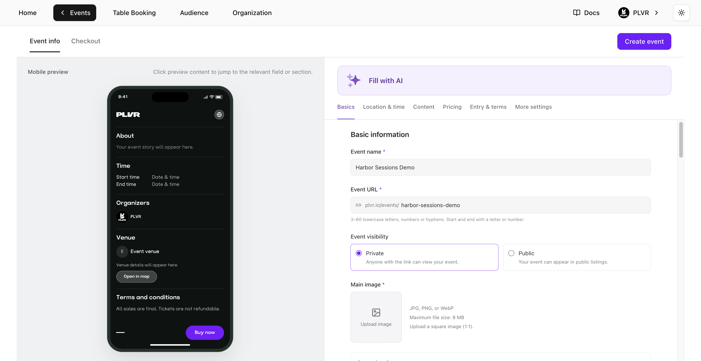
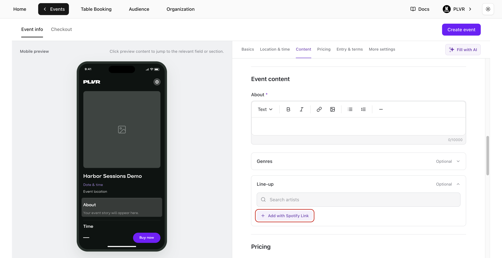
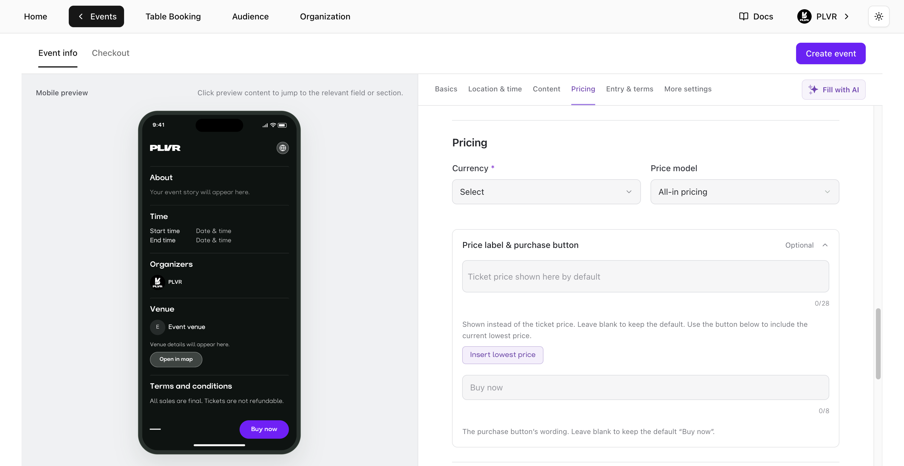
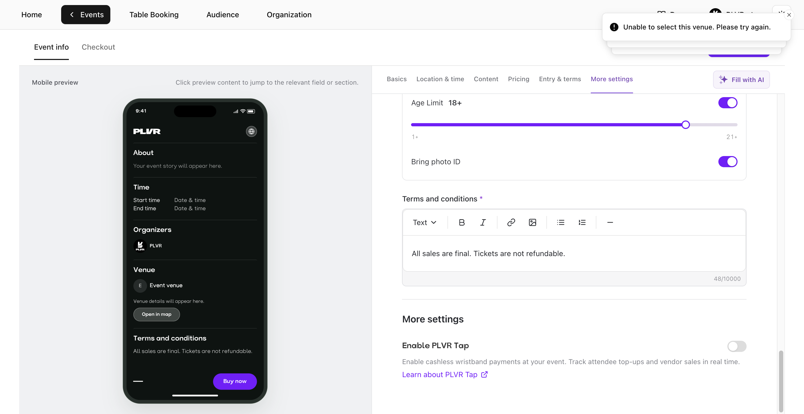
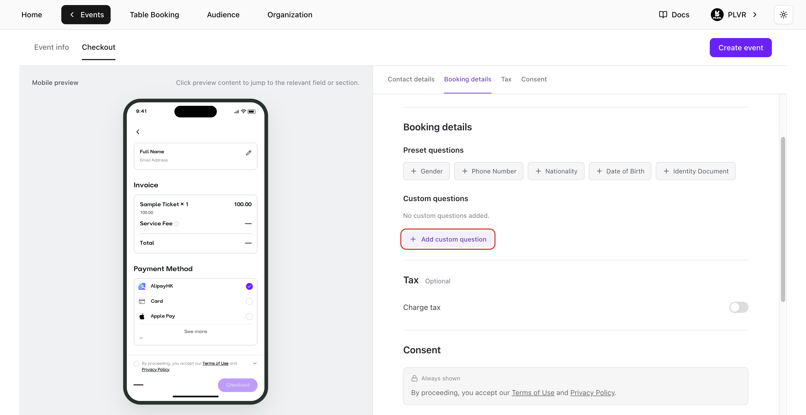
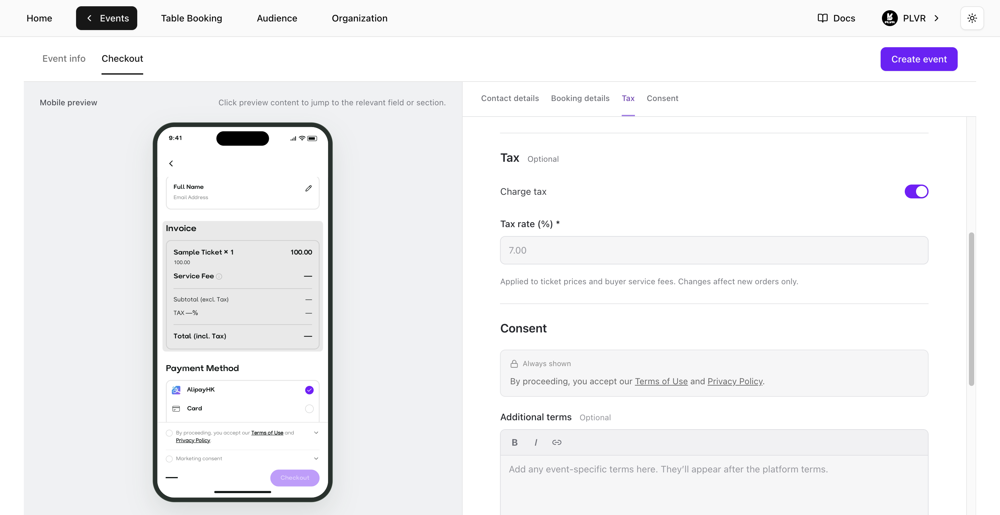
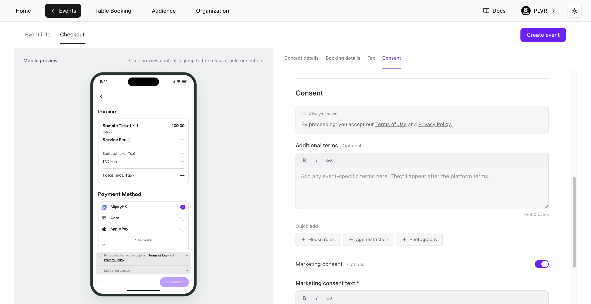

## 打开 Create event

在 **Home**（首页）或 **Events**（活动）中选择 **Create event**（创建活动）。组织的所有者、管理员和经理都可以创建标准售票活动。

在 **Home** 中，该按钮位于 **Your events**（你的活动）下方 **See all**（查看全部）的旁边。

<Frame>
  
</Frame>

在 **Events** 中，该按钮位于活动列表的右上角。

<Frame>
  
</Frame>

## 填写 Event info

使用 **Event info**（活动信息）顶部的板块快捷入口在表单中切换。**Mobile preview**（手机预览）会在你编辑时实时显示购票者看到的页面。在预览中选择某个板块，即可跳转到对应设置。带星号的字段为必填项。

### 用 AI 填写

如果你已经有一份活动简介，可以使用 **Fill with AI**（用 AI 填写）快速开始。

1. 选择 **Fill with AI**，粘贴活动详情，包括年份、开始和结束时间以及场地。选择 **Try an example**（查看示例）可查看样例。
2. 选择 **Fill event details**（填写活动详情）。AI 会填写 **Event info** 中支持的字段，并可根据你的信息起草 **About**（简介）。除非你开启 **Replace existing values**（替换已有内容），否则它会保留已有的值。
3. 检查 AI 填写的内容，然后补全缺失的字段。图片上传和 **Checkout**（结账）设置需要手动完成。

<Frame>
  
</Frame>

### 基本信息

- **Event name**（活动名称）— 填写购票者会看到的名称。
- **Event URL**（活动链接）— 输入名称后检查系统建议的链接。如果链接为空或已被占用，请编辑 `plvr.io/events/` 之后的部分。使用 3–60 个小写字母、数字或连字符，且以字母或数字开头和结尾。
- **Event visibility**（活动可见性）— 默认选择 **Private**（私密）。任何拥有链接的人都可以打开活动。选择 **Public**（公开）后，活动才有资格出现在 PLVR 的活动列表中。
- **Main image**（主图）— 选择 **Upload image**（上传图片），并选择一张正方形（1:1）的 JPG、PNG 或 WebP 文件，最大 8 MB。
- **Secondary images**（辅助图片）— 展开这个可选板块，选择 **Add**（添加）最多上传 15 张图集图片。拖动图片即可调整顺序。

<Frame>
  
</Frame>

### 地点与时间

1. 在 **Venue**（场地）下搜索场地或地址并选择一个结果。这会设置时区，并启用日期和时间字段。
2. 在 **Time**（时间）下，为 **Start**（开始）和 **End**（结束）同时设置日期和时间。请使用场地所在时区的今天或未来日期。结束时间必须晚于开始时间。如果更换了场地，请重新检查时间：时区会随之更新，但你填写的日期和时间保持不变。
3. 如果活动有多个场次，请选择 **Add session**（添加场次）。为每个场次设置不同的 **Session name**（场次名称），并分别设置开始和结束时间。使用 **Remove**（移除）删除多余的场次。

<Frame>
  
</Frame>

### 内容

- **About**（简介）— 撰写购票者会看到的活动描述。使用工具栏设置文字格式，并添加链接或图片。
- **Genres**（风格）— 可选。搜索或浏览音乐风格。选择子风格后会替换其父风格。
- **Line-up**（阵容）— 可选。搜索艺人并选择要展示的艺人。如适用，可将主打艺人标记为 **Headliner**（压轴）。如需从 Spotify 导入艺人，请选择 **Add with Spotify Link**（通过 Spotify 链接添加），粘贴艺人的 Spotify 主页链接，然后选择 **Add**。

<Frame>
  
</Frame>

### 定价

- **Currency**（币种）— 选择活动使用的币种。
- **Price model**（定价模式）— 选择 **All-in pricing**（全包定价）以显示包含购票者手续费和税费的总价，或选择 **Split pricing**（分项定价）以显示门票基础价格，并在结账时再加上手续费和税费。
- **Price label & purchase button**（价格标签与购买按钮）— 展开这个可选板块，可自定义价格和购买按钮的显示方式。使用 **Insert lowest price**（插入最低价）可在标签中显示当前最低价格。标签最多 28 个字符，最低价标记计为 16 个字符。**Button text**（按钮文字）最多 8 个字符。任一字段留空即使用默认值。默认按钮文字为 **Buy now**。

<Note>
  在成功创建第一个 **Ticket**（门票）、**Bundle**（套票）或 **Add-on**（附加项）后，活动币种将被锁定。
</Note>

<Frame>
  
</Frame>

### 入场与条款

- **Entry requirements**（入场要求）— 可选。如适用，开启 **Age Limit**（年龄限制）并设置最低年龄。开启 **Bring photo ID**（携带带照片的身份证件），告知购票者入场时必须出示有效的带照片身份证件。
- **Terms and conditions**（条款与条件）— 检查预填的条款，并根据你的活动进行修改。这些条款会显示在活动页面上。

### 更多设置

如果计划使用无现金手环支付，请开启 **Enable PLVR Tap**（启用 PLVR Tap）。该设置默认关闭。可在表单中通过 **Learn about PLVR Tap**（了解 PLVR Tap）查看详情。

<Frame>
  
</Frame>

## 设置 Checkout

选择 **Checkout**（结账）标签页。使用 **Mobile preview** 查看问题、费用和同意条款在购票者端的显示效果。

### 联系信息与预订信息

- **Contact details**（联系信息）— **Full Name**（姓名）和 **Email Address**（邮箱地址）始终为必填项。
- **Booking details**（预订信息）— 添加 **Phone Number**（电话号码）等预设问题，或选择 **Add custom question**（添加自定义问题）。输入问题并选择 **Text**（文本）、**Number**（数字）、**Single choice**（单选）或 **Multiple choice**（多选）。选择题至少需要添加一个选项，然后选择 **Add question**（添加问题）。使用 **Required**（必填）和 **Show at checkout**（在结账时显示）控制购票者能看到和必须回答的问题。问题类型、编辑和排序请参阅[报名表](/zh-hans/events/registration-form)。

<Frame>
  
</Frame>

### 税费

如果需要收取税费，请开启 **Charge tax**（收取税费）并填写 **Tax rate (%)**（税率）。在预览中查看示例发票。该税率适用于新订单的门票价格和购票者服务费。

<Frame>
  
</Frame>

### 同意条款

- **PLVR terms**（PLVR 条款）— 平台的 **Terms of Use**（使用条款）和 **Privacy Policy**（隐私政策）始终会显示。
- **Additional terms**（附加条款）— 如有需要，可添加活动专属的结账条款。使用 **Quick add**（快速添加）选择 **House rules**（场地规则）或 **Photography**（拍摄说明）等模板。
- **Marketing consent**（营销同意）— 默认关闭。开启后请填写 **Marketing consent text**（营销同意文字）。购票者会看到一个未勾选的复选框，可自行选择是否订阅。

<Frame>
  
</Frame>

## 预览并创建

1. 在表单中检查 **Event URL** 和 **Event visibility**。在两个标签页中使用 **Mobile preview** 检查场地、场次时间、活动页面和结账页面。
2. 选择 **Create event**。如果表单高亮显示某个字段，请修正后重试。活动页面会按照你选择的可见性上线。你可以在添加任何门票之前先创建活动。
3. 创建完成后会打开[门票管理](/zh-hans/tickets/ticket-management)，方便你添加第一张门票。之后如需更新活动页面或结账设置，请打开[活动编辑器](/zh-hans/events/event-editor)。
