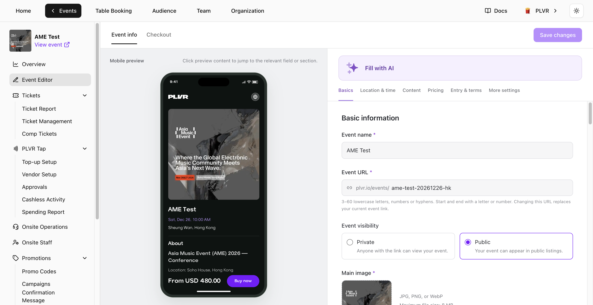

打开活动，在活动菜单中选择 **Event Editor**（活动编辑器）。在右侧编辑表单，在左侧查看 **Mobile preview**（移动端预览）。在预览中点击某个区块，即可跳转到对应设置。

<Frame>
  
</Frame>

## Event info（活动信息）

- **Basics**（基本信息）— 编辑 **Event name**（活动名称）、**Event URL**（活动链接）、可见性和方形 **Main image**（主图）。上传并调整副图顺序。修改 **Event URL** 会替换当前的活动链接。
- **Location & time**（地点与时间）— 先选择 **Venue**（场地），再设置场次日期和时间。时间采用场地所在时区。如添加多个场次，需为每个场次设置不同的名称。至少保留一个场次。已关联门票或订单的场次无法删除。
- **Content**（内容）— 更新 **About**（简介）、音乐风格和演出阵容。使用 **Add with Spotify Link** 添加艺人。
- **Pricing**（定价）— 选择 **Currency**（币种）以及费用的展示方式。**All-in pricing**（全包价）展示已包含买家手续费和税费的价格。关闭此设置后，买家手续费和税费将在结账时另行加收。可在选填的 **Price label**（价格标签）中使用 **Insert lowest price**（插入最低价）。**Button text**（按钮文字）留空则使用 **Buy now**。
- **Entry & terms**（入场与条款）和 **More settings**（更多设置）— 设置入场要求、更新 **Terms and conditions**（条款与条件），并按需启用 **PLVR Tap**。

<Note>
  首个 **Ticket**、**Bundle** 或 **Add-on** 创建成功后，活动币种即被锁定。免费项和停用项同样会锁定币种。
</Note>

使用 **Fill with AI**（AI 填写）可根据你粘贴的文本自动填写 **Event info**。默认只填写空白字段。开启 **Replace existing values**（替换已有内容）可更新已填写的字段，保存前请检查结果。

## Checkout（结账）

- **Contact details**（联系信息）和 **Booking details**（预订信息）— **Full Name** 和 **Email Address** 始终为必填项。使用[报名表](/zh-hans/events/registration-form)添加或编辑预订问题。
- **Tax**（税费）— 如适用，开启税费并输入税率。更改仅对新订单生效。
- **Consent**（同意条款）— PLVR 的使用条款和隐私政策为固定内容。可在 **Additional terms**（附加条款）中添加你自己的条款。**Marketing consent**（营销许可）默认关闭。启用后，买家可自行选择是否同意接收营销信息。

## 保存

选择 **Save changes**（保存更改）即可保存两个标签页中的编辑内容。如编辑器标记了需审核的内容，请修改高亮字段后重新保存。

<Warning>
  选择 **Leave without saving**（不保存并离开）将丢弃所有未保存的编辑。
</Warning>
