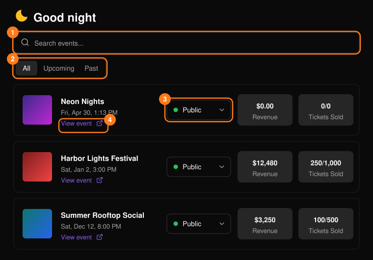
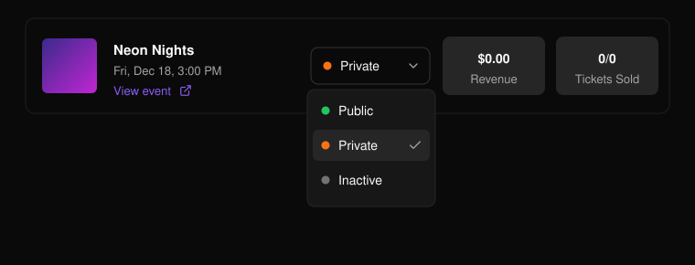
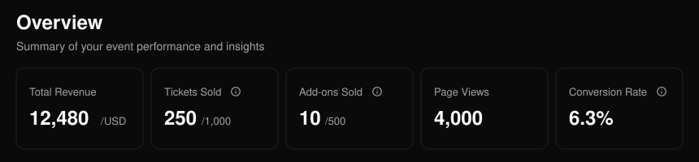
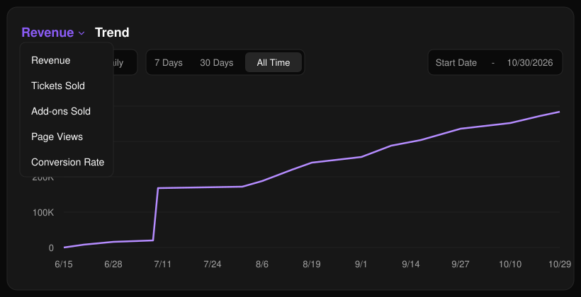
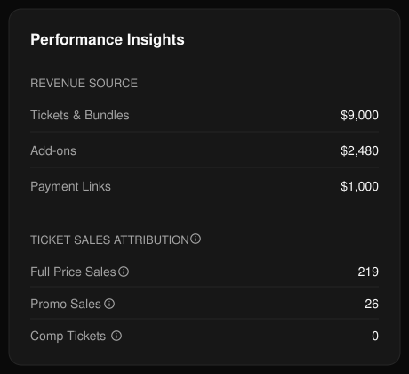
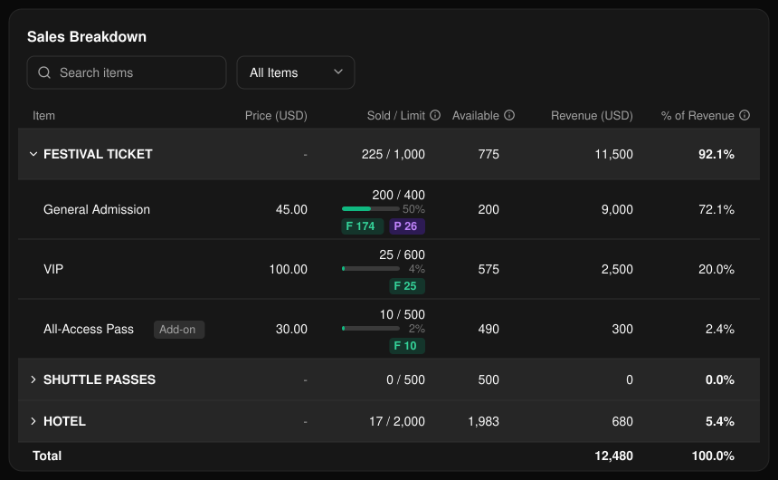

## 活动列表

在页眉中打开 **Events**（活动），或在 **Home**（首页）的 **Your events** 下选择 **See all**。可按名称搜索 (1)，在 **All**、**Upcoming** 和 **Past** 之间切换 (2)，选择某一行即可打开该活动。**View event** (4) 会打开公开的活动页面。

<Frame>
  
</Frame>

使用状态菜单 (3) 将活动设为 **Public**（公开）、**Private**（私密）或 **Inactive**（停用）。**Ended**（已结束）的活动将被锁定。

<Frame>
  
</Frame>

如需创建新活动，在 **Home** 或 **Events** 中选择 **Create event**（创建活动）。参见[创建活动](/zh-hans/events/create-an-event)。

## 活动概览

打开活动后会显示其 **Overview**（概览）。通过侧边菜单可进入该活动的其他页面。

<Frame>
  
</Frame>

Total Revenue（总收入）包含门票、附加项和支付链接的收入。Conversion Rate（转化率）为已付款订单数除以页面浏览量。Personalization Progress（个性化信息进度）和 Add-ons Sold（附加项销量）仅在适用时显示。

**Trend**（趋势）图表展示某一指标随时间的变化。可在 **Cumulative**（累计）和 **Daily**（每日）之间切换。选择预设区间（**7 Days**、**30 Days** 或 **All Time**），或自定义日期范围。

<Frame>
  
</Frame>

**Performance Insights**（表现洞察）按来源拆分收入，并按类型拆分销量：全价、优惠码或赠票（直接发放，无需结账）。

<Frame>
  
</Frame>

**Ticket Breakdown**（门票明细）显示每个票种的销量和收入。

<Frame>
  
</Frame>

<Tip>
  如需查看更详细的销售数据，请参阅[门票报表](/zh-hans/tickets/ticket-report)。
</Tip>
